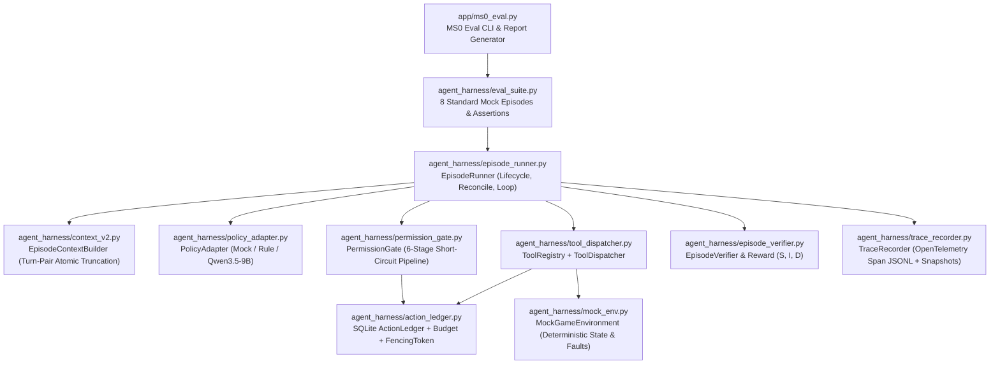

# Harness Episode Contract v2 — MS0 Architecture & Interface Specification

Authoritative target Python module: `pioneer_agent.agent_harness.episode_contracts` (alongside existing v1 [`pioneer_agent.agent_harness.task_contracts`](../../../packages/pioneer-agent/src/pioneer_agent/agent_harness/task_contracts.py)).

This specification defines the **MS0 (Harness最小闭环)** architecture, module boundaries, data contracts, SQLite ledger schema, and the 8 mandatory mock acceptance scenarios for [三谋多模态 Agent 设计基线 v5](sanmou-multimodal-agent-plan-2026-10-22-v5.md).

---

## 1. Compatibility & Ownership Boundaries

1. **Zero Breakage of v1 Read-Only Harness**:
   - Existing [`task_contracts.py`](../../../packages/pioneer-agent/src/pioneer_agent/agent_harness/task_contracts.py), [`task_runner.py`](../../../packages/pioneer-agent/src/pioneer_agent/agent_harness/task_runner.py), [`context_builder.py`](../../../packages/pioneer-agent/src/pioneer_agent/agent_harness/context_builder.py), [`run_budget.py`](../../../packages/pioneer-agent/src/pioneer_agent/agent_harness/run_budget.py), [`run_store.py`](../../../packages/pioneer-agent/src/pioneer_agent/agent_harness/run_store.py), and [`task_eval.py`](../../../packages/pioneer-agent/src/pioneer_agent/agent_harness/task_eval.py) remain untouched so all H01–H10 unit and native CI tests continue to pass.
   - MS0 introduces explicit `v2.ms0` contracts and components for multi-step tool-calling episodes with separated `state_effect` and `window_effect`.
2. **Confirmed Design Decisions (2026-10-22)**:
   - **DecisionStep Tool-Call Granularity**: A single `DecisionStep` may propose **multiple concurrent passive read-only tool calls** (`state_effect == "read_only"` and `window_effect == "passive"`, e.g. `query_knowledge`), which execute without acquiring a window input lease; and **at most one (≤ 1) window-affecting or state-mutating tool call** (`window_effect != "passive"` or `state_effect != "read_only"`). Proposing more than one non-passive or mutating tool call in a single step is rejected at the permission/validation boundary (`multiple_non_passive_calls_in_step`), increments invalid action count $I$, and dispatches zero window input.
   - **Reward Penalties ($I$ and $D$)**:
     $$R = S - 0.1 \times \min(I / 5, 1) - 0.1 \times \min(D / 5, 1)$$
     - $S \in \{0, 1\}$: Independently verified episode goal completion.
     - $I$ (**Invalid Action Count**): Incremented on model output parse failure, unknown tool name, tool parameter schema failure, `multiple_non_passive_calls_in_step`, permission/freshness/role/idempotency rejection (`permission_denied`, `stale_observation`, `wrong_role_or_window`, `duplicate_dispatch`), or `target_not_found` in the current observation.
     - $D$ (**Duplicate No-Progress Action Count**): Incremented when a call invokes the exact same `(tool_name, canonical_args_json)` as a prior call in the same episode while the verified `state_digest` has not changed since that prior call (excluding explicit wait tools `wait_ticks`).

---

## 2. MS0 Module Layout



| Module Path | Responsibility |
| --- | --- |
| `pioneer_agent/agent_harness/episode_contracts.py` | Versioned Pydantic v2 contracts (`v2.ms0`) and Protocol ports |
| `pioneer_agent/agent_harness/context_v2.py` | `EpisodeContextBuilder`: builds prompt/messages, enforces turn-pair atomic truncation, persists `ContextSnapshot` |
| `pioneer_agent/agent_harness/action_ledger.py` | SQLite WAL ledger (`episode_runs`, `action_ledger`, `permission_audit`, `context_snapshots`), atomic quota reservation, monotonic `fencing_token`, deterministic `idempotency_key` |
| `pioneer_agent/agent_harness/permission_gate.py` | `PermissionGate`: 6-stage verification (kill switch → role/window identity → observation TTL/SHA → tool/domain scope → budget/idempotency → approval policy) |
| `pioneer_agent/agent_harness/tool_dispatcher.py` | `ToolRegistry` & `ToolDispatcher`: schema validation, parallel passive read-only execution, leased single window/mutating execution |
| `pioneer_agent/agent_harness/episode_verifier.py` | Independent goal condition verifier (`Condition` + `field_meta` provenance) and $(S, I, D)$ reward calculator |
| `pioneer_agent/agent_harness/trace_recorder.py` | Hierarchical span recorder (`episode → decision → observe / context / model / permission / dispatch / verify / recover`) |
| `pioneer_agent/agent_harness/mock_env.py` | Deterministic mock environment supporting happy paths and fault injection |
| `pioneer_agent/agent_harness/episode_runner.py` | `EpisodeRunner`: full lifecycle (`preparing → running → reconciling / waiting / paused / human_takeover → succeeded / failed / cancelled / truncated`) |
| `pioneer_agent/app/ms0_eval.py` | CLI entry point running all 8 MS0 acceptance tests and emitting a versioned JSON/Markdown report |

---

## 3. Core Data Contracts (`episode_contracts.py`)

All contract models inherit `StrictContract` (`ConfigDict(extra="forbid", frozen=True)`).

### 3.1 Session Identity, Permission Scope & TaskSpec (`EpisodeTaskSpec`)

```python
from __future__ import annotations

from datetime import datetime
from typing import Any, Literal, Protocol
from pydantic import BaseModel, ConfigDict, Field, model_validator

from pioneer_agent.runbook.models import Condition


class StrictContract(BaseModel):
    model_config = ConfigDict(extra="forbid", frozen=True)


ExecutionMode = Literal["mock", "dry_run", "supervised", "authorized_auto"]
RunPurpose = Literal["train", "eval", "debug"]
DatasetSplit = Literal["train", "dev", "holdout", "unassigned"]


class WindowBinding(StrictContract):
    hwnd: int
    pid: int
    title: str = Field(min_length=1)
    geometry: tuple[int, int, int, int]  # (x, y, width, height)


class RoleSessionSpec(StrictContract):
    account_id: str = Field(min_length=1)
    server_id: str = Field(min_length=1)
    role_id: str = Field(min_length=1)
    role_session_id: str = Field(min_length=1)
    window: WindowBinding
    season_id: str = "S1"
    split: DatasetSplit = "unassigned"


class EpisodeBudgetSpec(StrictContract):
    max_decisions: int = Field(default=20, ge=1, le=1000)
    max_tool_calls: int = Field(default=40, ge=1, le=2000)
    max_mutating_actions: int = Field(default=10, ge=0, le=500)
    max_input_tokens_per_call: int = Field(default=16384, ge=256)
    reserved_output_tokens: int = Field(default=1024, ge=64)
    max_total_tokens: int = Field(default=200_000, ge=1000)
    max_wall_seconds: float = Field(default=600.0, gt=0.0, allow_inf_nan=False)
    observation_ttl_seconds: float = Field(default=15.0, gt=0.0, allow_inf_nan=False)


class TaskPermissionSpec(StrictContract):
    mode: ExecutionMode = "mock"
    allowed_tools: tuple[str, ...] = Field(min_length=1)
    allowed_building_ids: tuple[str, ...] = ()
    max_land_level: int = Field(default=0, ge=0, le=12)
    max_recruit_draw_tickets: int = Field(default=0, ge=0, le=500)
    require_approval_tools: tuple[str, ...] = ()


class EpisodeTaskSpec(StrictContract):
    schema_version: Literal["v2.ms0"] = "v2.ms0"
    task_id: str = Field(min_length=1)
    task_family: Literal[
        "bootstrap", "info_gather", "chapter_building", "recruit_prep", "land_attack"
    ]
    goal: str = Field(min_length=1)
    role_session: RoleSessionSpec
    success_conditions: tuple[Condition, ...] = Field(min_length=1)
    stop_conditions: tuple[Condition, ...] = ()
    required_domains: tuple[str, ...] = ()
    budget: EpisodeBudgetSpec = Field(default_factory=EpisodeBudgetSpec)
    permission: TaskPermissionSpec
    run_purpose: RunPurpose = "eval"
```

### 3.2 Structured Observation & Context Snapshot (`RoleObservation` & `ContextSnapshot`)

```python
class RoleObservation(StrictContract):
    observation_id: str = Field(min_length=1)
    role_session_id: str = Field(min_length=1)
    captured_at: datetime
    frame_sha256: str = Field(pattern=r"^[0-9a-f]{64}$")
    window: WindowBinding
    ui_version: int = Field(ge=0)
    active_page: str = Field(min_length=1)
    state_fields: dict[str, Any]
    field_meta: dict[str, dict[str, Any]]
    state_digest: str = Field(pattern=r"^[0-9a-f]{64}$")
    unknown_fields: tuple[str, ...] = ()
    evidence_refs: tuple[str, ...] = ()


class HistoryTurnRecord(StrictContract):
    """Atomic unit for history retention/truncation: one decision + all its tool results."""
    decision_id: str = Field(min_length=1)
    observation_id: str = Field(min_length=1)
    assistant_message: dict[str, Any]
    tool_messages: tuple[dict[str, Any], ...] = Field(min_length=1)


class ContextSnapshot(StrictContract):
    snapshot_id: str = Field(min_length=1)
    episode_id: str = Field(min_length=1)
    decision_id: str = Field(min_length=1)
    role_session_id: str = Field(min_length=1)
    observation_id: str = Field(min_length=1)
    context_hash: str = Field(pattern=r"^[0-9a-f]{64}$")
    messages: tuple[dict[str, Any], ...]
    tool_schemas_version: str
    rag_version: str = "none"
    estimated_input_tokens: int = Field(ge=0)
    reserved_output_tokens: int = Field(ge=0)
    truncated_history_turns: int = Field(default=0, ge=0)
```

### 3.3 Tool Schema, Decision Proposal & Execution Envelope

```python
StateEffect = Literal["read_only", "mutating", "control"]
WindowEffect = Literal["passive", "ui_navigation", "ui_mutation"]


class ToolSchemaSpec(StrictContract):
    name: str = Field(min_length=1)
    version: str = "1.0.0"
    description: str = Field(min_length=1)
    parameters_json_schema: dict[str, Any]
    state_effect: StateEffect
    window_effect: WindowEffect
    timeout_seconds: float = Field(default=10.0, gt=0.0, allow_inf_nan=False)
    max_retries: int = Field(default=0, ge=0, le=3)

    @property
    def requires_window_lease(self) -> bool:
        return self.window_effect != "passive" or self.state_effect == "mutating"


class ToolCallProposal(StrictContract):
    tool_call_id: str = Field(min_length=1)
    tool_name: str = Field(min_length=1)
    arguments: dict[str, Any]


class DecisionProposal(StrictContract):
    """Output of PolicyAdapter for one DecisionStep.

    May contain multiple passive read-only tool calls, plus at most 1
    window-affecting or state-mutating tool call.
    """
    decision_id: str = Field(min_length=1)
    actor_origin: Literal["policy", "rule", "human", "recovery"] = "policy"
    tool_calls: tuple[ToolCallProposal, ...] = Field(min_length=1)
    raw_model_output: str | None = None
    model_version: str = "mock-policy-v1"
    adapter_version: str = "none"
    # Reserved for PPO (MS5)
    prompt_token_ids: tuple[int, ...] | None = None
    response_token_ids: tuple[int, ...] | None = None
    action_token_mask: tuple[int, ...] | None = None
    old_logprobs: tuple[float, ...] | None = None
    value_estimate: float | None = None


ToolErrorCode = Literal[
    "none",
    "parse_error",
    "unknown_tool",
    "invalid_params",
    "multiple_non_passive_calls_in_step",
    "permission_denied",
    "stale_observation",
    "wrong_role_or_window",
    "stale_fencing_token",
    "duplicate_dispatch",
    "budget_exceeded",
    "approval_required",
    "execution_timeout",
    "target_not_found",
    "verifier_failed",
    "cancelled",
]


class ToolResultEnvelope(StrictContract):
    tool_call_id: str = Field(min_length=1)
    tool_name: str = Field(min_length=1)
    status: Literal["ok", "denied", "error", "require_approval"]
    error_code: ToolErrorCode = "none"
    retryable: bool = False
    data: dict[str, Any] = Field(default_factory=dict)
    post_observation_id: str | None = None
    evidence_refs: tuple[str, ...] = ()
```

### 3.4 Permission Decision, Action Ledger & Trace Spans

```python
class PermissionDecision(StrictContract):
    decision_id: str = Field(min_length=1)
    tool_call_id: str = Field(min_length=1)
    verdict: Literal["allow", "deny", "require_approval"]
    error_code: ToolErrorCode = "none"
    reason: str = Field(min_length=1)
    fencing_token: int | None = None
    idempotency_key: str = Field(min_length=1)
    checked_at: datetime


class ActionLedgerRecord(StrictContract):
    action_id: str = Field(min_length=1)
    idempotency_key: str = Field(min_length=1)
    episode_id: str = Field(min_length=1)
    decision_id: str = Field(min_length=1)
    role_session_id: str = Field(min_length=1)
    tool_call_id: str = Field(min_length=1)
    tool_name: str = Field(min_length=1)
    canonical_args_json: str
    state_effect: StateEffect
    window_effect: WindowEffect
    pre_observation_id: str = Field(min_length=1)
    pre_state_digest: str = Field(pattern=r"^[0-9a-f]{64}$")
    fencing_token: int | None = None
    status: Literal[
        "prepared",
        "denied",
        "dispatched",
        "verified_ok",
        "verified_failed",
        "unconfirmed",
        "reconciled_applied",
        "reconciled_not_applied",
    ]
    post_observation_id: str | None = None
    post_state_digest: str | None = None
    error_code: ToolErrorCode = "none"
    created_at: datetime
    updated_at: datetime


SpanStage = Literal[
    "episode", "decision", "observe", "context", "model",
    "permission", "dispatch", "verify", "recover"
]


class TraceSpanRecord(StrictContract):
    trace_id: str = Field(min_length=1)
    span_id: str = Field(min_length=1)
    parent_span_id: str | None = None
    run_id: str = Field(min_length=1)
    role_session_id: str = Field(min_length=1)
    episode_id: str = Field(min_length=1)
    decision_id: str | None = None
    stage: SpanStage
    started_at: datetime
    ended_at: datetime
    status: Literal["ok", "error", "denied", "cancelled"]
    observation_id: str | None = None
    frame_sha256: str | None = None
    context_hash: str | None = None
    tool_call_id: str | None = None
    action_id: str | None = None
    error_code: ToolErrorCode = "none"
    attributes: dict[str, Any] = Field(default_factory=dict)


class EpisodeRewardBreakdown(StrictContract):
    success_flag: int = Field(ge=0, le=1)        # S ∈ {0, 1}
    invalid_action_count: int = Field(ge=0)      # I
    duplicate_noop_count: int = Field(ge=0)      # D
    total_reward: float                          # S - 0.1*min(I/5,1) - 0.1*min(D/5,1)


EpisodeStatus = Literal[
    "preparing",
    "running",
    "reconciling",
    "waiting",
    "paused",
    "human_takeover",
    "succeeded",
    "failed",
    "cancelled",
    "truncated",
]


class EpisodeResult(StrictContract):
    episode_id: str = Field(min_length=1)
    run_id: str = Field(min_length=1)
    task_id: str = Field(min_length=1)
    role_session_id: str = Field(min_length=1)
    status: Literal["succeeded", "failed", "cancelled", "truncated", "paused"]
    terminal_reason: str = Field(min_length=1)
    decisions_taken: int = Field(ge=0)
    tool_calls_taken: int = Field(ge=0)
    mutating_actions_taken: int = Field(ge=0)
    reward: EpisodeRewardBreakdown
    final_observation_id: str | None = None
    trace_id: str = Field(min_length=1)
```

---

## 4. Port Protocols & Execution Semantics

### 4.1 Single-Step Concurrency & Lease Rule

Within `EpisodeRunner.run_decision_step()`:

1. **Step-Level Batch Validation**:
   - Partition `proposal.tool_calls` into:
     - `passive_calls`: `schema.state_effect == "read_only" and schema.window_effect == "passive"`
     - `active_calls`: `schema.requires_window_lease or schema.state_effect != "read_only"`
   - If `len(active_calls) > 1`: reject all `active_calls` immediately with `error_code="multiple_non_passive_calls_in_step"`, increment $I$, record `PermissionDecision(verdict="deny")`, and dispatch zero window actions.
2. **Passive Calls Execution**:
   - Each passive call still passes `PermissionGate` (tool allowlist, budget reservation) and may run concurrently without acquiring a window lease or incrementing `ui_version`.
3. **Active Call Execution (≤ 1 per step)**:
   - Passes all 6 stages of `PermissionGate`:
     1. KillSwitch / Cancellation check
     2. `RoleSessionSpec` (`role_session_id`, `hwnd`, `pid`) identity match against current observation
     3. Observation freshness (`now - obs.captured_at <= observation_ttl_seconds` and `frame_sha256` binding)
     4. Tool allowlist & domain parameter bounds (`allowed_building_ids`, `max_land_level`, etc.)
     5. Deterministic `idempotency_key` deduplication in `ActionLedger` + atomic quota reservation
     6. Approval mode check (`auto` vs `require_approval`)
   - Acquires a monotonic `fencing_token` from `ActionLedger`, persists `status="dispatched"` before invoking `EnvironmentAdapter.execute_tool()`, and runs independent post-action verification on the resulting `RoleObservation`.

### 4.2 SQLite Ledger Schema (`ActionLedger`)

Initialized with `PRAGMA journal_mode=WAL; PRAGMA synchronous=NORMAL; PRAGMA foreign_keys=ON;`:

- `episode_runs`: tracks episode cursor, `status`, `decisions_taken`, `invalid_count`, `duplicate_count`, `total_reward`, and active `unconfirmed_action_id` for crash recovery.
- `action_ledger`: enforces `UNIQUE(idempotency_key)` and tracks `pre_observation_id`, `pre_state_digest`, `fencing_token`, `status`, `post_observation_id`, `post_state_digest`, `error_code`.
- `permission_audit`: append-only log of every `PermissionDecision` (`allow`, `deny`, `require_approval`).
- `context_snapshots`: indexes `snapshot_id`, `episode_id`, `decision_id`, `observation_id`, `context_hash`, `messages_path`, `estimated_input_tokens`.

---

## 5. MS0 Built-in Tools & 8 Mandatory Acceptance Scenarios

### 5.1 Built-in MS0 Tool Schemas

| Tool Name | `state_effect` | `window_effect` | Description |
| --- | --- | --- | --- |
| `query_knowledge` | `read_only` | `passive` | Query season rules/building prerequisites from `qa-agent` (supports multi-call concurrency in one step) |
| `observe_panel` | `read_only` | `ui_navigation` | Navigate to / inspect a specific UI panel (`city_buildings`, `chapter_panel`, `team_panel`) and return a fresh `RoleObservation` |
| `claim_chapter_reward` | `mutating` | `ui_mutation` | Claim a claimable chapter reward |
| `upgrade_building` | `mutating` | `ui_mutation` | Upgrade a target building (`building_id`, `current_level`, `target_level`) |
| `wait_ticks` | `control` | `passive` | Wait a bounded duration for resource/stamina recovery |
| `complete_task` | `control` | `passive` | Propose episode completion (independently verified by `EpisodeVerifier` against `success_conditions`) |

### 5.2 The 8 Mandatory MS0 Acceptance Scenarios (`app/ms0_eval.py`)

| Case ID | Scenario | Expected Terminal Status | Key Assertions |
| --- | --- | --- | --- |
| `ms0_01_happy_path_success` | Parallel `query_knowledge` → `observe_panel` → `upgrade_building` → `complete_task` | `succeeded` | `S=1, I=0, D=0, R=1.0`; full span tree from `episode` to `verify`; ledger matches `verified_ok` |
| `ms0_02_happy_path_failure` | Target building cost unreachable within budget; policy attempts duplicate no-op then stops | `failed` | `S=0, D>=1`; failure trace and `ContextSnapshot` reconstructable from disk |
| `ms0_03_invalid_tool_params` | Policy proposes invalid parameter types / disallowed building + >1 mutating calls in one step | `failed` | Schema/step validator rejects with `invalid_params` / `multiple_non_passive_calls_in_step`; `I` incremented; zero environment dispatch |
| `ms0_04_stale_observation` | Observation exceeds `observation_ttl_seconds` before mutating call | `succeeded` (after re-observe) or `failed` | `PermissionGate` denies stale call with `stale_observation` (zero dispatch); forces fresh observation |
| `ms0_05_wrong_role_or_window` | Observation `role_session_id` or `hwnd` mismatches `EpisodeTaskSpec.role_session` | `failed` | `PermissionGate` denies with `wrong_role_or_window`; zero environment dispatch |
| `ms0_06_budget_exceeded` | Policy loops beyond `max_decisions` or `max_tool_calls` | `failed` (`budget_exceeded`) | Hard stop at exact quota boundary; no extra tool call dispatched |
| `ms0_07_cancelled_mid_episode` | Cancellation / kill switch triggered after step 1 | `cancelled` | Subsequent dispatch blocked; ledger and run state cleanly persisted as `cancelled` |
| `ms0_08_duplicate_dispatch_idempotency` | Duplicate submission of same `idempotency_key` (or crash recovery of already-applied write action) | `succeeded` | `ActionLedger` blocks second execution (`duplicate_dispatch` / `reconciled_applied`); building upgraded exactly once |
