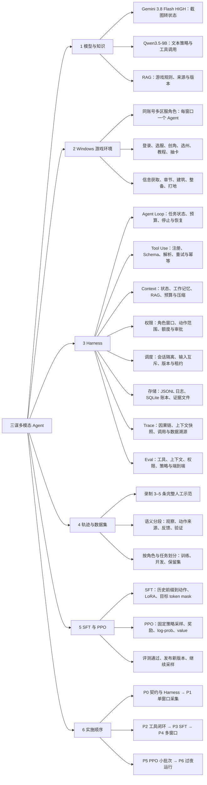

# 三谋多模态 Agent 设计基线 v6

2026-10-23。策略基模保持 **Qwen3.5-9B**；首版采用固定 Gemini 感知＋RAG＋文本策略，训练保持 **LoRA SFT → PPO**。接口细节见 [MS0 Episode 契约 v3](harness-ms0-episode-contract-v3.md)。

在本机 Windows 多开三谋客户端，每个窗口由独立 Agent 推进角色。Harness 负责模型与工具循环、上下文、权限、调度、持久化、Trace、Eval 和恢复；完整轨迹用于 SFT 与 PPO。暂不建设云游戏 worker。

本版合并 Gemini v5／v2 契约 review 与 Grok 优化建议，只更新设计。代码基线为新仓 `6e304b79`：已有只读 TaskRunner、Context、预算、checkpoint、因果 Trace 和任务 Eval，新增学习型／副作用能力需在这些基础上扩展。

## 技术选择

| 部分 | 选择 |
|---|---|
| 感知基线 | Gemini 3.8 Flash，HIGH；固定模型、prompt 与观察 schema |
| 策略基模 | Qwen/Qwen3.5-9B；首版使用文本输入路径 |
| 策略输入 | 目标、结构化观察、RAG、历史、工具定义和约束 |
| 训练 | LoRA SFT → PPO；trainer、critic 与超参通过小跑确定 |
| 游戏环境 | 本机 Windows，同一登录账号、多区服角色、每窗口一个 Agent |
| 共享服务 | 视觉 API、Qwen 推理、只读知识库；角色状态和上下文隔离 |
| 算力 | A100 80GB 首测；实测 actor／critic／rollout／更新峰值后定预算 |
| 对照 | 规则策略、原始 Qwen、SFT、SFT＋PPO，以及同工具／同任务下的教师模型 |

Qwen checkpoint 本身保留多模态能力，直接看截图留作后续对照，首版架构不变。教师模型是比较基线，不是学生性能上限。

## Roadmap 与 Milestones

顺序仍为 **工程闭环 → SFT 与多窗口 → PPO 与过夜运行**。数字和阈值是首版验收规格，不是已测成绩。

- MS0 → MS1 → MS2 为主线；MS2 早期单窗口切片可与 MS1 采集准备并行，不等待完整训练集。
- MS3 SFT 与 MS4 双窗口隔离可在 MS2 后并行；MS3 → MS5 → MS6 是学习线。
- MS3＋MS4 与恢复测试通过后推进 MS7；可用稳定 SFT 过夜采样，新 PPO 发布仍需 MS6。
- 复用已有 Context、预算、checkpoint、Trace、Eval；本轮不把已有模块重新列为从零建设。

| Milestone | 目标与主要交付 | 过关条件 | 前置 |
|---|---|---|---|
| MS0 最小协议闭环 | v3 契约、版本化 adapter、mock tools／ledger／goal verifier、实际输入快照、Eval | 8 组确定性子场景与契约不变量通过；保留 v1 只读回归；不开放实机输入 | 无 |
| MS1 数据可训练 | Gemini 接线、单窗口录制、3–5 条示范、语义标注、教师采样入口、manifest | 角色／目标／上下文来源／动作／反馈可追溯；训练与保留集隔离；导出读回通过 | MS0 |
| MS2 单窗口闭环 | 初始化、章节／建筑语义工具、现有 guarded chain、单资源 owner/fence 出口复查、账本与恢复 | 一轮选服／创角／教程／预算抽卡；3 个不同起点短任务成功；断连、重复请求、错目标与结果不明反例通过 | MS0＋MS1；早期切片可并行 |
| MS3 SFT 策略 | Qwen LoRA、loss mask、数据质量、模型适配与 log-prob 一致性诊断 | 重载一致；至少20个未见短任务首次动作合法率≥95%、任务成功率≥80%；报告各基线及失败分母 | MS1＋MS2 |
| MS4 双窗口隔离 | 跨窗口队列、公平调度、角色绑定、fence 实机切换验证与独立状态 | 60分钟、至少60次输入事务、每窗口至少20次、至少20次跨窗切换；零串窗／重复写，故障恢复通过 | MS2 |
| MS5 PPO 工程通路 | 固定行为策略 rollout、独立 reward、actor／critic、概率／mask、更新和版本保存 | 至少一批真实新 rollout 完成参数更新、重载和同配置评测；不合格数据不进 PPO；失败候选保留旧版 | MS3 |
| MS6 PPO 收益验证 | 冻结评测、SFT／PPO 对比、发布记录 | 预先固定主指标、分层、样本量与阈值；收益达到规格且系统不退化再发布 | MS5 |
| MS7 过夜运行 | watchdog、恢复、通知、配额与运行报告 | 先2小时、再8小时；轨迹完整、无重复消耗，故障／预算／异常停机符合预期 | MS3＋MS4及恢复 gate |

MS2／MS4 可用规则或脚本验证执行基础，MS3／MS6 单独比较模型收益。MS3 保留首次失败，重试后的成功另报；20 个任务仅是首版 gate，不作为广泛泛化证明。

### 尽早做真实可行性切片

不另造只有 JSONL 的临时 Agent，也不增加独立 MS-1：

1. 在现有只读 Harness 上完成单窗口观察、状态检查与策略建议，比较 Qwen／教师的提议，分类感知、工具、策略和环境错误。
2. MS2 中先接通一个“章节要求的建筑升级”任务；实机写操作前具备单窗口独占、持久意图、既有守卫与效果核对。
3. 多个起点的小样本成功只说明这条链可走通；记录真实耗时、调用数、成本与失败原因，决定后续投入。

不预设“1–2 周完成”“平均每任务10分钟”或“过夜可采几百条”。10分钟是首轮预算上限，实际吞吐要包括初始化、等待、输入串行和模型耗时。

### 当前工作顺序

先落实 MS0 的接口／mock／固定 oracle；同步准备真实截图和少量示范。随后在 MS2 早期切片中验证观察—策略—工具链，再扩数据与 SFT；多窗口、公平调度和长期运行按各自里程碑推进。

## 项目总任务树

下图保留总体工作范围；具体哪些已有、哪些新增，以后文代码映射和 v3 契约为准。



## H1 Agent Loop 与恢复

每个角色按观察 → Context → 策略提议 → 工具校验 → 执行／验证 → 持久化推进。已有只读 TaskRunner 继续服务 v1；新 EpisodeCoordinator／Runner 通过版本化 adapter 承担新增 episode，不同时启动两个可独立操纵同一会话的循环。

- 目标、budget、deadline、pending call／operation 和模型版本持久绑定；恢复不换任务或补满额度。
- goal satisfied／not_satisfied／unknown 独立判定；模型 complete_task 只是提议。
- 宏动作选择一次后固定意图，新观察只重绑定原目标；取消／abort／撤权仍立即生效。
- 输入前取消可以终止未发送操作；输入后取消／断连保留结果不明状态，先核对，不能重放整个动作。
- watchdog 按游戏、Bridge、模型和磁盘分别报告；故障与策略失败分开记录。

**验收重点**：实际效果与任务游标一致；取消不会被误解为游戏回滚；重启不导致重复消耗。

## H2 Tool Use

服务端注册工具名／版本、输入输出 schema、state_effect、window_effect、timeout、retry、权限、预算与 verifier。模型只能填写允许的语义参数，不决定副作用类别、bbox、角色事实或授权。

每 DecisionStep 可并发多个被动只读调用，最多一个其他调用。数量限制与输入租约分别判断：wait_ticks、complete_task 计入其他调用，但不占窗口。批次含依赖时拆成下一 step；并行结果按请求顺序写回。

工具覆盖知识、当前画面、带导航的观察、语义游戏动作和任务控制。查看面板需要切页／聚焦时也属于输入。未来实机 adapter 必须解析为可信 CandidateAction，经过现有 DispatchGuard、UIActionRunner、帧／目标／确认／verifier 与 Bridge；mock 不连接真实设备，dry-run 不输入。

**验收重点**：稳定错误码、参数与引用可核对；未知工具／错误批次零派发；协议成功、实际效果和任务成功分开。

## H3 Context 与输入快照

复用 BoundedContextBuilder 的 mandatory-first 和 detached projection，通过 adapter 增加真实模型序列化与完整工具往返。

| 内容 | 规则 |
|---|---|
| 任务／身份／权限／未决操作 | 固定且优先保留，模型不能回写 |
| 当前观察 | 角色绑定、同帧来源、未知项和时间；与历史合并状态分开 |
| 工作记忆／近期历史 | 有界、带来源，assistant 调用与全部 tool replies 成组保留 |
| RAG | 保存实际内容与 KB／entry hash、适用性、检索版本 |
| 版本与实际请求 | 模型／adapter／tokenizer／template／prompt／sampling、actual_messages、actual_tools、渲染输入或 token artifact |

快照深拷贝、重校验、确定性序列化封存；frozen=True 不充当嵌套不可变保证。哈希覆盖实际输入及版本内容，后续 usage／响应另关联，不改旧快照。

估算输入＋输出预留不超过模型上下文限制；mandatory 超限零模型调用。压缩和裁剪保存 manifest，不能吞掉未知项、未决操作或接管边界。RunBudget 在模型调用前 reserve，成功／异常／未知 usage 都 settle；恢复保留原限额、deadline 和未决预留。

## H4 权限与运行控制

scope 绑定角色／窗口、工具／目标、资源额度、有效期、确认方式与撤销。实际能力取 scope、模式、设备能力、已注册实现、Runbook 与既有 guards 的交集。RAG、工具输出和模型提议不能改变权限。

MS0 只验证 mock／dry-run；真实导航和变更仍受当前执行开关和实机 evidence gate 约束。输入前检查 `0 <= observation_age <= ttl`，时间需带时区；未来时间、旧绑定和过期帧拒绝。

保留限频、预算和异常停机：登录失效、验证码／限制提示、身份异常或重复失败时暂停相关操作并通知。随机间隔不作为可靠保障。同账号多角色不等于账号风险隔离；账号选择保持用户既定方案，不自动换账号或扩张操作范围。

## H5 多窗口调度

AccountIdentity → RoleSession → DeviceSession，各角色独立历史与状态，共享模型／RAG。状态接受检查 binding revision、source generation、capture sequence 与 state revision；迟到感知只能归档，不能覆盖新状态。

输入资源按 Windows 交互桌面互斥。lease 有 owner、expiry、单调 fence 和撤销语义，实际派发端验证；取得租约后重查当前帧、角色、目标、取消和预算。在途输入未静止，不因 lease 到期重授；长等待释放输入资源。

MS0 定义并 mock 验证这些接口；MS2 做真实单窗口独占与复查；MS4 才建设完整跨窗口队列、公平性和切换实证。已有因果 ID／Trace 不推迟，仅把新可视化或 OTel 后端作为可选后续工作。

## H6 存储、幂等与恢复

| 数据 | 权威来源与边界 |
|---|---|
| v1 只读任务 | 既有 JsonRunStore／RunOwnership checkpoint，格式与恢复身份不改 |
| v3 episode | 新版本 EpisodeStore，单写者／revision；可引用 v1 子运行，不复制成第二份主状态 |
| Runbook 阶段 | 原 RunbookStateStore 与阶段确认，不与 episode 混同 |
| 业务副作用 | SQLite ActionLedger：operation／step／attempt、游戏资源预留和效果核对 |
| 输入／证据 | 不可变 Context 与 artifact，原始帧、内容 hash、ready 状态 |
| Trace／日志 | 既有因果事件、JSONL 与 outbox 投影，不作为是否可以重发的唯一依据 |
| 数据集／评测 | 版本化 manifest、split、标签、源码与运行证据 |

业务 operation 固定角色、任务、动作、目标、期望变化和意图序号；网络重传、模型换 call ID 或更新截图不自动生成新的业务意图。同 key 不同 payload 拒绝。宏动作下一步骤与同一步重试分开。

派发状态与效果分开：not_sent／applied／no_effect／partial／unknown。只有已确认未发送或无效果才可核准重试；unknown 保留预留并对账，partial 以关联恢复意图处理。

真实不可逆输入前持久提交 intent、资源预留和 dispatch_started；关键账本采用 WAL＋synchronous=FULL，失败不输入。账本与事件去重同事务，文件先核 hash 再发布 ready。进程崩溃和断电耐久性分别验收；当前文档不承诺外部游戏 exactly-once。

## H7 Trace、奖励事件与训练归属

复用现有 causal trace，关联 episode／decision／invocation／logical call／operation／step／attempt、角色、观察、Context、权限、执行和结果。原始日志、审核标注与训练导出分开。

actor_origin 由 Harness 或审核层写入，覆盖 policy、rule、teacher、human、bootstrap、recovery。记录输入输出和实际行动，不补造隐藏思维过程。

奖励由独立可信判定产生唯一 RewardEvent；parse／schema／permission 等各自提供事实，单一结算边界累计 I／D，重放不重复扣分。成功只结算一次。工具原语执行不切策略片段；人工／恢复策略改选业务动作时切分归因。

PPO transition 连接前后输入、实际动作 token、旧概率、value、mask、reward event、terminated/truncated 和 learning segment。缺必需字段的记录仍保留作诊断或合格 SFT，不伪装成 on-policy rollout。

## H8 Eval 与发布

MS0 使用 v3 中固定的 8 组子场景，分别报告输入、终态、错误码、精确 S／I／D／R 和真实 mock dispatch 数；不用“成功或失败都通过”或“去重或崩溃恢复任选其一”。原有只读 task_eval 回归单独保留。

感知、上下文、权限、效果 verifier、策略与端到端分别评测。成功／失败、超时、取消、身份错、预算耗尽、结果不明、lease失效、深拷贝与重启对账都要有确定性负例。运行环境、真实模型调用与输入模式分别标明。

开发集、发布回归集、最终保留集独立。保留集不参与调参；吸收其失败案例前先转开发用途并建立新的未见集。发布流程：候选 checkpoint → 冻结 Eval → 小范围运行 → 扩大采样；未过门禁继续用稳定策略。

## 版本、部署与感知实验

分别记录 client_build、resource_snapshot、season／scenario、observation schema、perception prompt/model、template/OCR 与 KB revision；分辨率、缩放和语言另记。未知版本不猜测。客户端变化后先采只读观察并验证受影响功能；仅把旧截图重跑通过不能证明新 UI 兼容。

Gemini 配置按真正发 API 请求的运行环境加载。Mac 上的 env 文件仅是配置来源，不作为 Windows／WSL 固定路径；不自动同步密钥，manifest 只保存非敏感配置与版本摘要。

OCR、ROI 和图标模板可作为与固定 Gemini 基线的并行对照，用同一截图集比较字段准确性、漏检、延迟与成本，再决定路由。已核验的版本化资源可辅助校验；未核验逆向资料不升级为权威 RAG，配置预期不能替代动作后观察。当前暂停的逆向／归档发布流程不因这项实验重启。

## 轨迹、教师数据与 SFT

一条角色成长轨迹包含多个短 episode，统一关联任务／身份、输入、动作来源、实际执行、反馈和独立标注。

首批人工示范仍为 3–5 条：初始化、预算抽卡、升级／章节、前置不足和异常恢复。先贯通录制、语义标注和工具边界，再扩到 30–50 条短任务试点；后续数量由覆盖与学习曲线决定。

教师使用同一工具、权限和 verifier 采样，记录模型与 prompt；实际 rollout、离线标签、纯合成数据明确区分。成功和失败原件均保留，终局成功不洗白中间错误；SFT 选审核合格动作，失败中的正确诊断／恢复也可入选。

Context 来源分开：captured_runtime_context 是实际发送输入；reconstructed_demo_context 是从人工录制当步及此前证据构建，保留 source_cutoff、构建版本和标注来源。教师改写不冒充用户原动作，未来观察或答案不回填早期输入。

Qwen3.5-9B LoRA 训练完整多轮轨迹或历史前缀→下一动作，仅监督目标动作 token。数据按角色、任务族和完整轨迹划分；训练与部署使用兼容 Context 逻辑与工具模板。

## Episode 与奖励

首轮任务仍为章节要求的建筑升级；起点绑定建筑和章节目标，可观察、领奖、升级前置／目标和等待。首轮预算20次决策、10分钟上限，按实测调整。

目标达成结束；提前声明完成但未达标、目标不可达或预算耗尽记失败；设备／服务故障按截断处理。已完成目标跳过，新角色提供新起点，不代表任意中间状态可重置。

```text
R = S - 0.1 × min(I / 5, 1) - 0.1 × min(D / 5, 1)
S = 独立验证的成功标记
I = 无效动作数
D = 重复且无进展的操作数
```

I 保持解析、未知工具、schema、多 active、权限／新鲜度／角色／幂等、目标缺失的既定类别。D 保持同 episode 同工具／参数且已核验区间未变化，wait_ticks 豁免。I／D 独立，可同一新调用同时命中；同请求重传／审计重放不重复计数。

state_digest 采用版本化任务语义投影，包含页面和已验证信息可见性，排除时间、观察ID、帧hash等纯元数据；区间 A→B→A 不视为没变化。缺证据的 D 保持待结算。必要的系统重观察不伪装成新策略动作，模型自主重复观察仍按同一规则判断。

本版不增加步数／时间奖励项；先报告效率分项与步数膨胀。初始化卡池作为条件，稀有度不直接作奖励；游戏资源成本按实际账本记录。

## PPO 闭环

SFT checkpoint → 固定行为策略采样 → 独立奖励 → 优势估计 → actor／critic 更新 → 冻结评测 → 发布下一版。

- 各窗口固定批次 policy，记录卡池、资源、地图和阶段；按初始条件分层比较。
- MS3 小跑提前核对 checkpoint／adapter、实际 token、工具 schema、tokenizer／template 和采样配置下的概率定义；同时检查 token／mask／log-prob 对齐与未更新权重的 ratio。
- raw probability 与 temperature/top-p/约束采样后的分布不混用；不通过时隔离 PPO 导出，原始数据和合格 SFT 样本仍保存。
- 接管后的回报不倒灌到原策略；取消／截断另标学习资格与 bootstrap 依据，不把所有 S=0 都当真实终止失败。
- critic 架构、KL/reference 布局、精度、驻留和更新策略通过小跑选择，不预设同时驻留三套完整9B模型。
- 拒绝采样 SFT 可作额外低成本基线，不能替代 MS5 的 PPO 更新验收。GRPO／DPO 如后续比较，须先建立可比条件和样本构造，不把不同卡池角色随意配组／配对。

## 当前代码与新增边界

| 能力 | 当前实现 | 新增内容 |
|---|---|---|
| 任务与策略 | [TaskRunner](../../../packages/pioneer-agent/src/pioneer_agent/agent_harness/task_runner.py)、[task contracts](../../../packages/pioneer-agent/src/pioneer_agent/agent_harness/task_contracts.py) | 版本化 episode／工具提议 adapter，保留 v1 只读路径 |
| Context | [BoundedContextBuilder](../../../packages/pioneer-agent/src/pioneer_agent/agent_harness/context_builder.py) | 实际模型请求、工具配对、深不可变快照 |
| 预算 | [RunBudgetLedger](../../../packages/pioneer-agent/src/pioneer_agent/agent_harness/run_budget.py) | 接入新增模型／工具调用；游戏资源独立事务 |
| checkpoint | [RunStore](../../../packages/pioneer-agent/src/pioneer_agent/agent_harness/run_store.py) | v3 EpisodeStore 与副作用账本，不重写 v1 格式 |
| Trace／Eval | [task trace](../../../packages/pioneer-agent/src/pioneer_agent/agent_harness/task_trace.py)、[task eval](../../../packages/pioneer-agent/src/pioneer_agent/agent_harness/task_eval.py) | invocation／operation／reward lineage 与新副作用 mock 子场景 |
| 游戏执行 | [AutonomousLoop](../../../packages/pioneer-agent/src/pioneer_agent/runtime/autonomous_loop.py)、[DispatchGuard](../../../packages/pioneer-agent/src/pioneer_agent/runtime/dispatch_guard.py)、[UIActionRunner](../../../packages/pioneer-agent/src/pioneer_agent/executor/ui_runner.py) | 固定意图续跑、可靠对账和后续输入租约集成 |
| 知识／感知 | [KnowledgeProvider](../../../packages/sanmou-common/src/sanmou_common/ports.py)、[VisionSync](../../../packages/pioneer-agent/src/pioneer_agent/perception/vision_sync.py) | 内容／版本快照、环境配置与独立感知对照 |

## Grok 建议在本版的落点

| 建议 | 处理 |
|---|---|
| P1 垂直切片 | 并入既有 Harness 与 MS2 早期验证，不新增 MS-1 |
| P2 精简 MS0 | 复用已有基础；完整跨窗调度移 MS4，关键写操作合同不后置 |
| P3 教师扩量 | 加入教师基线与审核采样，保留失败／恢复数据，不设300–500硬门槛 |
| P4 改学习算法 | PPO主线不变；拒绝采样SFT、GRPO、DPO仅额外实验 |
| P5 log-prob | 前移到MS3适配诊断，作为MS5数据资格条件 |
| P6 原生资源/OCR | 可核验资料与感知对照并行，不阻塞主线、不重启暂停逆向 |
| P7 风险控制 | 合入权限、预算、异常停机，不新增随机间隔保障 |
| P8 效率奖励 | 保留当前公式，先检查唯一计数与效率指标 |
| P9 版本绑定 | 客户端、赛季、观察、模板、知识与模型分别绑定 |
| P10 部署/对照 | 去掉Mac固定运行路径假设；教师不是上限；首版维持文本策略 |

## 入口与来源

- [文档索引](../../README.md)、[MS0 v3](harness-ms0-episode-contract-v3.md)、[领域术语](../../../CONTEXT.md)
- [Bridge](../../runbooks/bridge-architecture.md)、[录制回放](../../runbooks/windows-record-replay.md)、[现有 task/context](../../contracts/harness-task-context-v1.md)
- [旧 v5 与 Gemini v2](README.md)、[更早总体方案](../sanmou-multimodal-agent/README.md)
- [Qwen 官方模型卡](https://huggingface.co/Qwen/Qwen3.5-9B)、[vLLM 采样分布](https://docs.vllm.ai/en/latest/training/sampling_mask/)、[SQLite durability](https://www.sqlite.org/pragma.html#pragma_synchronous)

本轮只合并设计与文档版本；未实现上述新增接口，未运行模型、游戏、训练或 MS0 验收。
