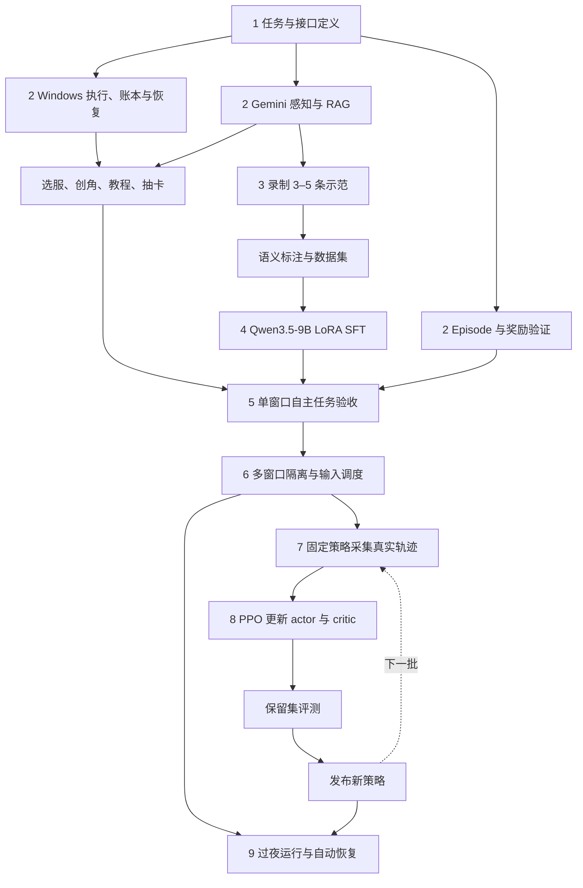

# 三谋多模态 Agent 设计基线 v2

> 归档于 2026-10-22，仅保留历史讨论；当前方案见 [v10](../../sanmou-multimodal-agent-plan-2026-10-23-v10.md)。

2026-10-22。策略基模确定为 **Qwen3.5-9B**。

在本机 Windows 多开三谋客户端，每个窗口由独立 Agent 推进角色。Gemini 读图，RAG 提供知识，Qwen3.5-9B 选择动作，Harness 执行和验证；人工轨迹用于 SFT，真实交互轨迹用于 PPO。

## 技术选择

| 部分 | 选择 |
| --- | --- |
| 视觉感知 | Gemini 3.8 Flash，HIGH，固定模型与感知配置 |
| 策略基模 | `Qwen/Qwen3.5-9B`，首版使用文本输入路径 |
| 策略输入 | 目标、结构化观察、RAG、历史、工具和约束 |
| 训练 | LoRA SFT → PPO；具体 trainer 与超参通过小跑确定 |
| 游戏环境 | 本机 Windows，同一账号、多区服角色、每窗口一个 Agent |
| 共享服务 | 视觉 API、Qwen 推理服务、只读知识库 |
| 算力 | A100 80GB 为首测资源；测量 actor、critic、rollout 和更新峰值后定预算 |

Qwen3.5-9B 保留原 checkpoint，策略首版只接收文本状态。游戏与采集留在本机，云游戏 worker 暂不建设。

## 工作依赖图

箭头表示依赖；示范数据、Windows 执行和奖励验证三条线并行建设。



## 系统分工

| 模块 | 要做的事情 |
| --- | --- |
| 感知 | 页面分类、字段抽取、ROI、目标定位、未知字段与证据 |
| RAG | 赛季规则、武将战法、建筑前置、任务条件，附来源与版本 |
| 策略 | 选择语义动作与参数，补充观察、等待、重规划、结束任务 |
| 执行器 | 把语义动作转换为页面导航、点击和输入 |
| Harness | 上下文、身份、预算、调度、验证、轨迹、恢复与接管 |
| 训练管线 | SFT 数据导出、PPO 采样和更新、评测与版本发布 |

运行循环：截图 → 观察与知识 → 策略动作 → 执行 → 新画面验证 → 下一步。

### 感知接入

使用 `/Users/lanull/Desktop/sub2api-gemini-3.8-flash-high.env`，接通其中的 key、网关、`gemini-3.8-flash` 和 `HIGH` 参数。当前客户端使用旧默认配置，需要适配。

按页面提供字段字典与示例；小字从原图裁剪 ROI，保留坐标变换。输出结构化观察和未知项，以标注截图评测字段及定位准确率。RAG 的攻略证据进入策略上下文。

### 本机多窗口

- 用 PID、窗口句柄、区服和角色绑定 Agent，会话与轨迹独立。
- 观察和推理并发，前台鼠标键盘由本机调度器互斥执行。
- 输入事务覆盖窗口激活、身份复核、新鲜观察、目标校验和操作；长等待释放输入锁。
- 首次双窗口测试同时检查登录稳定性、角色归属、焦点切换和截图绑定。

### 全流程与恢复

初始化流程：登录态检查 → 选服 → 创角 → 选州／职业 → 教程 → 预算内抽卡 → 起始快照。

区服、州、职业、卡池和券数由配置指定。用户处理首次授权和本人验证。凭据与验证码排除在轨迹、训练集之外。

每次不可逆操作保存意图、派发、验证和确认记录。超时后先检查扣券、资源、等级或入库结果，再决定是否重试。持久队列保存角色游标，watchdog 负责重启、预算停止与异常通知。

## 轨迹与 SFT

一条角色成长轨迹包含多个短任务 episode。每个 episode 有起点、目标、预算和结束条件。

统一记录：

- **任务与身份**：TaskSpec、版本、匿名账号、区服角色、窗口、episode、父轨迹。
- **输入**：截图引用、观察、未知项、当时 RAG、历史、工具与约束。
- **行动**：语义动作、参数、来源、模型提议、实际执行。
- **反馈**：工具结果、新观察、验证证据、终止原因与奖励。
- **PPO 字段**：策略版本、输入输出 token、旧 log-prob、value、action token mask。

动作来源区分人工、脚本、教师模型和策略。原始轨迹保留，标注独立存储。语义动作与执行器内部点击分层记录。

### 首批示范

1. 选服、创角、选州、教程。
2. 预算内抽卡、查看所得武将与战法。
3. 条件齐备的升级与章节推进。
4. 资源或前置不足时的观察、补缺与继续推进。
5. 弹窗或操作失败后的恢复。

先用 3–5 条贯通采集与标注，再一起设计 30–50 条短任务试点。

### 训练

Qwen3.5-9B 加载 LoRA，使用审核后的完整多轮轨迹或“历史前缀 → 下一动作”样本。离线预计算视觉状态和 RAG，仅监督目标动作 token；工具反馈和观察作为输入。

训练与部署使用同一上下文构造逻辑。输入只取决策当时已有信息；数据集按区服角色、任务族和完整轨迹划分。错误动作单独标记，正确恢复步骤可以进入 SFT。

## Episode 与奖励

| 阶段 | 任务 | 成功证据 |
| --- | --- | --- |
| 初始化 | 创角、教程、预算抽卡 | 角色、阶段、扣券与结果 |
| 小试验 | 跨页面补齐信息 | 必需字段与独立证据一致 |
| 核心首轮 | 章节瓶颈与建筑前置链 | 指定建筑等级、章节条件与奖励状态 |
| 第二批 | 补兵与队伍整备 | 目标队伍最终兵力与状态 |
| 第二阶段 | 选地与低损占领 | 本次目标归属、战报、损耗与时间 |

首个 episode：完成当前章节要求的建筑升级。开始时绑定建筑和章节目标；可检查、领奖、升级前置／目标、等待。初始预算为 20 次决策、10 分钟有效运行，后续按采样调整。

目标达成结束；提前声明结束但未达标、目标已不可达、预算耗尽记失败。设备和服务故障记截断。已完成目标跳过，新角色提供新的起点。

首轮奖励：

```text
R = S - 0.1 × min(I / 5, 1) - 0.1 × min(D / 5, 1)
S = 独立验证的成功标记
I = 无效动作数
D = 重复且无进展的操作数
```

I、D 分开计数；必要观察与合理等待保留。成功奖励结算一次。卡池作为初始条件，资源成本后续按动作支出账本计算。奖励系数在试点中校准。

## PPO 闭环

SFT checkpoint → 固定行为策略采样 → 独立奖励 → 优势计算 → actor／critic 更新 → 评测 → 发布下一版。

- 各窗口分别采集成功和失败 trajectory，整批固定行为策略版本。
- 更新使用实际动作 token、旧概率、value 和 mask；初始化脚本与工具回包分别记录。
- 人工或脚本改选业务动作时截断策略片段，接管后的回报单独归属；原动作的低层执行仍属于正常工具调用。
- 故障片段按终止／截断语义处理，保留可验证的 transition 和对应价值 bootstrap。
- 卡池、资源、地图、任务阶段进入策略与价值估计；按角色和初始条件分层评测。
- PPO trainer、critic 配置和 A100 显存／吞吐在小跑后确定；初期采样和更新交替执行。

评测固定 Gemini、RAG、工具和任务配置，对照规则策略、原始 Qwen3.5-9B、SFT、SFT＋PPO。主要指标为任务成功率、目标／参数正确率、无效操作、资源／时间、恢复和窗口隔离。

## 当前工程与下一步

已有：Windows Bridge、感知与状态、知识检索、规则 selector、部分动作 verifier、人工录制与 TickTrace。

待完成：Gemini 配置接入、任务与轨迹契约、初始化流程、完整动作验证、Qwen 策略接口、SFT／PPO、多窗口调度、持久恢复。正式执行沿用现有门禁，逐项补齐实机证据。

下一步先定义 TaskSpec、State、Action、Trace，接入 Gemini，在单窗口录制首批示范；数据与执行两条线汇合后做 SFT 自主任务验证，再进入双窗口和 PPO。

## 入口

- [术语](../legacy-workspace-2026-10-22/CONTEXT.snapshot.md)
- [开发待办](../legacy-workspace-2026-10-22/todo-list.snapshot.md)
- [Windows Bridge](../../runbooks/bridge-architecture.md)
- [录制与回放](../../runbooks/windows-record-replay.md)
- [完整讨论记录 v1](sanmou-multimodal-agent-plan-2026-10-22-v1.md)
