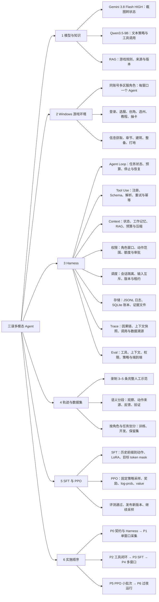

# 三谋多模态 Agent 设计基线 v4

> 归档于 2026-10-22，仅保留历史讨论；当前方案见 [v10](../../sanmou-multimodal-agent-plan-2026-10-23-v10.md)。

2026-10-22。策略基模确定为 **Qwen3.5-9B**。

在本机 Windows 多开三谋客户端，每个窗口由独立 Agent 推进角色。Gemini 读图，RAG 提供知识，Qwen3.5-9B 选择动作。Harness 负责模型与工具循环、上下文、权限、调度、存储、Trace、Eval 和恢复；完整轨迹接入 SFT 与 PPO。

## 技术选择

| 部分 | 选择 |
| --- | --- |
| 视觉感知 | Gemini 3.8 Flash，HIGH，固定模型与感知配置 |
| 策略基模 | `Qwen/Qwen3.5-9B`，首版使用文本输入路径 |
| 策略输入 | 目标、结构化观察、RAG、历史、工具和约束 |
| 训练 | LoRA SFT → PPO；具体 trainer 与超参通过小跑确定 |
| 游戏环境 | 本机 Windows，同一账号、多区服角色、每窗口一个 Agent |
| 共享服务 | 视觉 API、Qwen 推理服务、只读知识库 |
| 算力 | A100 80GB 为首测资源；测量 actor、critic、rollout 和更新峰值后定预算 |

Qwen3.5-9B 保留原 checkpoint，策略首版只接收文本状态。游戏与采集留在本机，云游戏 worker 暂不建设。

## 项目总任务树

一棵树覆盖模型、游戏环境、Harness、数据、训练与实施顺序。下文展开各模块的交付与验收。



## H1 Agent Loop 与恢复

每个角色会话执行：取得观察 → 构造上下文 → 调用 Qwen → 解析动作 → 权限检查 → 调度执行 → 验证结果 → 更新任务状态。

- 生命周期：准备、运行、等待、暂停、人工接管、成功、失败、截断。
- 停止条件：目标达成、动作／时间／调用额度耗尽、连续失败、kill switch。
- 固定初始化流程：登录态检查、选服、创角、选州／职业、教程、预算内抽卡。
- 持久化任务游标、最近已确认动作和等待期限；重启后先观察真实状态，再续跑。
- 只读请求可有界重试；领奖、抽卡等写操作先查动作账本与实际结果，再决定下一步。
- 用 watchdog 监测游戏、Bridge、模型请求和磁盘空间；故障分别归为模型、感知、工具、权限、游戏或基础设施。

**交付**：EpisodeRunner、初始化流程、恢复状态机。**验收**：超时、断连、重启、结果不明时任务游标和真实状态一致。

## H2 Tool Use

建立面向 Qwen 的工具注册表，覆盖观察、知识、游戏动作和任务控制。

| 工具组 | 首版接口方向 | 执行者 |
| --- | --- | --- |
| 观察 | 截图、检查建筑／队伍／章节、定位元素 | Gemini 与感知模块 |
| 知识 | 按目标、赛季检索规则及证据 | qa-agent |
| 游戏动作 | 领奖、升级、征兵、选地、出征、等待 | 语义执行器与 Windows Bridge |
| 任务控制 | 请求补充信息、暂停、报告完成 | EpisodeRunner |

每个工具注册名称与版本、用途、输入／输出 schema、副作用类型、超时、重试规则、权限要求和调用预算。参数使用 Pydantic 校验，结果统一为 `status / data / evidence_refs / error_code / retryable`。

模型只看到当前任务相关的工具定义。解析器保留 `tool_call_id`，核对动作类型、目标、参数和引用；执行器将语义动作展开成具体导航和输入。

工具分别声明游戏状态副作用和 UI 副作用。无窗口操作的截图、离线解析、知识查询可并行；查看队伍、建筑等涉及切页、聚焦、点击的观察工具也走输入租约，并更新角色 UI 版本。同角色状态变更按顺序执行。

模型适配器统一处理 Gemini 感知与 Qwen 策略请求的模型版本、响应解析、超时、限流、token／费用记录。Gemini 接入 `/Users/lanull/Desktop/sub2api-gemini-3.8-flash-high.env`；Qwen 的 tool-call 模板和训练模板保持一致。

**交付**：ToolRegistry、ToolDispatcher、ModelAdapter、标准工具结果。**验收**：合法调用可执行，错误参数、未知工具、重复调用、超时和失败都有稳定结果与错误码。

## H3 Context 管理

策略输入由 ContextBuilder 统一构建，SFT、推理与 PPO 复用同一逻辑。

| 层 | 内容 | 保留方式 |
| --- | --- | --- |
| 固定规则 | 角色职责、动作格式、任务权限 | 每次请求固定注入 |
| 当前任务 | 目标、预算、完成条件、进度 | 结构化状态 |
| 当前观察 | 字段、时间、未知项、证据引用 | 按角色隔离并检查新鲜度 |
| 工作记忆 | 已确认事实、待解决条件、失败与恢复状态 | 带来源的短状态摘要 |
| 近期历史 | 关键动作和工具反馈 | 有界窗口，保持调用与回包配对 |
| RAG | 规则、来源、适用赛季及版本 | 去重、排序、相关性与长度限制 |

配置 `max_input_tokens`、`reserved_output_tokens`、历史窗口和 RAG 预算。预算紧张时先去重工具输出和检索内容，再压缩旧历史；当前目标、权限、最新关键字段和待处理调用保持完整。

原始图片与长日志存磁盘，策略上下文使用结构化观察和引用。视觉层按页面加载字段说明，小字使用 ROI，坐标映射和未知项随观察保存。

每次调用保存实际 `ContextSnapshot`、token 数、`context_hash`、摘要版本、引用的观察和知识版本。训练直接使用采样时的快照，避免重新生成摘要改变当时的输入。引用缺失或关键状态过期时安排重新观察。

**交付**：ContextBuilder、角色工作记忆、预算与压缩器。**验收**：长轨迹预算受控、关键字段不丢失、角色间不串历史、离线重建输入与采样记录一致。

## H4 权限控制

权限由 Harness 校验，模型提出动作。任务启动时确定作用范围：

- **身份范围**：登录账号、区服角色、客户端 PID／HWND。
- **动作范围**：允许的工具、目标类型、土地等级与任务阶段。
- **资源范围**：券数、资源支出、动作数、模型调用数和时间额度。
- **输入条件**：当前画面、语义目标、窗口身份与几何、操作前置条件。
- **审批方式**：自动允许、需要一次性确认、禁止；一次性确认绑定动作、目标和当前观察。
- **控制方式**：暂停、取消、kill switch，以及每次 allow／deny／require-approval 的审计记录。

运行模式区分只读录制、dry-run、监督执行和已授权范围内自动执行。现有 DispatchGuard、风险和 verifier 检查继续作为唯一输入通道；策略指令、RAG 和工具返回内容不能改变运行时权限配置。

**交付**：TaskPermission、PermissionDecision、额度账本与审批接口。**验收**：错角色、错窗口、过期观察、额度不足和已消费授权均为零输入。

## H5 多窗口与会话调度

按 `AccountIdentity → RoleSession → DeviceSession` 组织：一个账号关联多个区服角色，每角色绑定一个活跃客户端。共享模型服务与知识库，各会话独立维护状态、上下文和轨迹。

建立跨 Agent 的输入队列和互斥租约。取得租约后激活窗口，重新观察、校验角色及目标，再输入；需要前台的验证属于同一事务或重新申请租约。长等待释放租约，公平调度其他窗口。

租约附带单调递增的 fencing token，Bridge 每次输入前校验当前租约及 token，过期 Agent 恢复后无法继续派发。排队结束再次检查 kill switch、权限与剩余额度，在账本事务中预留预算并记录 intent 后执行；结果不明的操作保持待核对状态。

读图和模型推理可并发；同角色写操作有顺序与版本检查。旧结果返回时核对角色、观察和任务版本，避免异步响应覆盖新状态。

**交付**：SessionRegistry、WindowBinder、InputScheduler。**验收**：双客户端 Alt-Tab、弹窗、窗口移动、超时和重启测试中没有跨角色输入或状态污染。

## H6 日志与存储

首版采用本机 **JSONL 事件／日志＋SQLite 事务账本／索引＋证据文件目录**。

| 数据 | 用途 | 存储 |
| --- | --- | --- |
| 运行日志 | 健康、错误、重试、耗时、token、费用和队列情况 | 按运行和组件分组的 JSONL |
| 状态账本 | 角色绑定、任务游标、输入租约、额度、动作意图与确认 | SQLite 事务，由协调层串行写入 |
| 证据文件 | 原始截图、ROI、输入输出快照 | 文件目录，以内容哈希和元数据索引 |
| 原始轨迹 | 人工／脚本／策略的观察、动作、反馈 | 只追加事件，标注单独保存 |
| 数据集 | SFT／PPO 导出、划分和样本来源 | 版本化 manifest 与训练文件 |
| Eval 报告 | 用例、指标、失败证据、比较结果 | 报告与版本化索引 |

写操作先持久化 intent 和幂等键，再派发；派发、验证和确认分别落账。数据库和证据文件以哈希、事务状态及完成标记核对。断电测试覆盖“点击发生但结果未确认”的区间。

日志关联角色、episode 和 trace ID；凭据与验证码不写入日志。证据目录设置配额和留存配置，空间不足暂停采集，归档按明确生命周期执行。

**交付**：EventSink、RunStore、ArtifactStore、ActionLedger。**验收**：重启可恢复、动作可对账、孤立文件可定位，已记录结果不会导致重复消耗。

## H7 Trace 与训练溯源

Trace 描述一次决策的因果路径，运行日志描述独立事件。Trace 以 span 表示有起止时间的操作，并用 parent ID 关联，采用 [OpenTelemetry 的 trace/span 语义](https://opentelemetry.io/docs/concepts/signals/traces/)。

层级：episode → decision → observe／context／model／tool／permission／dispatch／verify／recover。

必要关联字段：

- `run_id / role_session_id / episode_id / decision_id`
- `trace_id / span_id / parent_span_id / tool_call_id / action_id`
- `observation_id / frame_sha / context_hash`
- 模型、adapter、tokenizer、chat template、prompt、工具 schema、RAG 和 reward 版本
- 实际上下文、模型提议、权限判定、实际执行、反馈、状态差和结果证据
- `actor_origin`、接管边界、耗时、错误、费用和重试次数

PPO 采样额外记录生成 token、旧 log-prob、value、response mask、reward、terminated／truncated；SFT 导出保留标签与 lineage。原始 trace 可定位到某个训练样本，也可从样本反查原始上下文和动作证据。

运行开始时标记 `run_purpose=train/eval` 和角色所属划分。PPO 导出按训练用途、行为策略版本与记录完整性筛选，保留有效成功和失败轨迹；SFT 再进行动作标签审核。

人工或脚本改选业务动作时切断策略学习片段，单独归属后续结果；原语义动作的低层执行仍属于工具调用。Trace 记录可观察输入输出和行动，不要求补写隐藏思维过程。

**交付**：TraceRecorder、上下文快照、轨迹回放与 DatasetExporter。**验收**：任一失败或训练样本都能沿 ID 找回角色、输入、工具、执行和奖励依据。

## H8 Eval 与发布门禁

Eval 从第一阶段建设，与功能并行维护。

| 层级 | 用例 | 指标或断言 |
| --- | --- | --- |
| 工具协议 | 参数、schema、超时、返回错误、幂等 | 参数合规、稳定错误码、重复写处理 |
| 感知 | 页面、数字、小字、目标 bbox、未知值 | 字段准确率、定位命中率 |
| 上下文 | 长历史、压缩、过期字段、跨角色、调用配对 | 预算、事实保留、快照一致性 |
| 权限与调度 | 错窗口、旧授权、预算、并发和取消 | 零越权输入、无会话串扰 |
| Verifier／Reward | 成功、未变化、错误目标、遮挡、迟到结果 | 成功误判与漏判、奖励分项 |
| 策略 | 规则、原始 Qwen、SFT、SFT＋PPO | 任务成功、无效动作、恢复、步骤与成本 |
| 端到端 | 初始化、任务、重启、多窗口、过夜 | 完整率、重复消耗、干预次数、运行稳定性 |

每份 Eval 锁定任务集、角色划分、模型和 Harness 全部配置版本。训练奖励用于策略更新，发布评测使用保留角色／任务及独立检查。开发集与线上训练运行的失败案例回流调试；最终保留集不参与调参。需要吸收保留集案例时，先登记转为开发用途，再建立新的未见保留集。

当前固定状态 replay 用来检查决策回归，真实客户端验证动作后的状态变化。发布流程是候选 checkpoint → 固定 Eval → 小范围运行 → 扩大采样；不通过时继续使用当前版本。

**交付**：EvalSuite、RewardVerifier、RegressionReport、ModelReleaseGate。**验收**：同一批样本可复测，版本差异可定位到感知、上下文、策略或执行。

## 轨迹与 SFT

一条角色成长轨迹包含多个短任务 episode。每个 episode 有起点、目标、预算和结束条件。

统一记录：

- **任务与身份**：TaskSpec、版本、匿名账号、区服角色、窗口、episode、父轨迹。
- **输入**：截图引用、观察、未知项、当时 RAG、历史、工具与约束。
- **行动**：语义动作、参数、来源、模型提议、实际执行。
- **反馈**：工具结果、新观察、验证证据、终止原因与奖励。
- **PPO 字段**：策略版本、输入输出 token、旧 log-prob、value、action token mask。

动作来源区分人工、脚本、教师模型和策略。原始轨迹保留，标注独立存储。语义动作与执行器内部点击分层记录。

### 首批示范

1. 选服、创角、选州、教程。
2. 预算内抽卡、查看所得武将与战法。
3. 条件齐备的升级与章节推进。
4. 资源或前置不足时的观察、补缺与继续推进。
5. 弹窗或操作失败后的恢复。

先用 3–5 条贯通采集与标注，再一起设计 30–50 条短任务试点。

### 训练

Qwen3.5-9B 加载 LoRA，使用审核后的完整多轮轨迹或“历史前缀 → 下一动作”样本。离线预计算视觉状态和 RAG，仅监督目标动作 token；工具反馈和观察作为输入。

训练与部署使用同一上下文构造逻辑。输入只取决策当时已有信息；数据集按区服角色、任务族和完整轨迹划分。错误动作单独标记，正确恢复步骤可以进入 SFT。

## Episode 与奖励

| 阶段 | 任务 | 成功证据 |
| --- | --- | --- |
| 初始化 | 创角、教程、预算抽卡 | 角色、阶段、扣券与结果 |
| 小试验 | 跨页面补齐信息 | 必需字段与独立证据一致 |
| 核心首轮 | 章节瓶颈与建筑前置链 | 指定建筑等级、章节条件与奖励状态 |
| 第二批 | 补兵与队伍整备 | 目标队伍最终兵力与状态 |
| 第二阶段 | 选地与低损占领 | 本次目标归属、战报、损耗与时间 |

首个 episode：完成当前章节要求的建筑升级。开始时绑定建筑和章节目标；可检查、领奖、升级前置／目标、等待。初始预算为 20 次决策、10 分钟有效运行，后续按采样调整。

目标达成结束；提前声明结束但未达标、目标已不可达、预算耗尽记失败。设备和服务故障记截断。已完成目标跳过，新角色提供新的起点。

首轮奖励：

```text
R = S - 0.1 × min(I / 5, 1) - 0.1 × min(D / 5, 1)
S = 独立验证的成功标记
I = 无效动作数
D = 重复且无进展的操作数
```

I、D 分开计数；必要观察与合理等待保留。成功奖励结算一次。卡池作为初始条件，资源成本后续按动作支出账本计算。奖励系数在试点中校准。

## PPO 闭环

SFT checkpoint → 固定行为策略采样 → 独立奖励 → 优势计算 → actor／critic 更新 → 评测 → 发布下一版。

- 各窗口分别采集成功和失败 trajectory，整批固定行为策略版本。
- 更新使用实际动作 token、旧概率、value 和 mask；初始化脚本与工具回包分别记录。
- 人工或脚本改选业务动作时截断策略片段，接管后的回报单独归属；原动作的低层执行仍属于正常工具调用。
- 故障片段按终止／截断语义处理，保留可验证的 transition 和对应价值 bootstrap。
- 卡池、资源、地图、任务阶段进入策略与价值估计；按角色和初始条件分层评测。
- PPO trainer、critic 配置和 A100 显存／吞吐在小跑后确定；初期采样和更新交替执行。

评测固定 Gemini、RAG、工具和任务配置，对照规则策略、原始 Qwen3.5-9B、SFT、SFT＋PPO。主要指标为任务成功率、目标／参数正确率、无效操作、资源／时间、恢复和窗口隔离。

## 实现顺序

| 阶段 | 工作 | 交付与验收 |
| --- | --- | --- |
| P0 契约与 Harness 骨架 | TaskSpec、State、Action、ToolSchema、ContextSnapshot、Trace、Permission | 一条 mock episode 从上下文到验证和落盘全链路可检查 |
| P1 单窗口采集 | Gemini、录制器、原始事件与语义标注 | 3–5 条示范的画面、输入、上下文和结果对齐 |
| P2 工具闭环 | 初始化、领奖／升级、权限、账本、恢复 | 独立 verifier，超时重启后无重复消耗 |
| P3 SFT 与 Context | Qwen LoRA、工具模板、预算／压缩、快照导出 | 离线与 shadow eval，保存重载和输入一致性 |
| P4 多窗口 | 角色绑定、全局输入队列、异步状态版本检查 | 双窗口并行观察／推理、互斥输入、轨迹隔离 |
| P5 PPO | 真实采样、reward、概率／value／mask、发布门禁 | 可复测的保留集与策略改进报告 |
| P6 过夜运行 | watchdog、预算、暂停通知、磁盘配额和恢复 | 有限时长通过后扩大到过夜批次 |

Tool Use、Context、权限、日志／Trace 与 Eval 在 P0 开始，随每阶段补全；恢复账本在首次真实写操作前就接入。

## 现有代码与新增工作

| 模块 | 当前入口 | 新增重点 |
| --- | --- | --- |
| 运行循环 | [AutonomousLoop](../../../packages/pioneer-agent/src/pioneer_agent/runtime/autonomous_loop.py) | Qwen PolicyAdapter、标准工具循环与任务生命周期 |
| Tool Use | [Action handlers](../../../packages/pioneer-agent/src/pioneer_agent/executor/action_handlers.py) | ToolRegistry、版本化 schema、调用结果和预算 |
| Context | [QA ChatAgent](../../../packages/qa-agent/src/qa_agent/chat/agent.py) | 策略 ContextBuilder、压缩与精确快照；现有聊天历史仅作参考 |
| 权限 | [DispatchGuard](../../../packages/pioneer-agent/src/pioneer_agent/runtime/dispatch_guard.py)、[UIActionRunner](../../../packages/pioneer-agent/src/pioneer_agent/executor/ui_runner.py) | 明确任务 scope、额度、一次性审批与审计 |
| 多窗口 | [AccountSession](../../../packages/pioneer-agent/src/pioneer_agent/core/device.py)、[Bridge](../../../packages/pioneer-agent/src/pioneer_agent/adapters/win_bridge_server.py) | 账号／角色 session 拆分、全局输入队列 |
| Trace | [TickTrace](../../../packages/pioneer-agent/src/pioneer_agent/storage/trace_store.py) | span、模型上下文、工具 ID、配置版本与训练 lineage |
| 状态存储 | [Runbook store](../../../packages/pioneer-agent/src/pioneer_agent/runbook/state_store.py) | 事务动作账本与本机索引，角色级游标 |
| Eval | [Golden replay](../../../packages/pioneer-agent/src/pioneer_agent/runtime/golden_replay.py)、[Advisor tools](../../../packages/qa-agent/src/qa_agent/mcp_server/advisor_tools.py) | Context／Tool／权限／多窗口测试、训练与发布评测 |

正式执行沿用现有门禁，逐项补齐实机证据。

## 入口

- [术语](../legacy-workspace-2026-10-22/CONTEXT.snapshot.md)
- [开发待办](../legacy-workspace-2026-10-22/todo-list.snapshot.md)
- [Windows Bridge](../../runbooks/bridge-architecture.md)
- [录制与回放](../../runbooks/windows-record-replay.md)
- [Harness 展开版 v3](sanmou-multimodal-agent-plan-2026-10-22-v3.md)
- [简版路线 v2](sanmou-multimodal-agent-plan-2026-10-22-v2.md)
- [完整讨论记录 v1](sanmou-multimodal-agent-plan-2026-10-22-v1.md)
