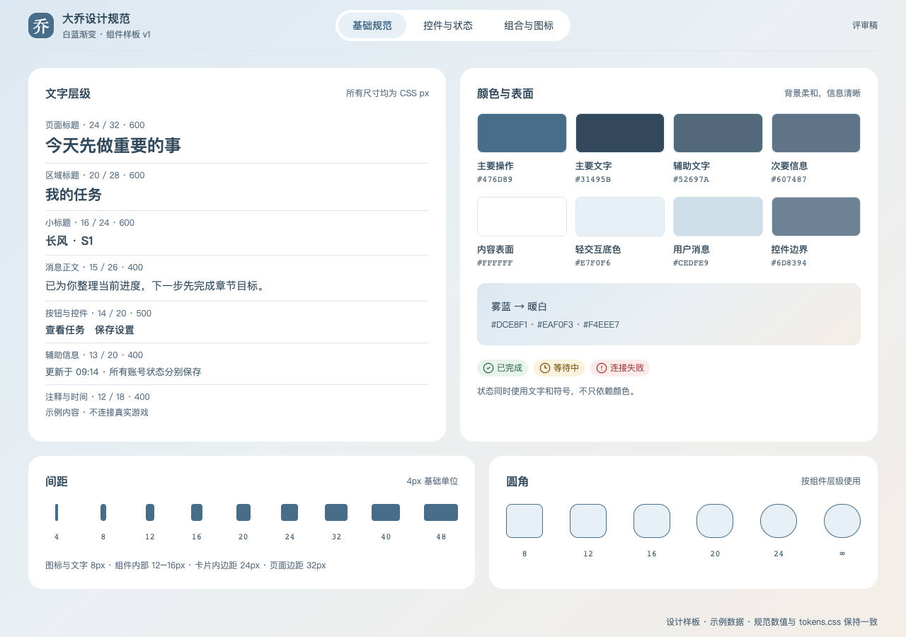
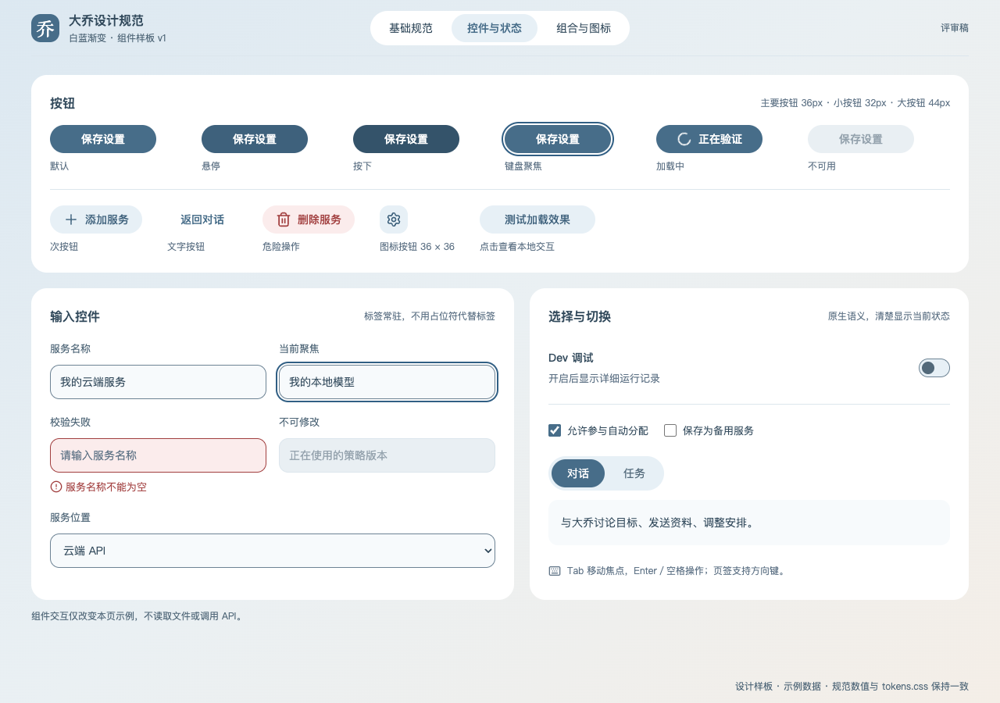
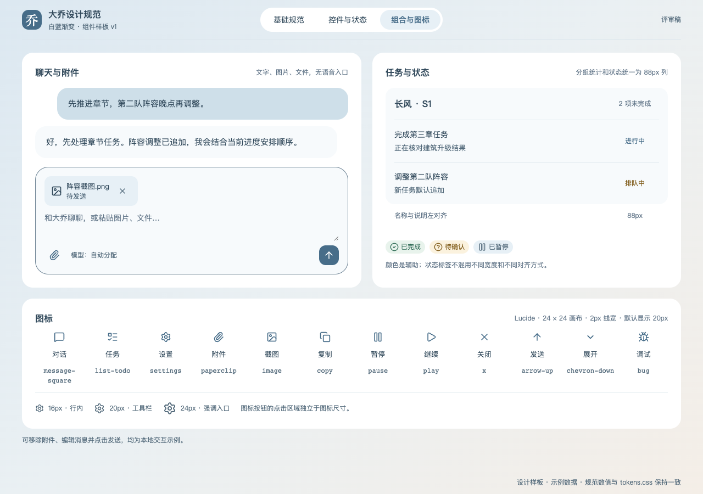

# 大乔界面设计规范 v1

2026-10-28 · 评审稿 · 配套《大乔三谋个人 Agent PRD v1》

本规范将白蓝、温和渐变的设计方向落实为可复用的字体、颜色、间距和组件规则。产品结构继续以 [PRD v1](../daqiao-prd-2026-10-28-v1/PRD.html) 为准，不增加页面或功能。本版是具体视觉数值与交互状态的提案，等待本轮评审。

与此前样图相比，本版统一零散的尺寸、加深辅助文字和主按钮、统一图标库。旧 PRD 与样图保留不覆盖；后续界面实现和重绘应使用本规范，不再从旧图中吸取任意颜色或像素值。

[查看组件样板](components.html#foundations) · [查看设计 tokens](tokens.json) · [CSS 变量](tokens.css)

## 1 基础样板



所有尺寸采用 CSS px，按操作系统缩放正常放大；不把截图的像素尺寸当成物理像素。1280×860 是 PRD 样图画布，不是应用窗口的固定尺寸。

## 2 字体与文字层级

界面使用系统无衬线字体，保证 Windows 上的中文可读性和稳定排版；不依赖用户额外安装字体。

```css
font-family: "Segoe UI", "PingFang SC", "Microsoft YaHei UI", "Microsoft YaHei", sans-serif;
/* Trace、代码、模型 ID 等技术内容 */
font-family: "Cascadia Code", "SFMono-Regular", Consolas, monospace;
```

| 层级 | 字号／行高 | 字重 | 使用位置 |
| --- | --- | --- | --- |
| 页面标题 | 24／32 | 600 | 任务、设置、账号规则等页头 |
| 分组标题 | 20／28 | 600 | 模型服务、任务详情的大分区 |
| 小标题 | 16／24 | 600 | 账号分组、卡片标题 |
| 对话正文 | 15／26 | 400 | 消息正文、策略解释、简报 |
| 控件与列表 | 14／20 | 500；长列表正文用 400 | 按钮、Tab、导航、任务名、输入框 |
| 辅助说明 | 13／20 | 400 | 字段说明、任务副标题、错误说明 |
| 时间与标注 | 12／18 | 400 | 时间、版本、非关键辅助标签 |
| 技术内容 | 13／20 | 400，等宽 | Trace、工具参数、模型 ID |

正文不小于 14px，聊天正文保持 15px；12px 只用于次要标注，不承载操作名称或关键结果。取消旧样图中 11px 的可读信息。只使用 400／500／600 三档字重，不用粗体堆砌整段消息。

数字状态、耗时、token 用量可以用等宽数字 `font-variant-numeric: tabular-nums`。正文正常换行，按钮短文本不截断；模型 ID、文件名过长时允许换行或显示完整内容的提示，不压缩字号。

## 3 颜色

### 3.1 背景与文字

| Token | 色值 | 用途 |
| --- | --- | --- |
| `bg-start` | `#DCE8F1` | 渐变起点，雾蓝 |
| `bg-mid` | `#EAF0F3` | 渐变中段，冷白 |
| `bg-end` | `#F4EEE7` | 渐变终点，暖白 |
| `surface` | `#FFFFFF` | 消息、卡片、弹层的实体底色 |
| `surface-subtle` | `#F7FAFC` | 输入区域和轻度分组 |
| `surface-soft` | `#E7F0F6` | 选中区域、次按钮、信息标签 |
| `surface-user` | `#CEDFE9` | 用户消息底色 |
| `text-primary` | `#31495B` | 正文、标题、重要数值 |
| `text-secondary` | `#52697A` | 辅助说明；渐变和浅蓝底上的说明文字 |
| `text-muted` | `#607487` | 仅用于白底或 `surface-subtle` 上的时间、标注 |
| `text-disabled` | `#94A2AD` | 不可交互的禁用内容，不用于普通说明 |

背景固定为 `linear-gradient(140deg, #DCE8F1 0%, #EAF0F3 48%, #F4EEE7 100%)`。渐变放在应用背景，不叠加到每张卡片。正文区域使用实体底色；不靠降低整块 opacity 制造柔和效果。

### 3.2 操作与状态

| Token | 色值 | 用途 |
| --- | --- | --- |
| `primary` | `#476D89` | 主按钮、重要操作 |
| `primary-hover` | `#3E617C` | 主按钮悬停 |
| `primary-pressed` | `#34536A` | 主按钮按下 |
| `on-primary` | `#FFFFFF` | 深色按钮上的文字和图标 |
| `border-subtle` | `#DCE6ED` | 非交互分隔线、轻卡片轮廓 |
| `border-control` | `#6D8394` | 必须识别的输入框／控件边界 |
| `focus` | `#315F84` | 键盘焦点环 |
| `success`／`success-bg` | `#2F6B55`／`#E8F3EC` | 已完成、验证成功 |
| `warning`／`warning-bg` | `#805C1A`／`#FBF2DE` | 等待、需要确认 |
| `danger`／`danger-bg` | `#A13E3E`／`#FBECEC` | 失败、取消确认等危险操作 |
| `disabled-bg` | `#E9EFF3` | 禁用控件底色 |

状态必须同时有文字或图标，不能只看颜色。“排队中”和“等待中”可共享颜色，但文案必须区分；“暂停”与“已取消”也不能用同一个含糊圆点表示。

### 3.3 对比度验收

本规范以普通文字至少 4.5:1、必要控件／状态图形至少 3:1 为验收目标，参考 [W3C 文字对比度说明](https://www.w3.org/WAI/WCAG22/Understanding/contrast-minimum.html)和[非文字对比度说明](https://www.w3.org/WAI/WCAG22/Understanding/non-text-contrast.html)。

关键组合的计算结果见 `verification.json`。主按钮白字约 5.50:1；主文字在渐变蓝端约 7.54:1，次级文字约 4.60:1。`text-muted` 在白底约 4.83:1，但在浅蓝／渐变底不足 4.5，因此不能跨背景随意复用。新控件边框在所用背景上的最低比值大于 3:1。

这些是指定颜色组合的数值检查，不等于整个产品已通过无障碍认证；布局、焦点、缩放和实际渲染仍需逐页验收。

## 4 间距与布局

统一使用 4px 基础网格。常用间距为 **4、8、12、16、20、24、32、40、48px**，不再散落 17／19／21／23px 等近似值。

| 场景 | 规格 |
| --- | --- |
| 图标与文字 | 8px；紧凑标签可用 4px |
| 标题与辅助说明 | 4px |
| 字段标签与控件 | 8px |
| 表单字段之间 | 16px |
| 卡片内部 | 20px 或 24px，同类卡片保持一致 |
| 消息气泡内部 | 上下 16px、左右 20px |
| 相邻消息 | 12px；说话人切换可用 20px |
| 同级卡片之间 | 16px 或 24px，不混用 |
| 页面大分区 | 32px |
| 桌面页面边距 | 32px；窄窗口 16px |

桌面侧栏 224px，顶栏 72px；聊天最大宽度 800px，普通内容区最大宽度 1120px。设置内导航 160px。任务状态列与分组计数列固定同宽 **88px**，标题和内容左右边距一致。

宽度不足 1024px 时侧栏可收至 64px；不足 768px 时收为按需展开的导航，表单双列变单列。它们是桌面窗口适配，不新增独立手机产品。纵向内容正常滚动，不靠缩小整页字号、固定高度裁切或压扁截图解决溢出。

## 5 圆角、边框与阴影

| 对象 | 圆角 |
| --- | --- |
| 小标签、内嵌代码容器 | 8px |
| 输入框、下拉框、附件卡 | 12px |
| 小面板、菜单 | 16px |
| 普通卡片、消息气泡 | 20px |
| 对话输入区、弹窗 | 24px |
| 胶囊 Tab／按钮、头像 | 999px／50% |

气泡可保留一个 8px 方向角，其余角为 20px。边框默认 1px；焦点环为 2px，外偏移 2px。普通白卡不靠厚阴影强调层次：仅浮层用 `0 8px 24px rgba(49,73,91,.10)`，弹窗用 `0 16px 48px rgba(49,73,91,.16)`。遮罩为 `rgba(27,44,58,.36)`。

## 6 图标

统一使用 **Lucide 线性图标**，不混用 Emoji、不同图标库或 Unicode 字符 `⚙`、`＋`、`↑` 作为正式操作图标。大乔品牌字“乔”属于品牌标记，不受此限制。

图标采用库提供的路径，24×24 viewBox，描边 2，圆端点、圆连接，默认无填充，颜色跟随 `currentColor`。工具栏显示 20×20；行内辅助图标 16×16；空态或较大入口 24×24。图标不独立做渐变，不为了突出一个按钮随意加粗描边。

| 功能 | Lucide 图标 |
| --- | --- |
| 对话／任务／设置 | `MessageSquare`／`ListTodo`／`Settings` |
| 附件／发送／新增 | `Paperclip`／`ArrowUp`／`Plus` |
| 图片／文件／复制 | `Image`／`FileText`／`Copy` |
| 游戏画面／放大／关闭 | `Monitor`／`Maximize2`／`X` |
| 暂停／继续 | `Pause`／`Play` |
| 完成／等待／异常 | `CircleCheck`／`Clock3`／`CircleAlert` |
| 加载／展开／调试 | `LoaderCircle`／`ChevronDown`／`Bug` |

只有图标的按钮必须有可访问名称和悬停提示，例如“设置”“移除附件”。文字旁的装饰图标不重复朗读。正式项目只打包用到的图标；本组件样板使用本机已有 Lucide 1.8.0，升级后要复核图标名称和视觉。参见 [Lucide 官方用法](https://lucide.dev/guide/lucide)。

## 7 按钮及交互状态



### 7.1 尺寸和层级

| 类型 | 高度 | 字体 | 左右内边距／图标 | 使用位置 |
| --- | --- | --- | --- | --- |
| 紧凑按钮 | 32px | 14／20，500 | 12px，图标 16px | 列表行内、次要操作 |
| 标准按钮 | 36px | 14／20，500 | 16px，图标 20px | 页面和弹层常规操作 |
| 强操作按钮 | 44px | 14／20，500 | 20px，图标 20px | 表单提交、首次绑定 |
| 图标按钮 | 36×36px | 不适用 | 图标 20px | 齿轮、附件、关闭 |

主按钮用 `primary` 底色与白字；次按钮用 `surface-soft` 与 `primary-hover` 文字；轻操作用透明底和深色文字。一个局部操作区只保留一个主要动作。危险按钮使用危险语义颜色，不能把普通“暂停”渲染成红色警报。

桌面可点击区至少 32×32px，默认 36×36px；触摸／粗指针环境扩大到至少 44×44px，图标本身不用一起放大。文案短而明确，例如“保存配置”“测试模型”“暂停”，不写“立即开始智能赋能”。

### 7.2 状态矩阵

| 状态 | 表现 | 行为 |
| --- | --- | --- |
| 默认 | 标准颜色与尺寸 | 可触发一次动作 |
| 悬停 | 主按钮加深一级，次按钮强化背景 | 不改变尺寸、不挤动相邻元素 |
| 按下 | 再加深一级 | 不改变文字或位置；释放后恢复 |
| 键盘焦点 | 2px 深蓝外环，offset 2px | Tab 可见，Enter／Space 触发；不清除浏览器焦点而不替代 |
| 加载 | 图标＋“测试中”等过程文案 | 保持原宽度，阻止重复提交；取消若可用，作为独立操作 |
| 禁用 | 灰色背景和文字 | 不可触发；在附近说明未满足条件，不把原因只放在禁用按钮 tooltip 中 |
| 错误后 | 恢复可操作并展示错误原因 | 用户可修改或重试；不能只短暂闪红 |

危险确认明确动作对象和后果；不对所有普通动作重复弹确认。已经批准的账号规则继续生效，视觉规范不增加新的权限流程。

## 8 表单、选择器与开关

- 表单控件默认高 44px，紧凑设置行可用 36px；横向内边距 12px、纵向居中，圆角 12px，文字 14／20。
- 字段标签 13／20，放在控件上方；占位文字不能代替标签。说明与错误也用 13／20。
- 输入框默认实体白／浅白底，必要边界用 `border-control`；聚焦用统一焦点环。
- 错误态有边框、图标和具体错误文字，使用 `aria-invalid` 与说明关联；不只靠颜色。
- 只读与禁用分开：只读值可选择复制，禁用控件不可修改。API Key 默认遮蔽，显示操作是明确动作，不把密钥展示在样图和日志中。
- 下拉和模型选择器显示当前值；长 model ID 提供完整查看方式。多选项通过勾选表达，不能只变背景。
- 开关建议 40×24px，可点击区域至少 44px 高；“开／关”有可读状态。Dev 默认关，打开后出现调试 Tab。
- 对话／任务 Tab 采用同组胶囊，选项高 36px、外层内边距 4px，组合总高 44px；选中项有明确底色、较深文字和语义状态。键盘导航遵循 Tab 组件行为。

设置值的保存策略、默认值与业务行为遵循 PRD；未评审的通知／存储选项不能因为样板有开关就视为已确认功能。

## 9 对话、附件与任务组件



### 对话与输入区

助手消息白底、左对齐，用户消息浅蓝底、右对齐；聊天正文 15／26。消息最大宽度不超过会话区域的 90%，长文按段落排版，来源和技术细节按需展开。头像不是每段正文都必须重复出现。

输入区白底、24px 圆角、16px 内边距，文字区从 2 行起；内容增长后在合理高度内滚动，不推走发送按钮。附件在文字区上方排列，间隔 8px；名称 13／20，类型与状态 12／18，移除按钮有独立点击区域。预览图按比例缩放，不拉伸或裁掉关键游戏文字。

输入区保留附件与发送入口、模型“自动分配”说明；不加入语音按钮或每账号固定模型选择器。

### 任务与状态

任务分组标题 16／24，任务名 14／20，副标题 13／20；行高按内容增长，单行最小 56px。分组计数和每行状态使用同一个 88px 列居中，不按文字长度分别对齐。状态标签高度建议 24px，左右 8px，文字 12／18。

“进行中”用深蓝，“已完成”用绿，“等待／待确认”用琥珀，“错误”用红，“暂停／取消”用中性文字。每个状态都写完整名称。任务详情的时间线用图标与文字表示完成、当前和异常，不连续闪烁。

### 空态、加载与错误

空态保留一条清楚说明和一个相关下一步，不塞仪表盘。加载只占用即将出现内容的位置，避免整个页面跳动；错误说明放在发生问题的区域。游戏画面过期时展示采集时间和状态，不能用“在线”圆点替代新鲜度。

## 10 动效与层级

悬停／按下用 120ms，展开／收起用 180ms，较大弹层最多 240ms；缓动统一 `cubic-bezier(.2,0,0,1)`。禁止循环呼吸、无意义弹跳和每条新日志的入场动画。模型长任务依靠过程文字说明，不依靠一直转动的大图标占据页面。

响应 `prefers-reduced-motion`：移除非必要位移和旋转，保留静态加载文字与状态。焦点样式即时可见。层级建议：普通内容 0、粘性顶栏 10、菜单 20、弹层／遮罩 30、提示 40；同一时刻避免叠多个阻塞弹窗。

## 11 开发交付与旧稿迁移

`tokens.json` 是数值来源，`tokens.css` 由构建脚本生成，变量名统一为 `--dq-*`。组件样板读取同一份 CSS，不再复制一套色值。业务仓库尚未接入这些 token，本目录只是设计交付。

| 旧样图现象 | 本规范处理 |
| --- | --- |
| 11px 辅助字、12px 按钮 | 辅助标注最低 12px；按钮统一 14px |
| 多种过浅蓝灰文字 | 按背景选择 secondary／muted，去掉文字 opacity |
| 主按钮 `#6E94AF` 白字偏淡 | 改为 `#476D89`，白字达到约 5.50:1 |
| 19／21／23px 圆角和间距混杂 | 收到 4px 网格和指定圆角档位 |
| `⚙`、`＋`、`↑` 等字符代替图标 | 用指定 Lucide 图标，统一尺寸与描边 |
| 输入／任务状态只有默认态 | 补 hover、pressed、focus、loading、disabled、error |
| 固定 1280×860 画布 | 仅用于导出样图；生产界面按窗口宽高适配 |

不在本次覆盖 PRD v1 的十张样图。确认规范后，再统一应用到下一版完整页面，避免同时把视觉提案和产品决定当成已审核结果。

## 12 验收清单

1. 所有字号、颜色、间距、圆角和控件尺寸可追到 token，无同义近似值散落。
2. 聊天正文与列表文字清晰；重要内容不降到 12px 或使用禁用色。
3. 校验真实前景／背景组合：文字 4.5:1，必要边界与状态图形 3:1。
4. 按钮有完整状态，不因 hover／loading 改变布局；重复提交被阻止。
5. 键盘焦点可见，只有图标的按钮有名称；状态不只靠颜色。
6. 任务计数与状态列宽、对齐一致；长名称和长模型 ID 不挤出布局。
7. 1280px 和窄窗口无横向溢出；系统缩放／文字放大不隐藏操作。
8. 图标统一库、描边和尺寸；没有把 Emoji 当正式控件图标。
9. 减少动态效果模式下仍可理解加载和状态。
10. 无语音、地图、百科或人工接管等已删除入口回流。

## 13 交付文件

- `DESIGN-SYSTEM.md`：规范原稿。
- `DESIGN-SYSTEM.html`：内嵌三张样板图的阅读版。
- `components.html`／`components.css`：组件样板源与交互示例。
- `tokens.json`／`tokens.css`：统一设计数值与 CSS 变量。
- `verification.json`：颜色对比度、页面和交互校验结果。

与 [PRD v1](../daqiao-prd-2026-10-28-v1/PRD.md) 配套阅读：PRD 决定做什么，本规范决定怎样一致地呈现。
