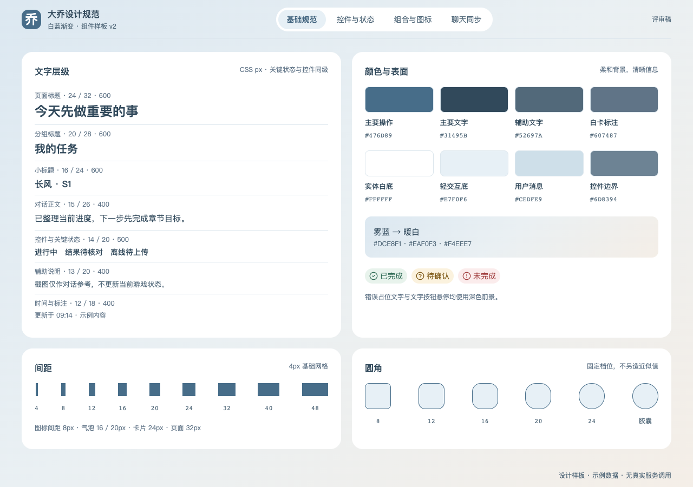
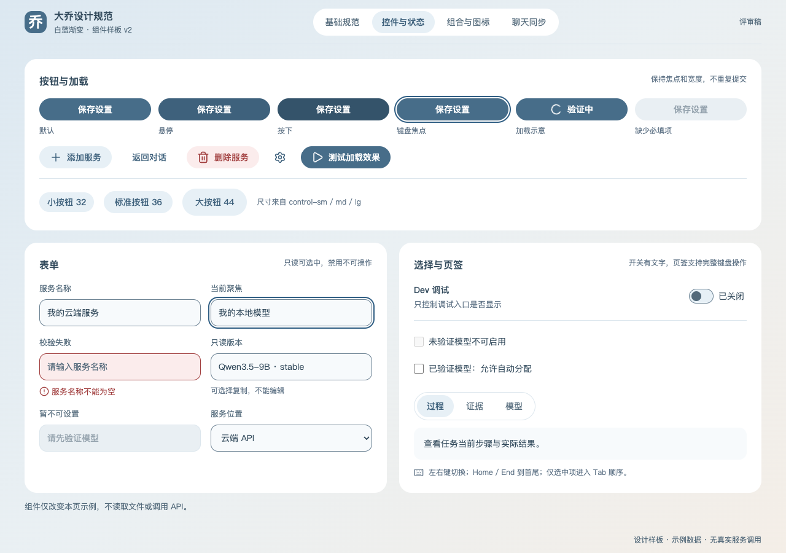
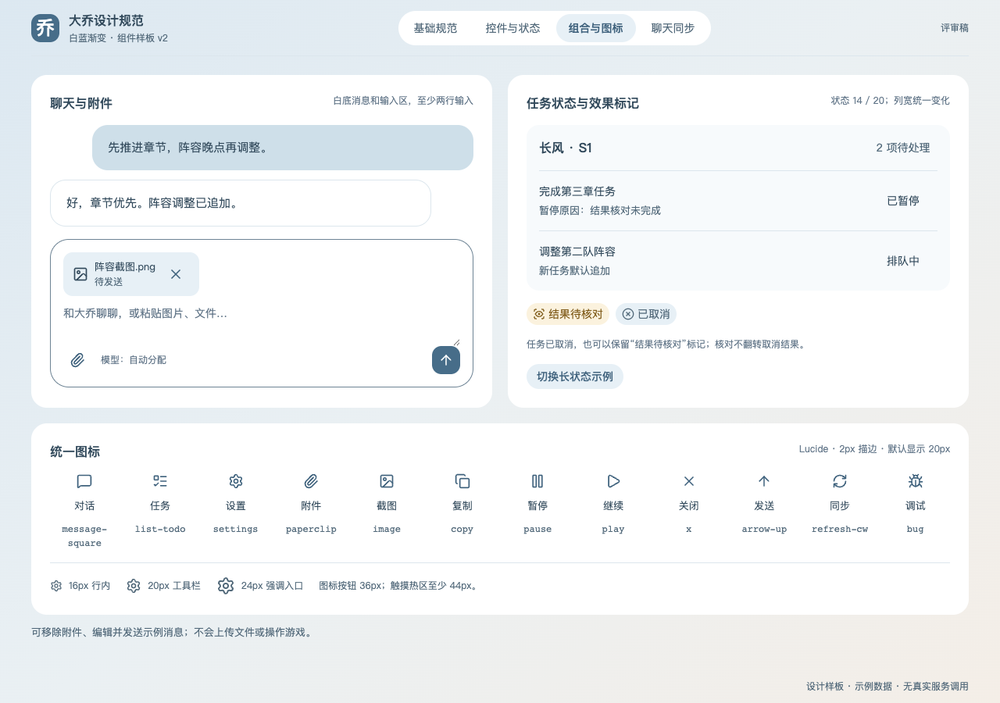
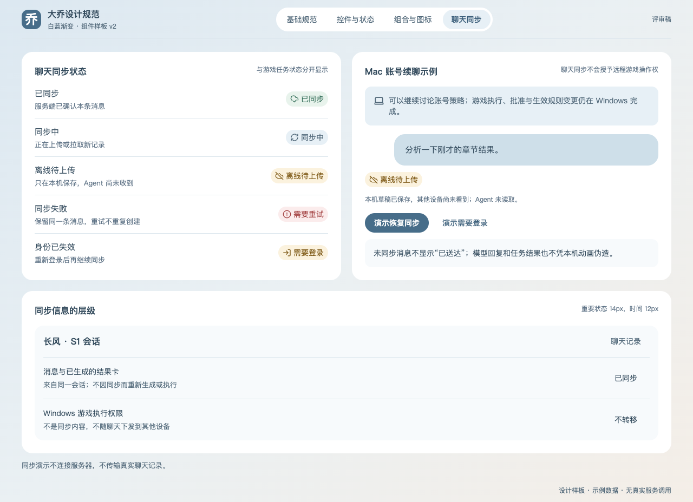

# 大乔界面设计规范 v2

2026-10-29 · 联合评审修订稿 · 配套大乔 PRD v2

本版保留白蓝、温和渐变的视觉方向，修正组件与规范不一致的问题，补齐模型管理、任务状态和跨设备聊天同步需要的呈现规则。产品功能与权限以 [PRD v2](../daqiao-prd-2026-10-29-v2/PRD.md) 为准；本目录不实现业务服务，不修改旧版文件。

[组件样板](components.html#foundations) · [设计 tokens](tokens.json) · [CSS 变量](tokens.css) · [旧版规范](../daqiao-design-system-2026-10-28-v1/DESIGN-SYSTEM.md)

## 1 本次收口

| 问题 | v2 规则 |
| --- | --- |
| 关键状态降到 12px | 任务状态、同步状态、关键失败提示统一 14／20；时间和类型标注仍为 12／18 |
| 88px 列挤压长状态 | 88px 是整组基准；可整组扩为 132px 或完整换行，不缩字和省略关键结果 |
| 错误／悬停配色不足 | 错误 placeholder 用 secondary；ghost 默认、悬停均用 primary-hover |
| 加载变成灰色禁用并丢焦点 | 使用 aria-busy／aria-disabled，保留 spinner、按钮尺寸与焦点，事件处理阻止重复触发 |
| 只读与禁用混用 | 只读正常对比度、可选中复制；禁用只用于当前不能操作的控件并解释原因 |
| 大小按钮、页签行为不完整 | 实现 sm／md／lg；路由导航与内容页签分开；三页签支持 Left／Right／Home／End |
| CSS 多层补丁 | 合并成按组件组织的一份样式，每个核心规则只有一个来源 |
| 跨设备聊天同步 | 新增同步中、已同步、离线待上传、需重试、需登录组件，独立于游戏任务状态 |

PRD v1 的十张旧图保留作历史对照；PRD v2 的新样图使用这一版 token。样板中的状态与数字是演示，不代表模型或同步服务已验证。

## 2 字体与层级



所有尺寸使用 CSS px，随系统缩放正常放大。桌面样图画布不等于应用固定窗口；不能用整页缩放或裁切来适配窄窗口。

```css
font-family: "Segoe UI", "PingFang SC", "Microsoft YaHei UI", "Microsoft YaHei", sans-serif;
/* 模型 ID、代码、Trace */
font-family: "Cascadia Code", "SFMono-Regular", Consolas, monospace;
```

| 层级 | 字号／行高 | 字重 | 用途 |
| --- | --- | --- | --- |
| 页面标题 | 24／32 | 600 | 任务、设置、账号详情 |
| 分区标题 | 20／28 | 600 | 模型服务、任务详情大分区 |
| 小标题 | 16／24 | 600 | 账号分组、卡片标题 |
| 对话正文 | 15／26 | 400 | 消息、解释、简报 |
| 控件与列表 | 14／20 | 500；长列表用 400 | 按钮、导航、输入、任务名 |
| 关键状态 | 14／20 | 400 或 500 | 任务结果、效果核对、同步、关键附件失败 |
| 辅助说明 | 13／20 | 400 | 字段帮助、任务副标题、一般错误说明 |
| 时间与标注 | 12／18 | 400 | 时间、文件类型、版本附注 |
| 技术内容 | 13／20，等宽 | 400 | Trace、工具参数、模型 ID |

12px 不承载操作名称或关键结果。普通正文不小于 14px；对话正文保持 15px。字体可能不包含所有字重，Windows 验收需检查实际效果；重点同时通过尺寸、位置和状态文字表达，不只靠 400／500 的细微变化。

数字可用等宽数字。长模型 ID、文件名与状态允许换行或完整查看，不能靠缩小字号保住一行。品牌“乔”采用文字标记并继承可用字体，不依赖只在 Mac 安装的字体。

## 3 颜色与对比度

| 用途 | Token／色值 | 限制 |
| --- | --- | --- |
| 应用背景 | `bg-start #DCE8F1` → `bg-mid #EAF0F3` → `bg-end #F4EEE7` | 140deg，0／48／100%；只用于应用背景 |
| 内容表面 | `surface #FFFFFF` | 助手气泡、输入区、卡片、弹层为实体白底 |
| 轻分组 | `surface-subtle #F7FAFC` | 表单和次级区域 |
| 选中／次按钮 | `surface-soft #E7F0F6` | 配深色文字 |
| 用户消息 | `surface-user #CEDFE9` | 文字用 text-primary，不降为浅色说明 |
| 主文字 | `text-primary #31495B` | 标题、正文、重要数值 |
| 次文字 | `text-secondary #52697A` | 渐变／浅蓝底辅助说明、错误占位字 |
| 次要标注 | `text-muted #607487` | 只用在白底或 surface-subtle；不用在错误／用户消息底 |
| 主操作 | `primary #476D89` | 白字；hover #3E617C，pressed #34536A |
| 文字按钮 | `primary-hover #3E617C` | 默认与 hover 都保持深色，hover 底为 surface-user |
| 控件边界 | `border-control #6D8394` | 输入框、开关等必要边界 |
| 装饰分隔 | `border-subtle #DCE6ED` | 不承担控件可识别性的唯一线索 |
| 焦点 | `focus #315F84` | 2px outline，offset 2px |
| 成功 | `success #2F6B55`／底 `#E8F3EC` | 已完成、同步成功 |
| 需处理 | `warning #805C1A`／底 `#FBF2DE` | 待确认、结果待核对、离线待上传 |
| 失败 | `danger #A13E3E`／底 `#FBECEC` | 失败原因、需重试 |
| 禁用 | 字 `#94A2AD`／底 `#E9EFF3` | 只表示不可操作；原因放旁边正常文字 |

不通过整块 opacity 让普通说明变淡。状态总有文字，颜色不是唯一提示。

普通文字目标为至少 4.5:1，必要边界和状态图形至少 3:1；依据 [W3C 文字对比度](https://www.w3.org/WAI/WCAG22/Understanding/contrast-minimum.html)与[非文字对比度](https://www.w3.org/WAI/WCAG22/Understanding/non-text-contrast.html)。本版增加两个实际状态组合：错误占位字 `#52697A/#FBECEC` 约 5.0025:1；ghost 悬停 `#3E617C/#CEDFE9` 约 4.7902:1。完整组合由验证脚本重新计算；配色通过不替代焦点、缩放和实际页面检查。

## 4 间距、布局与响应式

基础网格为 4px。使用 4、8、12、16、20、24、32、40、48px；控件内部的几何居中可用计算式，不为同义样式新增近似值。

| 场景 | 规格 |
| --- | --- |
| 图标与文字 | 8px，紧凑状态标签 4px |
| 标题与说明 | 4px |
| 字段标签到控件 | 8px |
| 字段之间 | 16px |
| 卡片内边距 | 20px 或 24px，同类一致 |
| 消息内边距 | 上下 16px、左右 20px |
| 相邻消息 | 12px；说话人切换可用 20px |
| 大分区 | 32px |
| 页面边距 | 宽窗口 32px，窄窗口 16px |

侧栏 224px，收拢后 64px；顶栏 72px；聊天最大宽 800px；普通内容最大宽 1120px；设置内导航 160px。任务状态列基准 88px，同组所有行和计数保持同宽；长内容可让整组列宽同步扩至 132px，也可完整换行。不能只放大一行，或将关键状态缩成 12px。

1024px 为紧凑断点，768px 为窄窗口断点，均记录在 tokens 中。CSS 原生媒体查询不能直接使用自定义变量，因此媒体查询里的数值必须与 `breakpoint-compact`／`breakpoint-narrow` 校验一致。窄窗口双列表单转单列、侧栏按需展开；纵向正常滚动，不裁掉输入区和按钮。组件展示器也使用这两个断点，不引入另一套 1279／850px 规则。

## 5 圆角与层级

小标签／代码框 8px；输入框／附件 12px；小面板／菜单 16px；普通卡片／气泡 20px；输入区／弹窗 24px；胶囊与头像使用 999px／50%。可用一个 8px 气泡方向角，其他角保持 20px。

边框默认 1px。普通白卡不用厚阴影；浮层阴影 `0 8px 24px rgba(49,73,91,.10)`，弹窗 `0 16px 48px rgba(49,73,91,.16)`；遮罩 `rgba(27,44,58,.36)`。层级为普通内容 0、顶栏 10、菜单 20、弹窗 30、提示 40。

## 6 图标与可操作区域

Lucide 线性图标统一使用 24×24 viewBox、2px 描边、圆端点、默认无填充，跟随 `currentColor`。显示尺寸：16px 行内、20px 工具栏、24px 强调入口。正式操作不混用 Emoji 或 `⚙＋↑` 字符；品牌字不受此限制。

| 功能 | 图标 |
| --- | --- |
| 对话／任务／设置 | MessageSquare／ListTodo／Settings |
| 附件／发送／新增 | Paperclip／ArrowUp／Plus |
| 图片／文件／复制 | Image／FileText／Copy |
| 画面／放大／关闭 | Monitor／Maximize2／X |
| 暂停／继续／删除 | Pause／Play／Trash2 |
| 完成／等待／需确认 | CircleCheck／Clock3／CircleHelp |
| 核对效果／失败／取消 | ScanEye／CircleAlert／CircleX |
| 加载／展开／调试 | LoaderCircle／ChevronDown／Bug |
| 同步完成／同步中／离线 | CloudCheck／RefreshCw／CloudOff |
| 登录／设备／键盘 | LogIn／Laptop／Keyboard |

图标按钮为 36×36px；触摸热区至少 44×44px，图标不必跟着放大。只有图标的操作必须同时有可访问名称与 hover／focus 提示，装饰图标不重复朗读。组件样板使用本机 Lucide 1.8.0；迁入应用时需核对现有 React 依赖的名称与版本，不能假定 UMD 名称直接通用。参考 [Lucide 官方用法](https://lucide.dev/guide/lucide)。

## 7 按钮与表单



按钮提供 `sm` 32px、默认 36px、`lg` 44px 三档，文字统一 14／20、500。左右内边距依次 12／16／20px。主要操作使用深蓝白字，次按钮浅蓝深字，文字按钮透明深字；危险操作使用危险色。一个局部操作组最多一个主要操作。

| 状态 | 视觉与行为 |
| --- | --- |
| 默认／hover／pressed | 按规定色阶变化，不改变尺寸和布局 |
| 键盘焦点 | 2px 外环，Tab 可见；Enter／Space 触发 |
| 加载 | 保留按钮节点、焦点、宽度、spinner 和过程文字；`aria-busy=true`、`aria-disabled=true`；事件处理拒绝重复调用 |
| 禁用 | 使用原生 disabled；灰色只用于控件本身，在旁边说明缺少什么条件 |
| 错误 | 给具体原因并恢复可修复的操作，不靠闪红或短时 toast |

加载不等于禁用。不能为做加载态而设原生 disabled 把焦点移走，也不能只改文字而丢掉图标。真正不可操作的字段和按钮才使用 disabled。

表单默认高 44px，横向内边距 12px、纵向居中、圆角 12px，文字 14／20。标签和说明 13／20，标签常驻，placeholder 不代替标签。错误态含边界、图标、文字和 `aria-invalid`／关联说明；错误 placeholder 单独用 secondary。

只读字段保持普通文字对比度，能聚焦、选择和复制；禁用字段不能操作，原因与字段分开。密钥默认遮蔽，显示必须主动触发，示例不接收真实密钥。输入区从两行起，不以过小 min-height 挤成单行；用户添加多行内容时在合理高度内滚动。

开关外层 label 提供至少 44px 高的可点击区域，轨道 40×24px、滑块 16px，并显示“已开启／已关闭”。复选框标签同样扩大热区。未验证模型的启用控件必须禁用；“备用”指具体模型角色，不是给整项服务自动授予备用资格。

## 8 导航与内容页签

应用“对话／任务／调试”是页面路由，使用 `nav` 与链接、`aria-current=page`；不伪装成 ARIA tabs。组件展示器顶部也是路由导航。

同页切换过程／证据／模型等内容时，才使用 `tablist`／`tab`／`tabpanel`。仅当前选中 Tab 的 tabindex 为 0，其他为 -1；左右键分别向前／后移动并循环，Home／End 到首／尾；aria-selected、面板 aria-labelledby 和实际内容同步。至少用三个页签验收，不能用两个选项掩盖左键方向错误。

统一采用实体白底外壳、浅蓝选中底与深色文字的胶囊外观；选项高 36px、外层内边距 4px，总高 44px。选择态同时通过语义属性和字重体现，不只依赖颜色。

## 9 对话与任务组件



助手消息与输入区为实体白底，用户消息为 `surface-user`，正文 15／26。输入区圆角 24px、内边距 16px；附件在文字区上方排列，名字 13／20，类型和时间 12／18，关键失败提示升至 14／20。关闭附件用正式 36px 图标按钮，不因视觉图标小而缩热区。

任务分组标题 16／24、任务名和状态 14／20，副标题 13／20，单行最小 56px。颜色、图标和状态词按下表统一；“连接失败”等是原因，不能新增成任务主状态。

| 任务主状态 | 颜色 | 图标 | 说明 |
| --- | --- | --- | --- |
| 排队中 | secondary／soft | ListOrdered | 尚未轮到，普通排队不用警告色 |
| 进行中 | primary-hover／soft | LoaderCircle 或 CirclePlay | 正在推进，不承诺每一步都在点击 |
| 等待中 | secondary／soft | Clock3 | 等待游戏条件；附等待原因 |
| 待确认 | warning／warning-bg | CircleHelp | 明确需要用户处理 |
| 已暂停 | secondary／soft | Pause | 附用户暂停／身份／服务等原因 |
| 已完成 | success／success-bg | CircleCheck | 目标结果已核实 |
| 未完成 | danger／danger-bg | CircleAlert | 本次结束未达目标，附原因 |
| 已取消 | secondary／soft | CircleX | 不再推进，不抹掉已发生效果 |

“结果待核对”是独立效果标记，可与已暂停或已取消并存，不覆盖任务终态；解决核对问题也不把取消改成成功。定时计划使用已启用／已停用，单次简报运行仍使用任务实例状态，二者分开计数。分组计数只统计 PRD 定义的非终态实例，不把永久定时计划当永远未完成的任务。

## 10 跨设备聊天同步组件



聊天同步状态与游戏任务状态分开，不能用“在线”圆点替代消息送达。关键同步状态文字统一 14／20，更新时间 12／18。

| 同步状态 | 呈现 | 用户理解 |
| --- | --- | --- |
| 已同步 | success＋CloudCheck | 服务端已确认这条消息／对应同步进度 |
| 同步中 | secondary＋RefreshCw | 正在上传或拉取；不保证已送达 |
| 离线待上传 | warning＋CloudOff | 本机保留，其他设备和 Agent 尚未收到 |
| 需要重试 | danger＋CircleAlert，重试按钮 | 保留原消息身份，重试不创建第二条 |
| 需要登录 | warning＋LogIn，登录入口 | 身份无效；未上传记录保留，不冒称已同步 |

Mac 可以同步查看并继续账号会话，但不触发远程游戏执行、批准操作或改变 Windows 正在生效的执行规则。对话中的游戏计划卡在 Mac 上应明确标为建议／未执行，不能因记录同步而自动生成新执行指令。实际平台权限以 PRD v2 为准。

消息、附件上传、Agent 是否读取、游戏任务进度分别显示，不用一个通用“完成”混盖。同步错误尽量放在对应消息或会话状态旁，不刷屏；恢复后保留可回查的时间与结果。同步状态动画不触发模型或重复生成回复。

## 11 动效与验收

hover／pressed 120ms，展开 180ms，大弹层最多 240ms；缓动统一 `cubic-bezier(.2,0,0,1)`。加载 spinner 只在真实进行中使用，旁边保留文字。`prefers-reduced-motion` 关闭旋转、位移和非必要过渡，过程仍可理解。

组件验收至少覆盖：

1. 32／36／44px 三种按钮真实计算尺寸；状态文字14／20。
2. 加载前后宽度不变，焦点仍在原按钮，连续触发只产生一次模拟调用。
3. 三页签 Left／Right／Home／End 正确，只有选中项进入 Tab 顺序。
4. 只读值可选复制，禁用项确实不可触发并有原因；开关有44px热区与开关文字。
5. 错误 placeholder、ghost 默认／hover、状态标签等实际颜色组合通过目标，而不只抽查默认色板。
6. 88px 与长状态宽列下，各行与分组计数保持同列；不截断关键文字。
7. 1280、1024、768、390px 下无横向溢出，文字放大和较低窗口高度不裁切操作。
8. 图标全部渲染，无 Emoji 控件；图标按钮有名称及提示。
9. 离线待上传、同步中、已同步、需重试、需登录可以区分，重试不冒充真实送达。
10. Mac 续聊样板不出现可操作的远程游戏执行／批准入口；无语音、地图、百科、人工接管入口回流。

本目录的 `verification.json` 记录实际执行的静态／浏览器检查，不代表 Windows 实机、真实同步、模型或游戏能力已经通过。

## 12 交付与迁移

`tokens.json` 是值的来源；`tokens.css` 由构建脚本生成。变量名为 `--dq-*`，组件按职责分块组织，不保留相互覆盖的历史补丁。未在本样板使用的布局或弹层 token 仍可服务完整页面，不能把“变量名存在”描述成所有 token 都已被场景覆盖。

PRD v2 页面与本规范共用 token；旧 PRD v1／设计规范 v1 保留。应用接入时继续复用当前桌面工程，设计稿文件不直接替代其业务实现；真实状态、能力验证与同步结果由后端提供。

本版交付：`DESIGN-SYSTEM.md`、阅读版 HTML、`tokens.json/css`、`components.html/css`、四张样板图、验证结果。模型费用、数据去向、后台运行策略和存储期限等业务待定项不在视觉规范里代为拍板。
