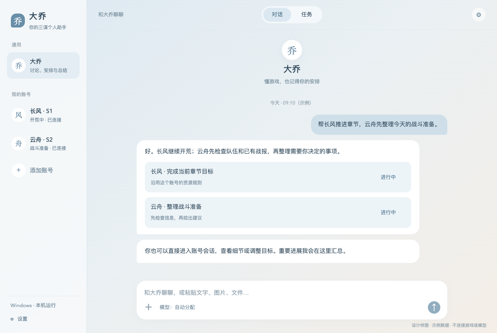
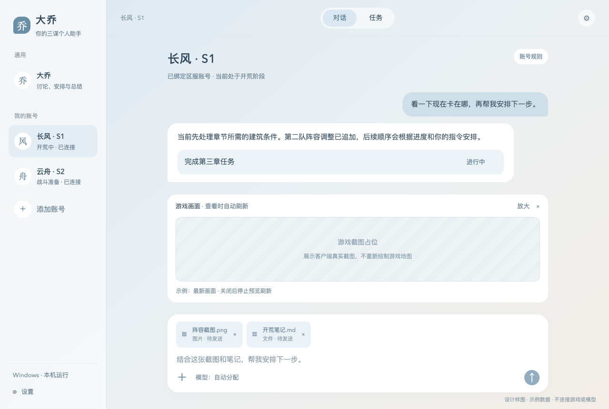
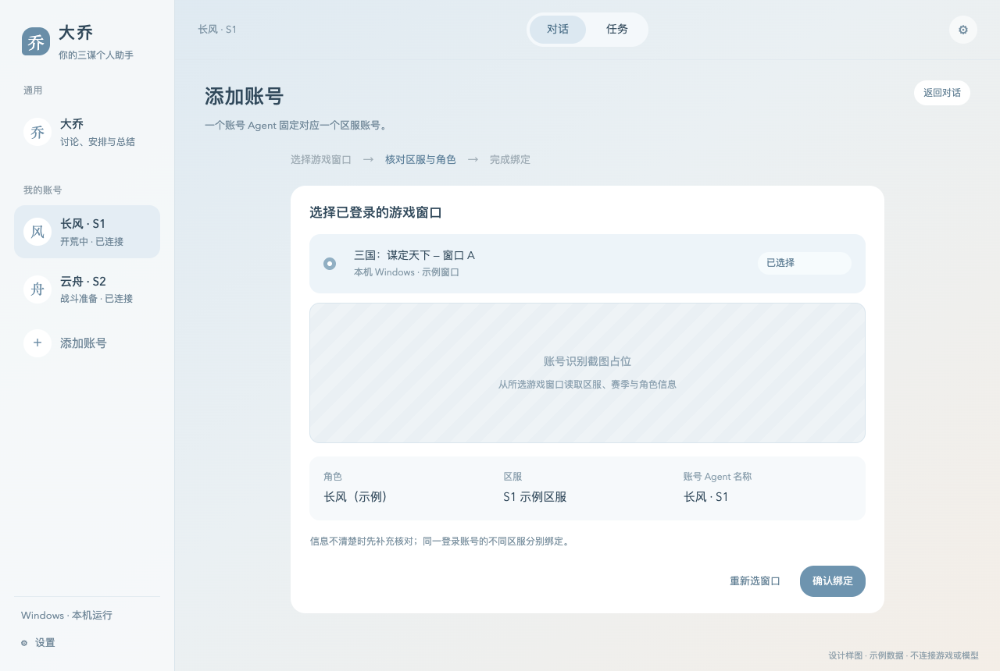
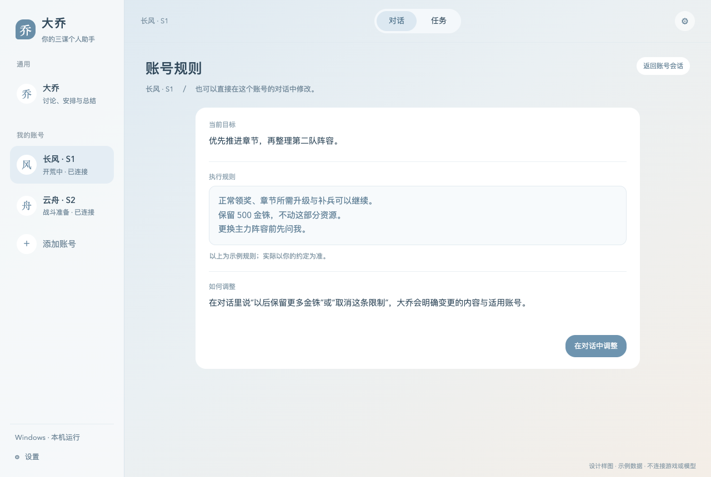
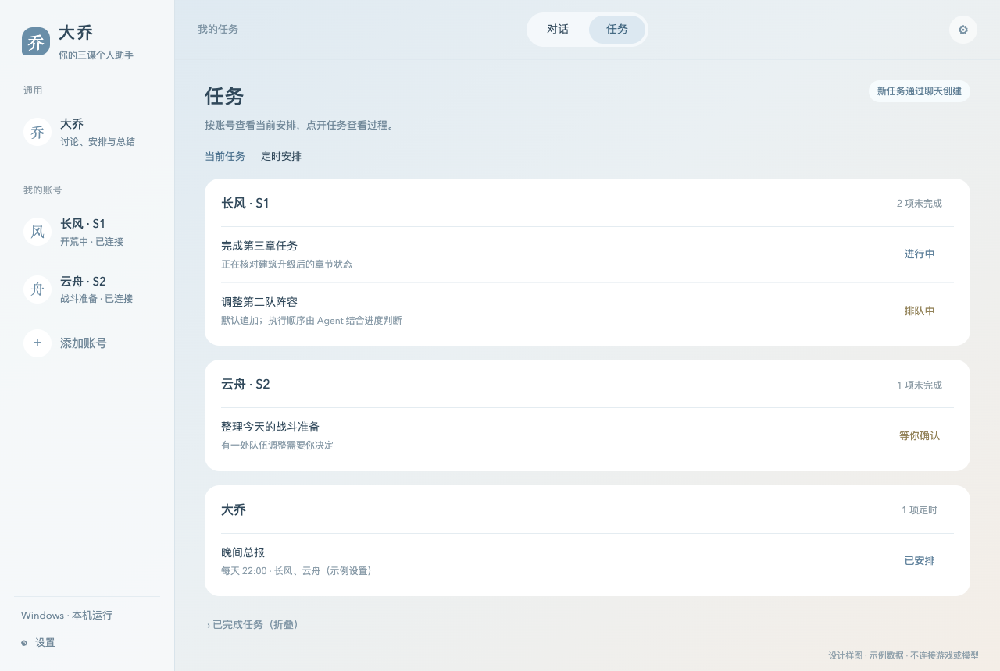
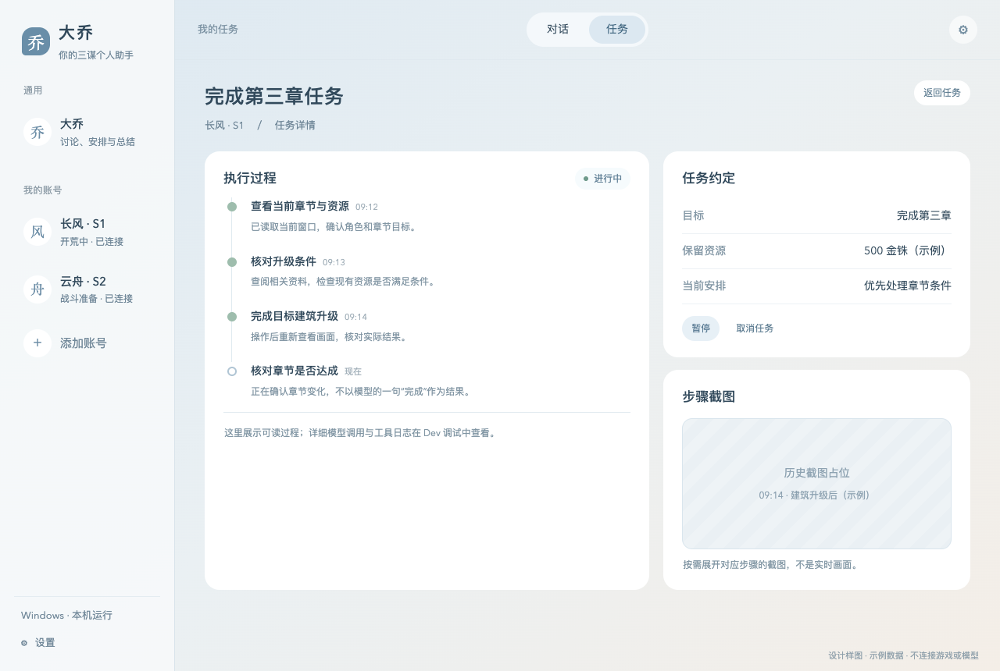
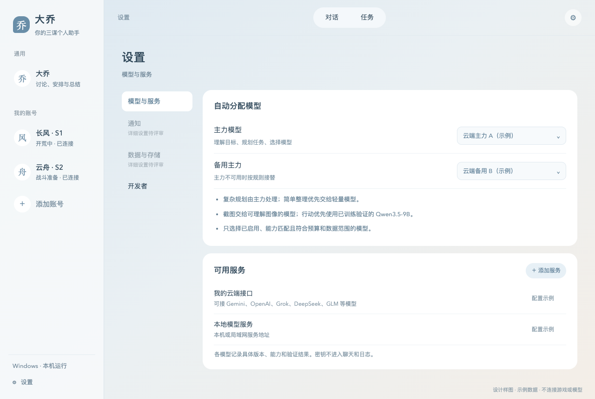
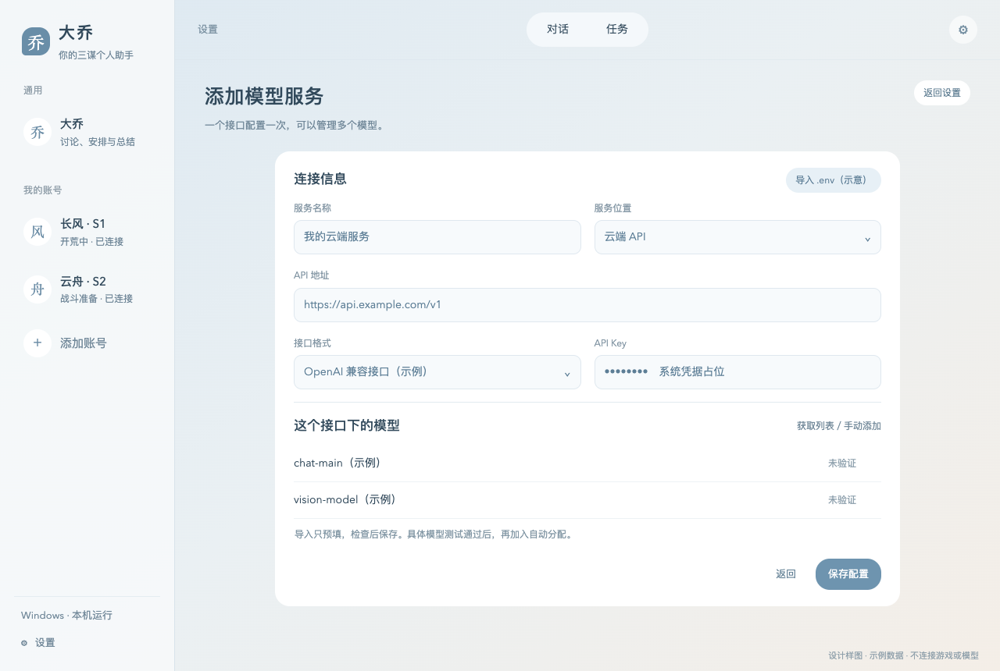
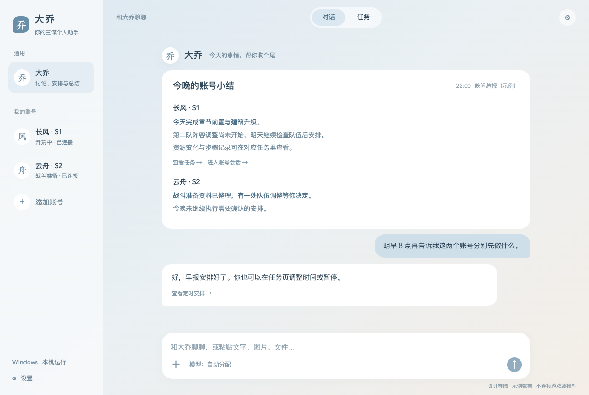
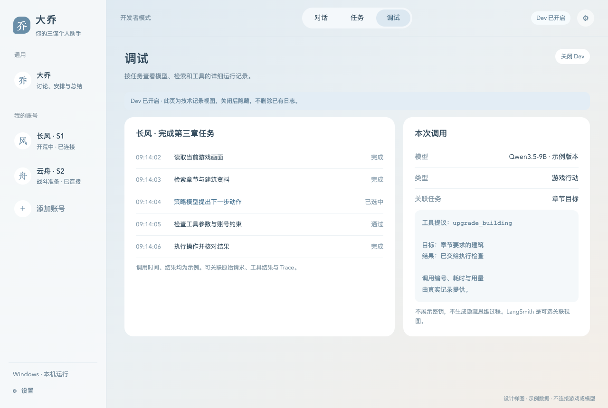

# 大乔 三谋个人 Agent PRD v1

2026-10-28 · 产品与交互评审稿 · Windows 为游戏执行端，Mac 为通用助手与开发端

大乔是《三国：谋定天下》的个人助手与游戏专家：理解玩家目标，结合游戏知识和账号状态制定计划，把任务交给对应账号 Agent，持续执行、检查结果，并在需要时主动汇报。产品覆盖 PVE 开荒和 PVP 战斗，首条可用执行链优先落地 PVE。

本版整理本轮已确认的产品决定，并配套重新绘制的设计样图。样图中的账号、进度、模型名称、时间与数值均为示例，不代表已实现功能或真实运行结果。未确定的设置细节集中列在第 16 节，不作为开发默认值。

[打开设计样图](mockups.html#chat) · [HTML 阅读版](PRD.html)

## 1 产品目标与边界

### 1.1 核心目标

- 玩家通过对话表达目标和限制，不必逐步指挥点击，也不必手动管理每一次模型调用。
- 大乔能够理解多个账号的情况，给对应账号 Agent 安排任务，并汇总结果。
- 账号 Agent 结合截图、历史与 RAG 检索资料推进游戏任务；RAG 指按问题查找相关资料，再交给模型使用。
- 玩家能看懂当前在做什么、为什么等待、结果如何，并能暂停、继续或取消任务。
- 保留完整执行记录，为自研游戏策略模型的 SFT 示范学习、PPO 奖励训练和效果评估提供数据。

### 1.2 首版不做

独立总览／仪表盘、独立地图、可见百科／攻略站、普通用户独立运行记录页、语音输入与实时语音、人工接管／交还控制权专用入口、云 Windows 执行集群、移动端专用产品界面。

没有游戏地图 API，不在产品中重建实时地图。游戏信息以截图识别为基础。移除人工接管入口不影响已有任务暂停／继续，也不移除后台输入协调、取消和异常停机机制。

## 2 对象与运行平台

| 对象 | 职责 | 不承担的职责 |
| --- | --- | --- |
| 大乔 | 通用对话、理解目标、规划、向账号 Agent 派任务、汇总多个账号结果 | 不直接绕过账号运行框架点击游戏 |
| 账号 Agent | 固定服务一个区服账号，维护独立会话、状态、任务和账号规则 | 不在同一 Agent 内切换多个区服角色 |
| 区服账号 | 此处指一个具体登录账号下的区服角色；同一登录账号的不同区服分别绑定不同 Agent | 不是仅用窗口标题或昵称识别身份 |
| 任务 | 用户目标及约束、进度、结果、执行过程；可由聊天创建 | 不等同于一次模型请求或一次点击 |
| 模型服务 | 提供一个或多个模型的云端、本机或局域网接口 | 不直接拥有游戏窗口控制权 |
| QA-agent | 管理游戏知识、检索证据、回答问题 | 不作为单独百科页面，也不执行游戏操作 |

Windows 运行大乔、账号 Agent 和游戏客户端。Mac 可用于开发、通用对话、资料处理和模型配置，但不能操作三谋客户端；首版不把 Mac 设计成 Windows 的远程游戏控制台。CUDA 训练和自建推理继续在云 Linux GPU 上运行，Mac 不作为 Windows 调用云模型的必经中转。

## 3 信息架构与视觉规范

| 入口 | 内容 | 显示规则 |
| --- | --- | --- |
| 对话 Tab | 大乔通用会话、各账号 Agent 会话 | 默认进入；左侧按 Agent／账号分组 |
| 任务 Tab | 大乔和各账号任务、执行详情、定时简报 | 与对话并列，不固定挤在聊天右侧 |
| 设置齿轮 | 模型与服务、已确认的 Dev 开关，以及后续待审设置 | 全局入口，不新增第三个常驻主 Tab |
| 账号详情 | 绑定信息与账号规则 | 从对应账号 Agent 打开 |
| 调试 Tab | 详细技术日志、模型与工具调用、Trace | 仅 Dev 开关开启后出现 |

视觉采用雾蓝到暖白的柔和渐变、白色圆角消息与克制的蓝色按钮。主区域保留足够留白，避免多列数据卡堆叠。桌面样图以 1280×860 为基准；较窄窗口可折叠侧栏，任务和设置表单顺序重排。

任务分组标题与任务名保持左对齐；“X 项未完成”和各行状态使用同一右侧列，样图宽度为 88px。状态同时有文字，不仅依赖颜色。所有交互支持键盘焦点；空态、加载、失败和离线必须有明确文案。

## 4 大乔通用会话

### 页面内容

- 左侧上方固定大乔通用入口，下方按账号 Agent 展示会话；切换后显示对应历史，不把不同账号记录混成一个上下文。
- 中间以消息为主。大乔可以给建议、回答知识问题，也可以把一句话拆成多个账号任务。
- 输入框支持文字、截图／图片与文件，不出现麦克风或语音按钮。
- 输入区显示“自动分配”；不要求用户为每个 Agent 手动选择聊天模型。
- 全局设置从齿轮进入；任务详情通过消息中的任务卡或任务 Tab 打开。

### 账号与任务归属

没有指定账号的通用讨论留在大乔会话。涉及实际账号操作但无法确定对象时，先在聊天中问清；不能任选一个账号执行。直接在某个账号会话说话时，默认对象是其绑定的区服账号。

大乔发起的多账号任务，结果由大乔汇总后回到原会话；直接给账号 Agent 的任务，由该账号会话反馈。内部保留来源关联，用于正确回复，但界面不显示生硬的“由谁下发／谁安排”字段。

### 复制、粘贴与附件

| 输入或操作 | 预期行为 |
| --- | --- |
| 粘贴文字 | 插入光标位置，可以编辑；不自动发送 |
| 粘贴图片 | 生成待发送附件，提供预览和移除；同一内容不因剪贴板多种表示重复添加 |
| 粘贴文件 | 接收文件本身，而不是把本地路径当文件内容；显示名称及处理状态 |
| 发送前移除附件 | 只移除当前草稿附件，不删除本地原文件 |
| 复制消息文字 | 支持选择复制及整段复制 |
| 复制图片／文件 | 复制可供其他应用粘贴的图片或文件对象，不只复制文件名 |
| 只有附件、没有文字 | 可以发送，必要时在会话里询问用途 |

Windows 使用 Ctrl+C／V，Mac 使用 ⌘C／V。发送后附件保留在对应聊天记录；只有用户明确说“加入游戏资料”等入库指令，才进入长期知识整理流程。账号截图属于对应账号，不自动变成通用攻略。

一般附件的格式白名单、大小／数量上限、保留期仍待确认；游戏截图的处理限制见第 10 节。

## 5 账号会话与账号绑定

账号会话显示自然名称，例如“长风 · S1”，不反复附加“Agent”。顶部可以打开账号详情、账号规则和游戏画面。状态与任务引用都绑定到该账号，切换会话不改变任务所属账号。

“游戏画面”是按需打开的当前截图预览：打开后自动刷新，关闭即停止。它不是持续视频流，也不是某一步历史截图。页面显示采集时间；断开连接时保留最后画面并标记已过期，不把旧图装成实时状态。任务历史截图在对应步骤中查看。

### 初次绑定

1. 在 Windows 选择一个已登录的游戏窗口。
2. 读取可识别的账号／区服／角色信息，让用户核对。
3. 确认后创建固定绑定；之后启动恢复原绑定，并重新核对窗口与身份。
4. 窗口消失、身份不符或无法确认时，显示需重新连接／核对，不继续沿用旧窗口引用。

首版界面不索要或保存游戏密码；不增加账号 Agent 内的多角色切换器。解绑、删除 Agent、账号重命名及更换区服的详细流程尚未定稿。

### 账号规则

规则留在对应账号详情，也可以通过聊天修改。例如：“优先推进章节，保留 500 金铢，调整主力阵容前问我。”其中 500 只是示例，不是产品默认值。

用户可以查看、修改、移除已有规则。允许范围内的明确任务直接推进，超出规则时在会话中询问，不用逐个工具勾选授权。规则修改有版本记录；不能通过改一段提示词，静默扩大已运行任务的许可或补满预算。

## 6 任务列表与模型调度

### 列表与创建

任务通过聊天产生，不再使用三步“新建任务”表单。缺少对象、目标或关键限制时，在会话中补齐；需要明确决定时使用简短消息卡。

任务 Tab 按实际执行的账号分组，另有大乔通用任务组。未完成任务优先，已完成任务可折叠。列表先展示任务名和状态，点开再看过程及操作，不同时摆出所有日志、截图和按钮。

### 调度规则

**由 LLM 决定调度，新任务默认追加。**主力模型根据最新指令、任务依赖、当前进度和可用资源判断执行顺序，必要时调序或切换。用户说“先做这个”是明确优先指令，但不要求用户手动维护队列。

- 普通追加不立即打断当前任务；实质性调序简短说明原因。
- 同一账号默认不并行进行互相冲突的游戏操作；不操作窗口的资料查询和聊天可继续。
- 不同账号可以并行推进任务；同一 Windows 交互桌面的键鼠输入仍由程序统一排队，不能同时抢占。
- 切换和恢复时重新核对账号状态、任务是否仍有必要、前置条件是否改变，不继续播放旧点击序列。
- 模型决定“先做什么”；运行框架检查“这一步现在能否执行”。两者分开。

### 用户可见状态

| 状态 | 含义 | 可用操作 |
| --- | --- | --- |
| 排队中 | 已接收，等待调度或依赖 | 查看、取消 |
| 进行中 | 正在观察、决策、操作或验证 | 查看、暂停、取消 |
| 等待中 | 等待可识别的游戏条件／资源 | 查看等待原因、暂停、取消 |
| 待确认 | 需要用户补信息或批准超出规则的事项 | 回到问题、确认或拒绝 |
| 已暂停 | 用户暂停或当前无法继续 | 继续、取消；继续前重新检查 |
| 已完成 | 目标经结果检查确认完成 | 查看结果与过程 |
| 未完成 | 预算、条件或错误导致本次结束 | 查看原因，按需另作安排 |
| 已取消 | 不再推进该任务 | 查看已发生的效果，不自动恢复 |

这些是界面状态，不替代后端任务、操作、重试和效果账本。一个点击返回成功，不能直接把任务显示为已完成。

## 7 任务详情与执行过程

任务详情包含：任务名称、账号、目标、当前状态、关键约束、可读步骤、结果与必要证据。正常过程用“查看章节要求”“检查资源”“升级目标建筑”“确认结果”等人话，不默认展示原始 JSON。

每个步骤展示状态和实际结果；需要时展开截图、引用资料或错误说明。历史截图必须附时间与所属步骤。暂停／继续／取消在任务详情中操作，状态同步到列表和原会话。

取消停止后续推进，但不撤销已经发生的升级、领奖或资源消耗。结果尚不明确时展示“正在核对／结果待确认”，不能当作没有执行，也不能直接重复发送。恢复保留原进度、已用额度和未决操作。

本版不加入“我来操作”“交回 Agent”或同类专门控制权 UI。

## 8 模型与服务设置

### 8.1 配置关系

用户指定**主力模型和备用主力模型**。其余调用由主力模型按规则从可用模型中选择，界面默认显示“自动分配”。不采用上一轮草案中的“每个账号在输入框固定选择一个聊天模型”。

可用模型支持 Gemini、OpenAI、Grok、DeepSeek、GLM 等云端 API，以及本机和局域网模型服务。具体协议通过适配器连接，不能仅凭服务商名称假定模型支持图片、工具调用或所有参数。

| 设置 | 用途 |
| --- | --- |
| 模型服务 | 接口协议、地址、凭据引用；同一接口下管理多个 model |
| 主力模型 | 理解用户目标，负责复杂规划、模型分配与结果汇总 |
| 备用主力 | 主力服务不可用时，由程序按已配置顺序接替，不等故障模型自行判断 |
| 可用模型记录 | 模型 ID、部署位置、已验证能力、用量／费用信息、允许处理的数据范围、启用状态 |
| 分配规则 | 按任务需要、能力、成本、延迟和数据范围选择模型 |

分配规则的首版方向：复杂规划交给主力；简单整理和摘要优先轻量模型；截图交给视觉模型；游戏行动优先采用训练并验证后的 Qwen3.5-9B。Gemini 保留为已有视觉基线，不写死为唯一选择。主力模型只在满足能力和配置约束的候选中选择，不能自己修改额度、放宽数据范围或启用未验证服务。

实际使用的模型和切换原因可从任务详情查看，完整调用记录放在 Dev 调试中。重试次数、故障判定阈值和费用额度具体数值待定。

### 8.2 添加服务

支持手动填写和 `.env` 导入预填两种入口。导入后检查协议、地址、模型等字段，再保存；不因导入就自动调用模型或覆盖现有配置。`.env` 作为文本解析，不执行其中的 shell 命令；不识别或有歧义的字段交给用户确认。

同一接口只保存一份服务配置，下面选择或手动添加多个模型。云端、本机、局域网使用同一套管理入口；本地服务是否需要 Key 由服务本身决定。不同服务即使 model ID 相同，也保留各自的连接身份。

保存配置后显示“未验证”。获取模型列表不等于模型可调用；对选定具体模型测试所需能力，成功后才允许参加自动分配。测试入口应说明会产生一次或一组小型请求，失败保留配置并显示具体原因。文本调用成功不自动获得视觉或工具调用能力标记。

密钥放入操作系统凭据存储，应用只持引用；不进入聊天、模型提示词、运行日志、LangSmith 或普通配置导出。样图不接受真实密钥。

### 8.3 与自训策略的关系

Qwen3.5-9B、TRL＋PEFT 的 SFT、verl＋SGLang 的 PPO，以及 9B Actor＋2B Critic 的现有工程选型不变。本 PRD 增加的是产品层的模型服务与分配方式，不重新定义训练算法。

日常产品任务可以按规则使用多个模型；训练和固定评测必须锁定参与模型、版本、输入构建与分配配置。中途备用模型或教师接替，记录实际来源并隔离受影响的 PPO 学习片段，不能把混合模型结果记为 Qwen 的训练收益。运行中的版本变更按既有协议处理，不静默替换在途策略。

## 9 知识与资料

不增加可见百科／攻略站。用户在对话中提问、贴链接或发送资料，QA-agent 在后台整理和检索；答案及任务建议按需展开来源。

| 三类知识来源 | 主要内容 | 必须保留的信息 |
| --- | --- | --- |
| 游戏基础知识 | 武将、战法、建筑、章节、术语和基础规则 | 出处、适用赛季／条件、确认状态 |
| REA 原包解析数据 | 已解析的配置、文案、数值和对象关系 | 客户端／资源版本、字段位置、解析版本、未知含义 |
| 玩家攻略 | 第三方视频、图文、在线文档中的经验与建议 | 作者、链接、发布时间、段落／时间点、赛季和版本 |

“资料进入聊天”和“资料进入长期知识库”是两件事。用户明确要求加入游戏资料后，才整理为待审内容；保留来源、去重和冲突，按已有审核流程进入可检索版本。账号私有截图和状态不自动共享。

已确认规则、原包字段和玩家经验分别标识。资料不足时说明缺哪一项并继续查找或提问，不把过期攻略当当前账号事实。资料里的指令不能变成游戏操作授权。现有暂停的原包解析或发布任务，不因这份 PRD 自动恢复。

## 10 游戏画面与上下文限制

以下是已确认的首轮默认规格，开发时还需用真实截图验证文字可读性。

| 用途 | 格式与尺寸 | 频率和体积 |
| --- | --- | --- |
| 用户查看当前画面 | JPEG，长边不超过 1280px | 单张不超过 300KB，最多 1 帧／秒；关闭查看即停止 |
| 模型常规观察 | JPEG，长边不超过 1280px，像素不超过 1.15MP | 单张不超过 512KB；任务需要观察／验证时才调用 |
| 模型局部细节 | 从原图裁剪的 PNG，长边不超过 768px | 单张不超过 512KB；按需追加 |
| 一轮观察 | 常规观察一次，必要时局部细节一次 | 最多 2 次视觉调用，重试计入；图片输入总量不超过 1MB |

预览与模型观察分开：持续预览不持续调用模型，不把每帧追加到聊天上下文；只保留最新待显示帧，丢弃过期积压。视觉模型输出结构化状态，文本策略使用状态、任务、知识和必要历史，而不是连续截图流。

原图和历史截图保存在执行证据／训练素材存储中，通过引用关联；模型上下文只放当前需要的内容。裁剪保留原图尺寸、缩放与偏移信息，点击坐标必须能映射回原画面。保留期限和自动清理策略待定，不能因容量问题直接删除尚需核对的证据。

## 11 主动提醒与早晚简报

主动提醒只覆盖有意义的变化：目标完成、需要用户决定、恢复后仍无法继续，以及用户设置的定时简报。普通步骤进展更新任务页，不逐步刷屏。

- **早报**：今天准备做什么、优先级、前置条件和需要用户决定的事项。计划与已经完成的事实分开写。
- **晚报**：今天实际完成什么、关键资源变化、未完成事项、阻塞和下一步建议；没有完整记录就说明缺失，不估算成已完成。
- **配置**：在聊天中指定账号、时间、早报或晚报；多账号总报由大乔汇总，单账号会话只报告该账号。
- **管理**：在任务 Tab 查看、修改或停用对应定时任务，不增加“资讯”页。

实际时区、错过触发时间后的补发规则、应用关闭时的行为，以及系统通知／外部推送渠道，尚未确认。样图的时间仅为示例，不创建真实定时任务。

## 12 Dev 调试

全局设置提供 Dev 开关，默认关闭。打开后增加“调试”Tab，可以按账号和任务查看详细技术记录；关闭只是隐藏入口，不删除已保存日志。

记录包括模型服务与版本、模型输入／输出的获准内容、工具名及参数／结果、状态变化、错误、耗时、用量、资料引用和关联 Trace。普通任务详情继续提供人类可读过程，不因 Dev 关闭而失去解释。

复用现有本地日志和 Trace，不另造一份业务事实源。LangSmith 是可重建的观测副本，不替代本地账本和训练原件。凭据不显示、不上传；截图与账号材料按其范围处理，不展示或补造模型隐藏思维过程。

## 13 设置页范围

| 分类 | 本版已确认 | 尚待评审 |
| --- | --- | --- |
| 模型与服务 | 云端／本地接入、手填／env、同服务多模型、测试后启用、主力／备用、自动分配 | 完整协议支持表、测试细节、能力登记方式、重试阈值、费用额度 |
| 账号规则 | 在对应账号详情查看与修改，也可通过聊天修改 | 删除／解绑流程、规则冲突的具体编辑交互 |
| 通知 | 重要变化提醒、聊天配置早晚简报、任务 Tab 管理 | 渠道、免打扰时段、系统权限、错过触发后的处理 |
| 数据与存储 | 聊天附件与 RAG 分开，账号数据归对应账号，密钥系统存储 | 保存位置、容量、保留期限、清理、导出、备份与跨设备同步 |
| 开发者 | 默认关闭的 Dev 开关，开启显示调试 Tab | 日志筛选细项、脱敏配置、LangSmith 配置界面 |

未审完的分类只保留入口与待定标记，不为其编造已同意的开关或默认值。设置仍通过全局齿轮访问。

## 14 关键流程与异常

| 流程 | 正常路径 | 必须处理的异常 |
| --- | --- | --- |
| 初次使用 | 配模型服务 → 验证模型 → 指定主力／备用 → 与大乔聊天 | 未配置模型时引导配置，不显示假回复 |
| 添加账号 | 选已登录窗口 → 识别身份 → 用户核对 → 固定绑定 | 窗口不可读／身份不清时保持未绑定 |
| 执行目标 | 聊天明确目标 → 追加任务 → LLM 调度 → 检查条件 → 执行／验证 → 回报 | 权限不足、资源不足、目标不明进入可解释状态 |
| 查看画面 | 打开 viewer → 获取新帧 → 自动刷新 → 关闭停止 | 断连显示过期时间；画面失败不增加模型调用风暴 |
| 处理新资料 | 发送附件 → 当前对话使用 → 明确要求入库 → 整理／审核 → 可检索 | 格式不支持、解析失败、资料冲突应可说明并保留原件 |
| 模型故障 | 在规则内选择兼容候选或备用 → 记录实际模型 → 继续 | 全部不可用时保留进度并报告，不无限重试；具体阈值待定 |
| 暂停／恢复 | 停止后续推进 → 保留进度 → 继续时重新观察 | 未决游戏效果先核对，禁止直接重放 |
| 定时简报 | 按配置聚合记录／计划 → 发回相应会话 | 缺数据不虚构；离线和漏触发策略待定 |

账户、窗口、任务、来源、模型请求和游戏操作均应有稳定关联。取消、断连、服务切换不能造成重复输入、重复资源消耗或把结果回错会话。

## 15 与现有项目的衔接及验收

### 15.1 复用现有职责

| 项目部分 | 对本 PRD 的承接 |
| --- | --- |
| `apps/sanmou-advisor-desktop` | 继续作为桌面界面；产品逻辑不搬到前端重写 |
| `pioneer-agent` Harness | 承接任务、Context、预算、权限、窗口协调、操作验证、恢复和记录 |
| `qa-agent` 与 common 知识接口 | 承接三类知识来源、检索、引用和资料审核 |
| 模型 adapter／gateway／SGLang | 承接自建策略服务；多服务配置和自动分配需另补产品接口 |
| 本地 Trace 与 LangSmith | 承接任务过程、调试、样本审核与效果比较 |
| TRL／PEFT、verl／SGLang | 继续实现 SFT→PPO，训练过程不依赖普通用户设置页面来改算法 |

这张表是责任映射，不是功能完成清单。具体已实现状态以源码、测试报告和当前待办为准。

### 15.2 实现顺序建议

1. 先完成本 PRD 与样图评审，补齐第 16 节会阻塞实现的设置决定。
2. 做对话／任务两 Tab、账号绑定、附件与自然语言规则的界面及状态衔接。
3. 接模型服务、验证、主力／备用和自动分配；先跑无游戏输入的任务。
4. 复用现有 Harness 接单账号真实 PVE 小任务，再按既有 MS4 验证多窗口。
5. 接知识入库请求、简报与 Dev；与训练、部署主线分别验收。

这是产品接线顺序建议，不替换已有 MS0–MS7／SV1–SV3 的依赖和实机门槛。原技术计划中的固定 Gemini 作为对照基线保留；产品自动分配能力需要在后续技术修订中明确接入位置，不能直接把旧协议当作已经支持动态路由。

### 15.3 首版验收清单

| 编号 | 验收场景 | 通过标准 |
| --- | --- | --- |
| A01 | 打开应用 | 默认对话；无总览／地图／百科／语音／人工接管入口 |
| A02 | 切换大乔与账号会话 | 历史与账号状态独立，无串号；通用问题不自动绑定账号 |
| A03 | 大乔派发两账号任务 | 分别进入对应账号，结果汇总回原会话；列表不显示派发者列 |
| A04 | 同账号追加与调序 | 新任务默认追加；LLM 调序有记录，窗口输入不冲突 |
| A05 | 复制粘贴 | 文字可编辑，图片／文件可预览移除、可独立发送；文件不是路径替身 |
| A06 | 固定账号绑定 | 退出重进后核验绑定；错窗口／身份变化不继续操作 |
| A07 | 游戏画面 | 打开自动刷新、关闭停止；预览不持续触发视觉模型 |
| A08 | 任务完成与取消 | 完成由效果验证；取消保留已发生效果，不自动重发 |
| A09 | 模型接入 | 手填／env均可；密钥不出现在日志和导出；模型测试结果按能力区分 |
| A10 | 自动分配与故障 | 只用符合规则的已启用模型；备用接替可追溯，全部不可用不无限重试 |
| A11 | 知识边界 | 普通附件不自动进入 RAG；入库有来源、账号范围和审核状态 |
| A12 | 定时简报 | 从聊天配置、任务 Tab 管理；实际结果和计划分开，缺失记录有说明 |
| A13 | Dev | 默认隐藏；开启有独立调试 Tab；关闭不删除日志 |
| A14 | 图片预算 | 尺寸、体积、每轮调用数均受限；裁剪后坐标可回映射 |
| A15 | 平台边界 | Mac 通用会话可用，不能操作游戏；Windows 才出现可执行账号能力 |
| A16 | 训练归属 | 混合模型／故障接替不被算成同一固定策略的 PPO 样本或收益 |

以上是未来产品验收条件；本次交付只检查文档、样图与引用，不执行真实模型、游戏或训练测试。

## 16 后续评审问题

1. 通知送到哪里，是否提供系统通知／外部渠道，免打扰怎样设置。
2. 早晚简报的时区、漏触发补发、应用退出后的运行方式。
3. 聊天、附件、截图、Trace 的保存期限、容量、导出／备份与同步。
4. 全局／账号／任务的模型费用额度，以及哪些材料只能留在本地。
5. 各 API 协议首批支持范围，能力测试与重试／备用切换阈值。
6. 通用附件支持格式、大小与数量限制；超限时的提示与处理。
7. 账号重命名、解绑、删除以及相应历史数据处理。

这些问题不影响已确认的主结构，但在对应功能开发前需要明确。没有新增未获确认的商业化、团队协作或多租户要求。

## 17 依据与版本关系

- 产品决定依据本轮 2026-10-27 至 2026-10-28 的逐项评审；本版覆盖旧 v1／v2 原型中与其冲突的产品设计，旧文件保留。
- [总体工程规划 v10](../../sanmou-multimodal-agent-plan-2026-10-23-v10.md)：既有 Harness、QA、训练与部署主线。
- [MS0 契约 v4](../../contracts/harness-ms0-episode-contract-v4.md)：任务、工具、输入、账本、训练归属与恢复边界。
- [当前 Todo](../../../todo-list.md)：工程进度参考；本次不改写已完成状态。
- [旧 v2 设计评审稿](../personal-agent-v2/design-review-2026-10-27-v1.md)：仅用于历史对照，不能据其恢复本版删除的页面。

本版未修改上述规划、契约、Todo 或业务代码。产品规则中的新模型分配能力与工程合同之间的适配，留给后续单独的技术设计变更。
