# 大乔 三谋个人 Agent PRD v2

2026-10-29 · 产品与交互修订稿 · Windows 执行游戏，Mac 同步查看与续聊

大乔是《三国：谋定天下》的个人助手与游戏专家：理解玩家目标，结合游戏知识和账号状态安排任务，把工作交给对应账号 Agent，检查实际结果并主动汇报。产品覆盖 PVE 开荒与 PVP 战斗，第一条可用执行链优先落地 PVE。

本版补齐模型管理、账号身份与规则、任务生命周期、页面入口和组件一致性，并将**跨设备聊天记录同步**纳入首版。Mac 可以查看并继续账号会话，但不远程触发游戏操作。样图中的账号、时间、模型名称和数值均为示例；文档与样图完成不代表运行功能已实现。

[HTML 阅读版](PRD.html) · [页面样图](mockups.html#chat) · [设计规范 v2](../daqiao-design-system-2026-10-29-v2/DESIGN-SYSTEM.html) · [本版变更](CHANGELOG.md)

## 1 产品目标与边界

- 通过对话表达目标和限制，不需要逐次指挥点击或手动分配每一次模型调用。
- 大乔统筹多个账号；每个账号 Agent 维护独立游戏状态、规则和任务。
- 使用截图识别与 RAG 检索资料推进任务。RAG 指按问题查找相关资料，再提供给模型使用。
- 任务进度、暂停原因、待确认事项和实际结果可理解、可追查。
- 同一用户在 Windows 与 Mac 上看到一致的聊天记录，并可以继续对话。
- 完整执行记录保留实际来源，为 Qwen3.5-9B 的 SFT 示范学习、PPO 奖励训练和效果评估服务。

首版不做独立总览／仪表盘、独立地图、可见百科／攻略站、普通用户独立运行记录页、语音、人工接管／交还控制权专用入口、云 Windows 执行集群或移动端专用界面。没有地图 API，不重建游戏地图。移除人工接管入口不移除任务暂停／继续、输入协调和异常停机机制。

## 2 对象、身份与平台能力

| 对象 | 职责与归属 |
| --- | --- |
| 产品用户 | 同步服务中的同一用户身份；与游戏登录账号分开，不使用游戏密码登录大乔 |
| 大乔 | 通用会话、规划、模型分配、向账号 Agent 安排任务、汇总结果 |
| 账号 Agent | 固定对应一个区服账号；聊天可跨设备，游戏运行只归属于其绑定的 Windows 执行设备 |
| 区服账号 | 一个游戏登录身份下的具体区服角色；同一登录身份的不同区服分别绑定 |
| 会话 | 稳定的 `conversation_id`，关联大乔或一个账号 Agent；不是某台设备上的临时窗口 |
| 任务 | 用户目标、限制、生命周期与结果；不等同于模型请求或一次点击 |
| 模型服务 | 一个提供多个模型的云端、本机或局域网接口；不持有游戏窗口控制权 |
| QA-agent | 管理知识、检索与引用，不操作游戏，不作为独立百科页面 |

### 平台权限矩阵

| 能力 | 绑定的 Windows 执行设备 | Mac／非执行设备 |
| --- | --- | --- |
| 大乔通用聊天与资料分析 | 支持 | 支持 |
| 同步查看、续聊账号会话 | 支持 | 支持；使用已同步资料，注明状态时间 |
| 查看任务结果、历史简报和获准附件 | 支持 | 支持；任务卡只读 |
| 创建游戏变更任务、批准操作 | 核验身份及授权后支持 | 不支持；只能形成明确标为“未执行”的建议 |
| 修改生效中的执行规则、暂停／继续／取消游戏任务 | 在本机任务与权限范围内支持 | 不支持，也不通过同步消息间接触发 |
| 绑定／重连游戏窗口、查看实时画面 | 支持 | 不支持；可查看获准同步的历史附件 |
| 本机模型服务配置与凭据 | 设备本地管理 | 设备本地管理，不随聊天同步复制密钥 |

账号会话在 Mac 上可见不等于 Mac 拥有账号执行权。界面标记“可续聊 · 游戏操作请在 Windows 完成”；需要执行时给出建议，不自动创建一条等待 Windows 上线后执行的任务。另一个 Windows 设备也不能因登录同步账户而自动接管原执行设备。

CUDA 训练与自建推理继续在云 Linux GPU 上运行；Mac 不作为 Windows 调用云模型的必经中转。具体执行接口仍遵循现有 Harness 契约。

## 3 信息架构与视觉

| 入口 | 内容 | 规则 |
| --- | --- | --- |
| 对话 Tab | 大乔与各账号 Agent 的独立会话 | 默认入口；不新增总览 |
| 任务 Tab | 账号任务、大乔汇总任务、定时简报管理 | 与对话并列，不固定挤在聊天右侧 |
| 设置齿轮 | 模型与服务、聊天同步、开发者及待审设置 | 不占主 Tab |
| 账号详情与规则 | 绑定身份、连接状态、重连入口、规则与版本 | 从账号会话进入，合并为同一管理范围 |
| 调试 Tab | 技术记录和 Trace | Dev 默认关闭，开启后才显示 |

采用雾蓝到暖白渐变、白色圆角消息和克制的深蓝操作色。字体、色值、间距、图标和状态以[设计规范 v2](../daqiao-design-system-2026-10-29-v2/DESIGN-SYSTEM.md)及其 tokens 为准，页面不另建一套近似值。

任务名左对齐，分组统计与状态共用同一右侧列。88px 是默认列宽；长状态或系统文字放大时整列同步扩展／换行，不缩小关键文字。所有入口覆盖键盘焦点、加载、失败和离线状态。固定截图画布只用于展示，实际窗口内容正常重排和滚动。

## 4 大乔通用会话

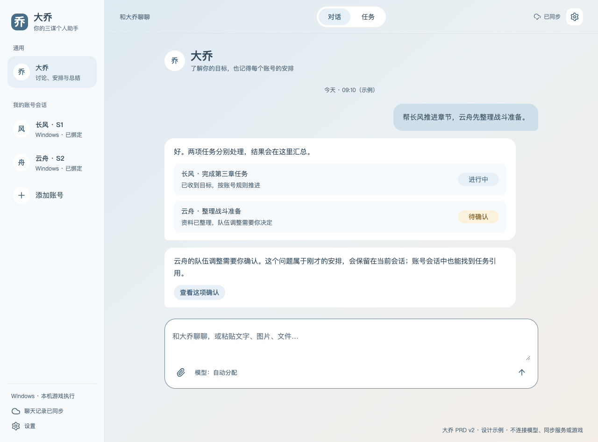

左栏固定大乔通用入口，下方为账号 Agent；切换会话不混用账号状态。消息可以包含文字、来源、任务引用卡和附件。输入区显示“自动分配”，不要求为每个 Agent 手动固定聊天模型，也不显示语音入口。

未指定账号的通用讨论留在大乔；涉及游戏操作但对象不明确时，先问清。直接在账号会话中说话，默认对象为该绑定区服账号，但是否可执行仍取决于发送设备能力和授权。

### 结果、追问与确认归属

大乔安排多账号任务时保留一个汇总任务，各账号有独立子任务；账号列表显示子任务，大乔列表显示汇总，不重复创建同一执行任务。实际执行者和来源保留在记录中，普通界面不显示“谁下发／谁安排”列。

结果、追问和确认都回到最初下达指令的会话，其他相关账号会话可显示引用卡。确认请求绑定具体任务、账号、规则版本和有效期；切换会话、跨设备收到副本或重连重试，不生成新确认权限。Mac 可阅读需要确认的事项，但必须回到绑定的 Windows 设备操作。

部分账号成功时逐账号报告，汇总任务只有全部必需目标完成才显示已完成。取消汇总任务会取消尚未结束的子任务，保留已经发生的效果；查看汇总不创建第二套执行队列。

### 复制、粘贴与附件

| 操作 | 预期行为 |
| --- | --- |
| 粘贴文字 | 插入光标位置，可编辑，不自动发送 |
| 粘贴图片／文件 | 形成待发送附件，可预览和移除；同一剪贴板内容只添加一次 |
| 粘贴文件 | 接收文件对象，不把路径文字冒充文件内容 |
| 移除草稿附件 | 只移除这条草稿的引用，不删除本地原文件 |
| 复制消息、图片、文件 | 支持文字选中／整段复制，以及可粘贴的图片／文件对象 |
| 只有附件 | 允许发送，必要时在会话中询问用途 |

Windows 支持 Ctrl+C／V，Mac 支持 ⌘C／V。附件有“待发送、上传中、已发送、解析中、可使用、处理失败”等可区分状态；收到文件不等于模型已经读过。

用户粘贴的截图只作对话参考，不能直接更新可信实时账号状态，也不能作为游戏操作完成的核验证据。通用会话中的截图归属不明确时先询问；归到某账号也不把旧图变成实时观察。

普通附件保留在聊天记录中；只有明确要求“加入游戏资料”时才进入 RAG 整理／待审流程。账号私有截图不自动变成通用攻略。跨设备附件同步规则见第 13 节；一般文件的格式、数量、体积和保留期限仍待定。

## 5 账号会话、绑定与规则

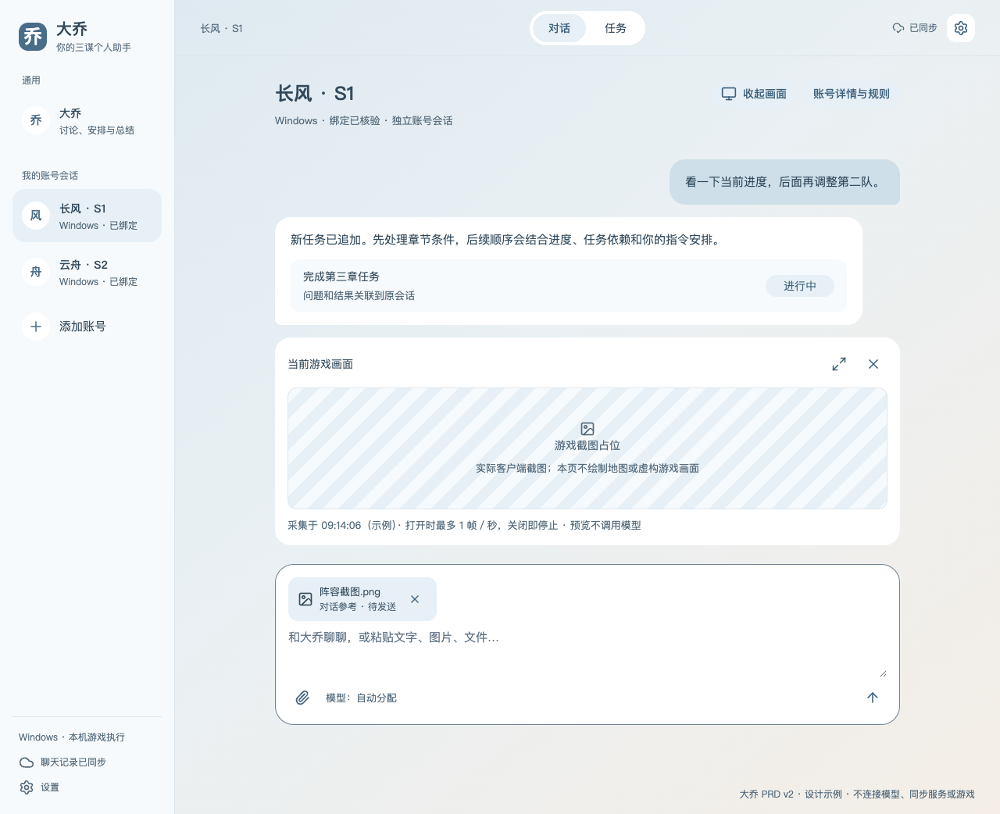

账号会话顶部固定保留“游戏画面”和“账号详情与规则”入口。游戏画面关闭后可以再次打开，不依赖已有消息中的截图。当前画面显示采集时间；离线时保留最后画面并明确标过期。历史步骤截图放在任务过程，不混作实时画面。

### 绑定与重复添加

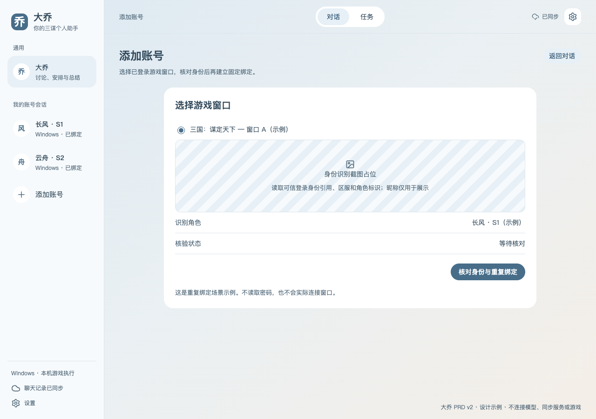

1. 在 Windows 选择一个已登录游戏窗口，读取可核验的登录身份引用、区服与角色依据。
2. 用户核对身份；可信角色标识优先，昵称、窗口标题、HWND／PID 不单独作为稳定身份键。
3. 在创建前按稳定身份查重。已存在则进入原 Agent 或重连，不新建第二套聊天、规则和执行队列。
4. 身份不清时保留待核对状态，可以聊天／保存草稿，但不能接收可执行游戏变更任务。
5. 核验后登记绑定修订；实际输入前仍复查。重登、换服、窗口变化使旧请求失效。

同一区服角色只有一个活动执行归属；同一登录身份的不同区服仍可以分别绑定。不同账号可并行推进，键鼠互斥由程序管理；是否会被游戏登录机制互相挤下线，需要实机验证，不能靠多开窗口推断。

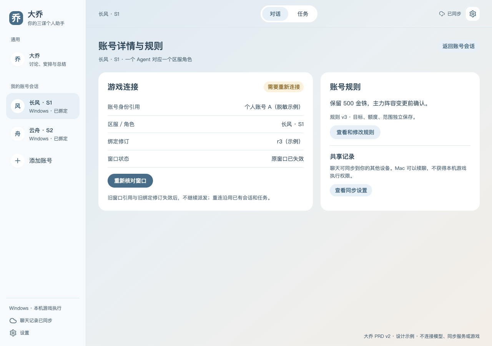

账号详情显示身份、绑定执行设备、连接／核验状态、最近核验时间和“重新连接／核对窗口”。新建入口不高亮某个旧账号；识别失败给出重新选择或补充核对路径。首版不索要游戏密码，不加入角色切换器。解绑、删除、改名与换服的完整数据处理仍待评审。

### 规则从对话到执行

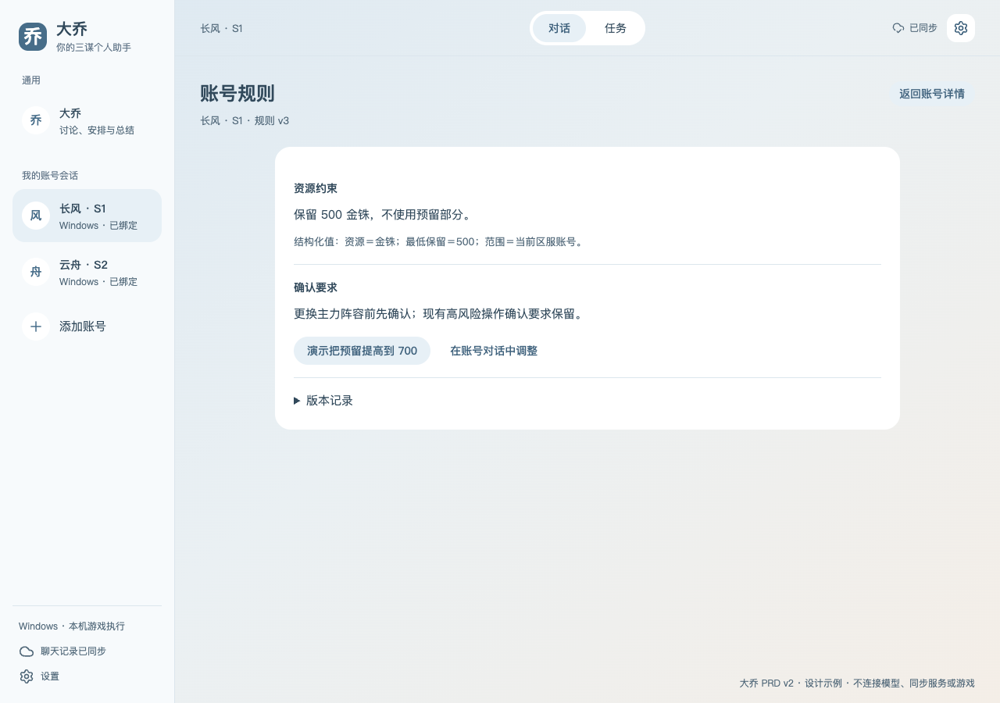

自然语言用于表达规则，执行层使用带单位、对象、阈值、范围、有效期和版本的结构化规则。例如“保留 500 金铢”必须转成资源种类、最低余额与适用账号；500 仅为示例。不能只将原文放进 prompt 并由模型自行决定是否放行。

执行相关变更先展示“原规则 → 新规则”的差异，关键字段不清先问清，由绑定 Windows 设备上的用户确认后保存。规则页可查看、移除、编辑和回看版本；目标放在任务里，不混进长期规则。

- 新账号在得到明确许可前只读；规则内、已授权的明确任务可直接推进，不逐工具勾选。
- 收紧规则使尚未派发的旧许可失效，下一次变更前用新版本重校验；不满足则暂停并说明原因。
- 放宽规则不自动扩大旧任务的范围、不补满预算；必须明确适用任务和新许可。
- 纯讨论或任务排序偏好不必每句话弹确认；影响资源消耗、执行范围或许可的变更才进入确认流程。
- 规则不能取消项目既有的高风险操作人工确认要求。
- Mac 上可以讨论规则或起草修改建议，但不能保存为 Windows 生效规则；同步副本也不能触发自动生效。

## 6 任务队列、调度与生命周期

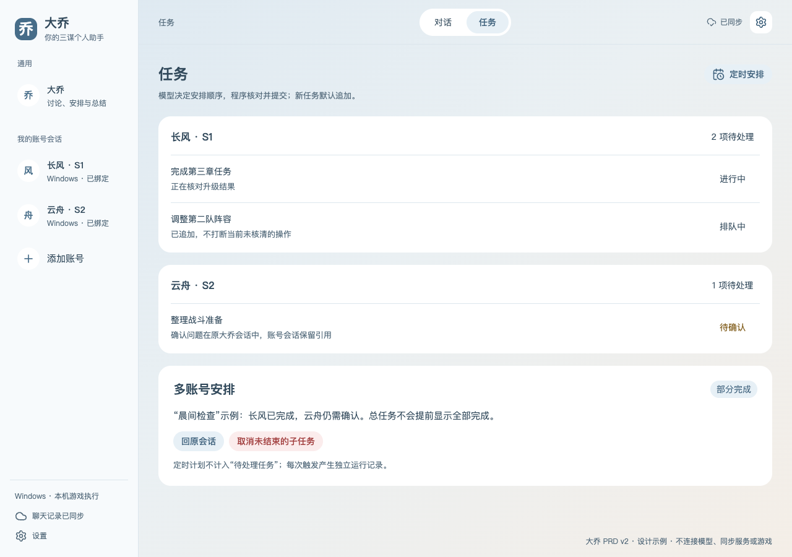

任务通过聊天创建，不恢复三步任务表单。缺目标、账号或限制时在会话补齐。列表按执行账号分组，另有大乔汇总／通用任务；活动计数只包括排队中、进行中、等待中、待确认、已暂停五种非终态，不计已完成、未完成、已取消，也不把永久启用的定时计划算作未完成任务。

### LLM 决定安排，Harness 提交

**新任务默认追加；由主力模型判断顺序、依赖和必要切换。**模型返回带账号、队列版本、候选顺序和理由的提案，Harness 检查身份、依赖、预算及版本后原子提交；旧版本提案不能覆盖更新的用户指令。该约定保留模型判断，不改成纯规则排序，也不允许模型直接改权威队列或派发窗口输入。

普通追加不抢占；“先做这个”是明确优先指令，切换仍须等旧输入停止且当前业务动作的效果已知。未发送输入的动作可以安全暂停；已经发送、正在核验或效果不明的动作先完成核对，不能切走丢账。等待任务保存唤醒条件与截止时间，并释放键鼠操作权。

同账号不并行推进冲突的游戏变更；只读查询和聊天可以并行。不同账号可并行推进，但同一 Windows 交互桌面的键鼠一次只交给一个输入事务。切换或恢复重新检查任务是否仍有必要、前置条件是否改变，不播放旧点击序列。

修改正在运行的目标，产生新的任务定义版本与后续运行引用，不原地篡改已封存的 TaskSpec／run_id。保留旧运行、取消或截断原因和已发生效果；新安排不能绕过未决效果核对。

### 统一主状态

| 主状态 | 含义 | 常规操作与边界 |
| --- | --- | --- |
| 排队中 | 已接收，等待顺序／依赖 | 查看、取消 |
| 进行中 | 正在观察、决策、执行或验证 | 查看、暂停、取消 |
| 等待中 | 等待明确游戏条件／资源 | 查看等待原因、暂停、取消 |
| 待确认 | 缺信息或需要批准 | 回到问题、确认／拒绝、取消；执行批准只在 Windows |
| 已暂停 | 用户暂停，或因明确原因停止后续推进 | 查看原因；满足恢复条件后继续／取消 |
| 已完成 | 目标通过独立结果检查 | 查看结果与过程 |
| 未完成 | 本次因预算、条件或错误结束 | 查看原因，按需新建安排，不静默重启 |
| 已取消 | 不再推进 | 保留已发生效果，不自动恢复 |

主状态之外单独记录 `pause_reason` 和“结果核对状态”。暂停原因区分用户暂停、身份失效、服务不可用、权限／预算限制等；“继续”不能跳过原因检查。“错误”是原因或步骤结果，不是第九个主状态；“等你确认”统一显示为“待确认”。

结果核对状态可显示“正在核对／结果待核对／已核对”。**已取消＋结果待核对**合法：任务终态保持已取消，只在获准范围内核对已经发出的操作，不因此生成新导航、升级或重放。主状态、效果子状态、原因和按钮规则必须同时驱动列表、详情和消息卡。

## 7 任务详情与确认

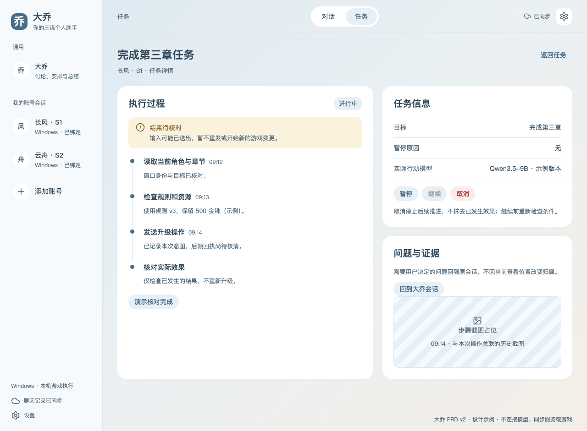

详情包含账号、目标、主状态、原因／效果标记、关键限制、实际使用的模型与版本摘要、可读步骤、引用资料和必要截图。正常步骤用“检查章节要求”“核对资源”“升级目标建筑”“确认结果”等表达，原始 JSON 放在 Dev 中。

暂停／继续／取消在绑定 Windows 设备上操作，列表与原会话同步结果。普通取消不反复确认；若输入已发送或效果不明，取消前说明“将停止后续操作，已发出的结果仍需核对”。取消不撤销已发生的游戏效果。

任务完成由独立核验决定，模型说“完成”和点击接口返回成功都不够。效果未知时保留资源预留，不能提供直接“重做一次”的捷径。已应用的动作不重发；恢复不重置已用额度和截止时间。

确认卡显示具体账号、事项、影响范围及有效期。拒绝后该事项不执行，任务根据可行性转为已暂停或未完成并写原因；过期确认不可重新提交。Mac 的同步卡仅展示“需在 Windows 确认”，无可用批准按钮。

不加入“我来操作”“交回 Agent”等专用控制权页面或按钮。

## 8 模型与服务设置

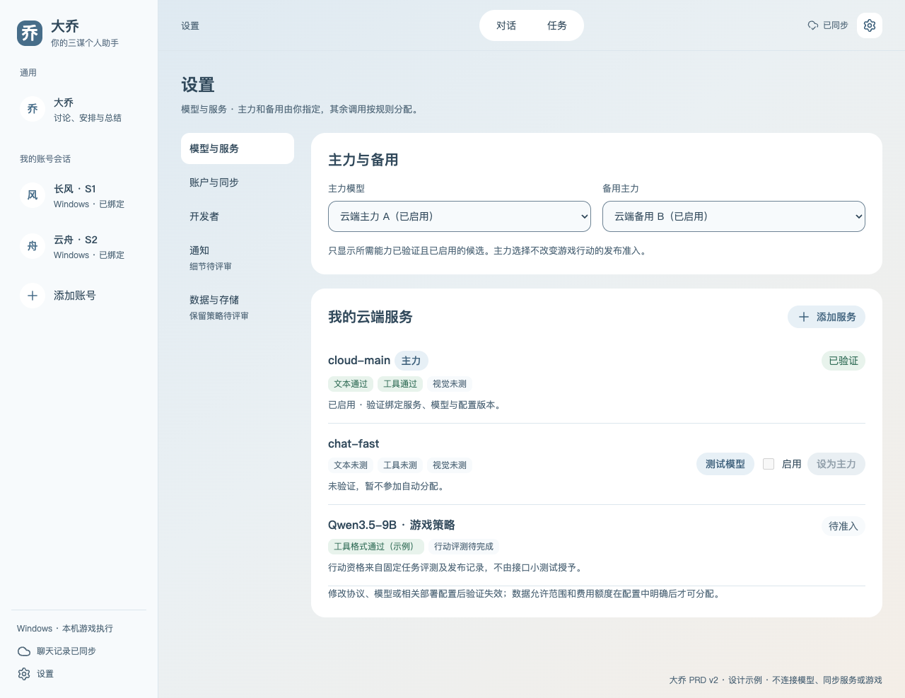

用户指定一个主力模型和一个备用主力；主力按规则从已启用候选选择其他模型。支持 Gemini、OpenAI、Grok、DeepSeek、GLM 等云 API，以及本机／局域网服务。具体能力按模型与版本测试，不能仅凭品牌名称授予视觉或工具能力。

### 8.1 模型行级闭环

| 层次 | 记录与状态 | 界面行为 |
| --- | --- | --- |
| 连接配置 | 服务 ID、协议、地址、凭据引用、配置版本、调用设备／可达范围 | 同一服务下多个模型；保存不等于可调用 |
| 能力验证 | 具体 model ID；文本、视觉、工具调用各自未验证／测试中／通过／失败 | 每行有测试、结果与失败原因；只测试选定能力 |
| 启用状态 | 停用／启用，与能力结果分开 | 所需能力未通过、验证失效或范围未配置时不能启用相应用途 |
| 规划角色 | 普通候选／主力／备用 | 仅符合规划所需能力的已启用模型可选；主力与备用不能相同 |
| 游戏行动准入 | 固定任务评测／发布记录、策略与工具协议版本 | 设置页的连通或能力测试不能授予游戏行动资格 |

测试说明将发送小型真实请求及可能产生用量，明确区分接口可达、文本成功、视觉成功、工具调用成功。连接身份、协议、模型／部署或相关输出配置改变后，使受影响验证失效；不能继续拿旧测试给新配置背书。

“已验证”“已启用”和“主力”不是互斥的四个阶段标签：前者是能力证据，启用是用户选择，主力是角色。设置页同时展示它们，未验证不能通过直接选主力绕过检查。停用模型后不分配新调用，在途请求按取消／结算合同结束。

### 8.2 添加与分配

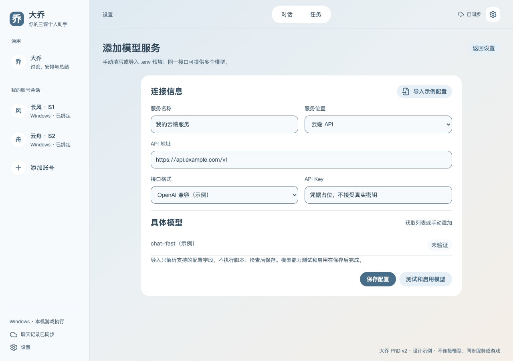

手动填写和 `.env` 导入预填都保留。导入只解析支持字段、不执行 shell、不自动发请求或覆盖现有配置；有歧义的协议、地址、模型先确认。云端、本机、局域网共用管理入口，同名模型在不同服务下保留不同身份。Key 是否必需由服务要求决定。

密钥存入系统凭据，普通配置只持本机引用；不写进聊天、提示词、日志、LangSmith 或同步数据。模型连接及密钥不随聊天复制到另一设备；目标设备另行配置可用模型，页面显示“此设备尚未配置”，不假装同步后已能调用。

主力可以在任务规划时或必要时选模型并解释实质性切换；不必每次截图前额外问一次主力。Harness 仍检查能力、预算、数据范围和实际版本。主力不可用时程序切到用户指定的兼容备用，沿用累计额度；没有合格候选就停止相关处理并提示。

复杂规划用主力，简单整理优先轻量模型，截图用已验证视觉模型；游戏行动优先训练并验证后的 Qwen3.5-9B。Gemini 保留为已有视觉基线，不写死唯一视觉提供方。任何模型选择都不扩大游戏授权或数据允许范围。

### 8.3 训练与日常运行

Qwen3.5-9B、TRL＋PEFT 的 SFT、verl＋SGLang 的 PPO、9B Actor＋2B Critic 与现有奖励公式不变。游戏行动资格来自固定评测与发布记录；未训练策略、教师／规则基线使用各自明确身份，不能伪装成已发布自训模型。

训练采样和固定评测冻结 Actor、视觉模型、输入构建、知识库／检索版本及分配配置。运行中若发生教师或备用接替，可信运行层记录真实来源与边界，按既有合同隔离受影响 PPO 片段；产品结果可以如实成功，但后续成功奖励不倒灌给原策略。主力规划接替不必然改变游戏 Actor，分别记录。

具体协议覆盖、预算额度、测试样本和故障阈值仍需实施前确定，不默许未知费用等于免费。

## 9 知识与资料

不建设可见百科或攻略站。QA-agent 在后台检索，用户从对话提问、发送资料和按需查看来源。

| 三类知识来源 | 内容 | 必须保留 |
| --- | --- | --- |
| 游戏基础知识 | 武将、战法、建筑、章节、术语与基础规则 | 出处、对象、赛季／条件、确认状态 |
| REA 原包解析数据 | 已解析配置、文案、数值和关系 | 资源版本、字段位置、解析版本、未知含义 |
| 玩家攻略 | 视频、图文、在线文档中的经验与建议 | 作者、链接、时间、段落／时间点、赛季与修订 |

明确要求“加入游戏资料”只创建整理／待审记录，不直接发布正式库。经过来源保留、去重、冲突处理和审核，才进入可检索版本。审核由谁做、在聊天确认还是开发端进行仍待定；没有审核入口时不得把“已收到”说成“已入库”。

账号私有状态、截图、规则与通用游戏知识分开。首版不因开启聊天同步就把私有资料加入跨账号 RAG；若未来支持私有检索，需明确范围字段和访问校验。原包字段、玩家经验与已确认规则不混成同一种事实。资料中的指令不是操作授权；暂停的原包解析／发布任务不因本 PRD 自动恢复。

## 10 游戏画面与模型输入

| 用途 | 格式与尺寸 | 限制 |
| --- | --- | --- |
| Windows 当前画面预览 | JPEG，长边 ≤1280px | ≤300KB／张，最多 1 帧／秒；关闭即停止 |
| 模型常规观察 | JPEG，长边 ≤1280px，像素 ≤1.15MP | ≤512KB／张，任务需要时调用 |
| 局部细节 | 从原图裁剪 PNG，长边 ≤768px | ≤512KB／张，按需追加 |
| 一次观察请求 | 一次常规观察，必要时一次细节识别 | 最多 2 次视觉调用，重试计入；图片总量 ≤1MB |

“一次观察请求”是一次画面采集与识别，不是整个任务或 DecisionStep。动作前复查和动作后效果核验属于独立观察请求，但视觉、摘要、检索改写、重试与备用全部累计到任务总调用／token／费用／时长预算；不能靠新建观察轮绕过总额。

采集与证据保留原始客户区尺寸、几何、时间及 hash；预览图和模型图是派生图，不覆盖原件。缩放和裁剪记录原始尺寸、缩放比例、裁剪原点、来源 hash，局部坐标先映射回原客户区再过执行检查。真实小字可读性和 PNG 体积需实测。

预览走不调用模型的独立路径，只显示最新帧、丢弃积压，不灌入对话 Context。被遮挡／最小化导致无法被动获取时显示过期，不为刷新预览擅自抢焦点。视觉模型返回结构化状态；文本策略只取必要状态、资料和历史。原图、OCR、摘要和结构化状态继承同一账号数据范围。

## 11 主动提醒与定时简报

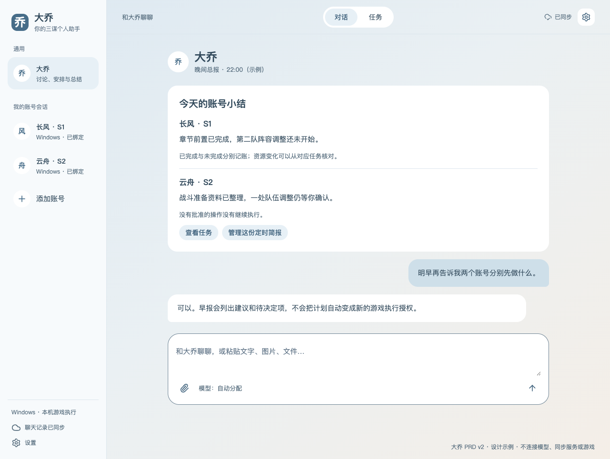

主动提醒覆盖目标完成、需要用户决定、恢复后仍无法继续和已配置简报。普通步骤只更新任务过程，不逐步刷屏。早报说明计划／优先级，晚报说明实际成果／资源变化／未完成事项；缺记录就注明，不把计划当成果。

用户在聊天中指定账号、时间和早报／晚报；大乔汇总多个账号，账号会话只报告本账号。简报只读取获准记录，不因写“明天计划”而授予游戏执行权。Mac 续聊可讨论简报内容，但本版不通过它远程新增／修改 Windows 的执行计划。

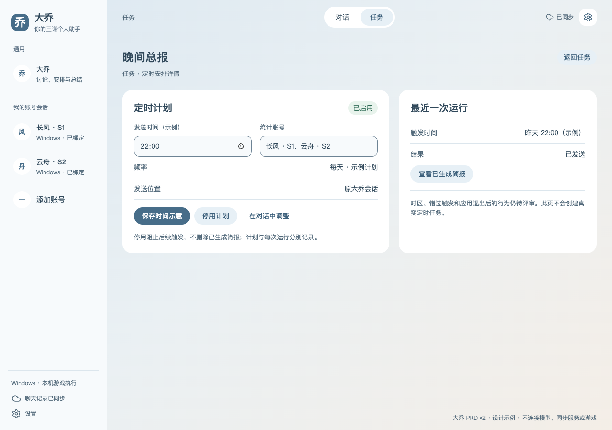

任务 Tab 的“定时安排”进入计划列表／详情，提供修改、停用、恢复和查看已生成简报，不跳回简报正文冒充管理页。计划有已启用／已停用状态；每次触发生成独立运行实例，使用八种任务主状态。停用阻止未来触发，取消本次运行不自动删除计划。

计划、触发实例和发送记录分别保存，按计划版本＋触发时间识别重复。简报发送后作为同一会话消息跨设备同步，不在每台设备重新生成一份。时区、漏触发补发、应用彻底退出／休眠行为与外部通知渠道仍待定。

## 12 Dev 与设置入口

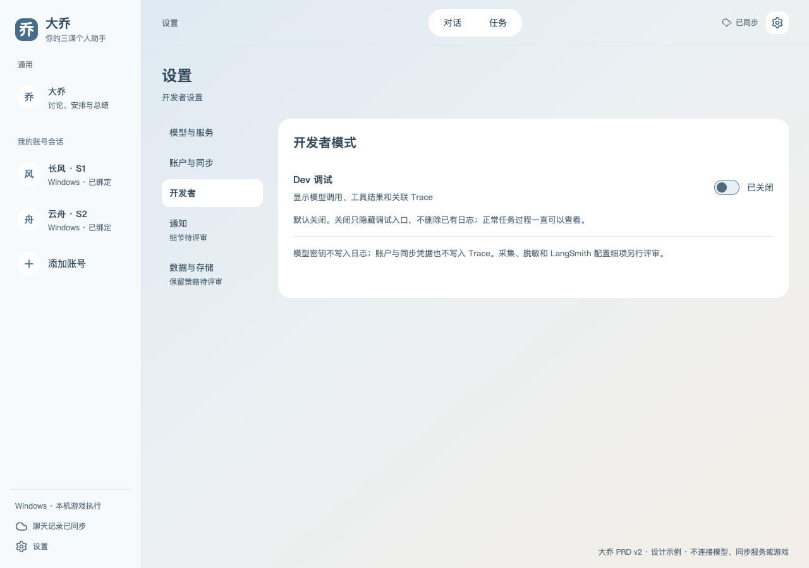

设置中的“开发者”先进入带 Dev 开关的面板，默认关闭，不直接跳到已开启的调试页。打开后主导航出现调试 Tab；关闭后隐藏，不删除日志。

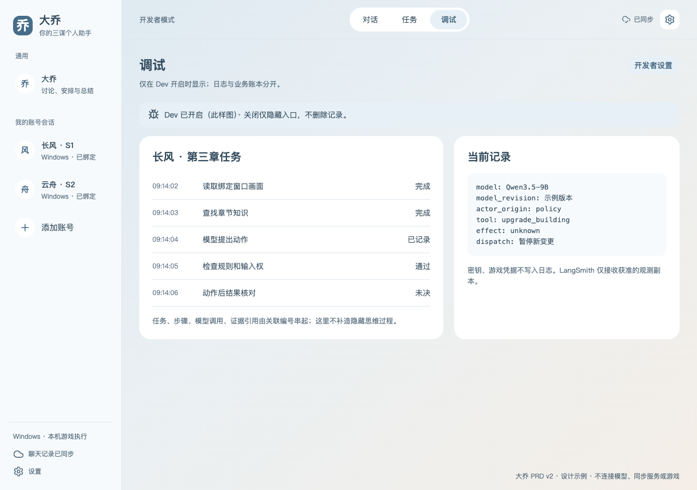

调试按账号／任务显示实际模型与版本、获准的输入输出、工具参数／结果、状态变化、错误、耗时、用量和 Trace；普通任务详情仍显示可读过程。LangSmith 是观测副本，不替代本地账本、原始证据或训练记录。密钥和隐藏思维不展示；原始技术 Trace 不随普通聊天同步。

设置保留模型与服务、聊天同步、开发者三类已明确范围；通知与数据保留等栏目标待评审。具体账号规则留在账号详情，避免全局设置和账号页面各保存一份冲突配置。

## 13 跨设备聊天记录同步

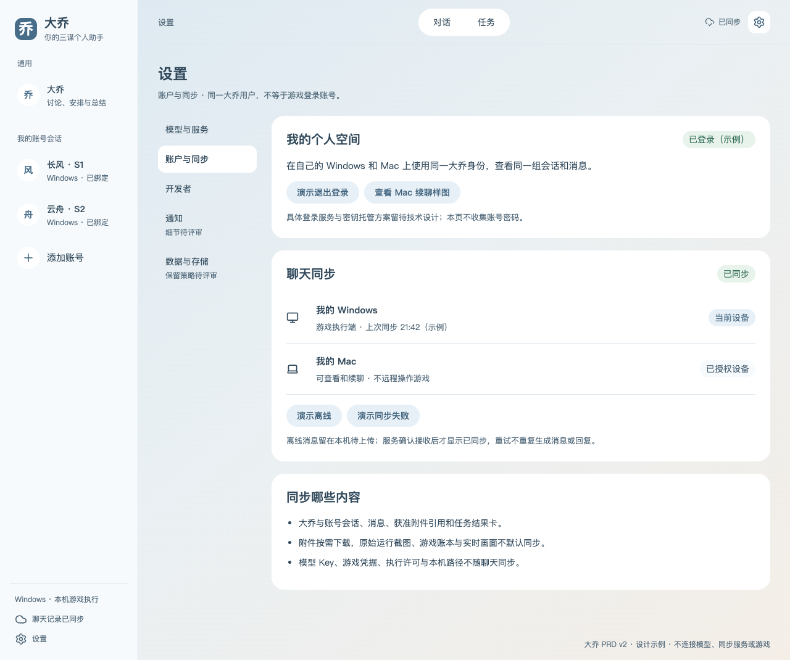

### 13.1 同步内容和权限

跨设备聊天同步是首版必要功能。同一产品用户在 Windows 和 Mac 登录后，可以看到相同会话和已确认送达的消息。首次启用展示同步内容及设备授权，不借游戏登录状态建立产品身份。

| 同步 | 不自动同步 |
| --- | --- |
| 大乔／账号会话 ID、名称和账号展示关系 | 游戏密码、模型 API Key、本机凭据引用和设备令牌 |
| 已发送的用户／助手消息、引用关系、消息状态 | 未发送草稿、本机路径、原始窗口句柄及控制权凭据 |
| 获准上传的聊天附件与可下载引用 | 持续预览帧、原始执行截图库、动作账本和完整 Trace |
| 任务结果／待确认卡的只读投影、简报 | 可执行任务队列、审批权限、Windows 生效规则的写权限 |
| 已读位置、服务端确认游标 | SFT／PPO 原件、模型权重、训练恢复状态 |

同步到云端存储不等于允许任意云端 LLM 读取。同步上传范围与模型使用范围分别校验；被标为仅本地的附件只同步“本地附件，当前设备不可用”的占位信息，不上传原件或通过摘要绕过限制。

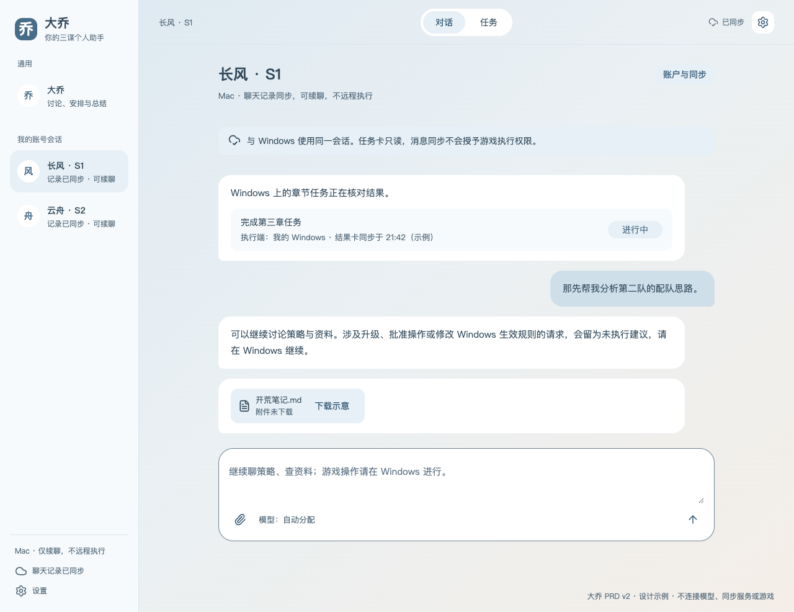

Mac 可以根据同步历史续聊、查游戏知识、分析已提供资料并形成建议。消息由服务端记录可信的发送设备／能力，不能通过提示词或改一个前端字段把 `chat_only` 变成执行许可。该轮回复只能使用只读工具；即使 Windows 承担回复处理，或收到这条消息的同步副本，也不能转成游戏操作、审批、规则变更或远端暂停命令。

Windows 用户若要采纳 Mac 上讨论的建议，必须在绑定执行设备上明确再下达一次命令，生成新的执行请求；可以引用原建议，但不继承 Mac 消息的执行权限。消息同步是存档复制，不是新的用户提交事件。

### 13.2 消息顺序、去重与单次处理

1. 客户端生成稳定的 `message_id` 与发送操作 ID（`client_operation_id`），先放进本机待发送箱；重试沿用原 ID。
2. 同步服务按用户和会话校验权限，以操作 ID 去重，写入后分配会话内服务端顺序号并返回确认游标。各设备按服务端顺序合并，不按各自时钟覆盖消息；同步副本、任务事件和新的用户提交分开标识，只有有效的新提交可产生回复轮次。
3. 同一会话的用户轮次由唯一获准的对话处理者串行消费；服务端记录处理归属与结果。两端收到同一消息不能各自触发一次回复或任务。发生接替时，新处理者承接已记录状态，而不是重跑已完成轮次。
4. 助手回复绑定原用户消息／轮次及已使用的上下文版本；流式草稿不是已完成回复。断连后读回已确认部分，不能产生两条看似不同的最终答案。
5. 多设备同时发送时，两条消息都保留，按服务端序号处理；第二条可看到前一轮的已提交结果。需要澄清的目标冲突在会话中说明，不使用“最后写入覆盖前一条”的合并方式。
6. 游戏任务的创建与执行另外使用任务／操作身份和权限校验。聊天去重不能代替动作幂等，Windows 也不能因同步重放而再次创建游戏任务。

这些是待实现的同步合同，不承诺网络传输天然 exactly-once。系统通过稳定 ID、唯一消费归属和持久确认，避免重复回复与重复业务操作；错误必须可见、可恢复。

### 13.3 离线与附件

消息显示“待发送／发送中／已同步／发送失败”。离线输入进入本机待发送箱，明确提示“尚未上传，Agent 尚未收到”；不假装另一设备或后台已开始工作。网络恢复后按本机发送顺序补传，重复请求不新增消息；失败可重试，同一操作 ID 不变。

已同步消息的跨设备编辑、删除和版本合并首版不开放；修改用新消息补充。未发送草稿仍可本机修改或移除。清除本地缓存不等于删除云端历史，也不撤销已执行游戏动作；全局删除／保留策略另行确认。

带附件的消息先完成受限附件上传、完整性检查与持久确认，再提交可供 Agent 读取的消息引用。未完成时显示上传进度／失败，不生成指向不存在文件的“已发送”消息。接收端按需下载，显示未下载／下载中／可用／失败；原始本地路径不跨设备使用。

会话顶部或侧栏显示同步中、已同步时间、离线／失败状态；错误可进入设置查看。同步失败不阻止阅读本地已有历史，但不能把旧记录或旧任务状态标成最新。

### 13.4 设备与存储安全

设置列出已授权设备、最近同步时间和撤销入口。撤销后该设备不能继续读写服务端记录；离线缓存是否远程清除不作承诺，退出登录提供明确的本机缓存处理选项。设备令牌本机安全保存，传输使用 TLS，服务端持久存储加密，并按产品用户隔离会话与附件访问。

同步后端／账号登录方式、服务商、密钥托管和加密密钥恢复方案需在实施前确定。本版不声称已经提供端到端加密。跨设备同步本身已确认，不因这些实现选型待定而降为“以后再考虑”。

## 14 实施边界与首条可用链

继续复用 `apps/sanmou-advisor-desktop` 的桌面基础，业务执行仍在 `pioneer-agent`，知识服务在 `qa-agent`。现有 Advisor 的单图重置、无报告不能通用聊天和图片专用上传接口需要改造；它们不是已经完成的大乔会话能力，也不是禁止复用桌面应用的理由。

建议按以下产品顺序接线：对话／账号／任务与同步身份 → 附件与消息去重 → 模型验证／启用与主力分配 → Windows 单角色真实 PVE 小任务 → 多窗口、简报和训练接线。后台同步与本机执行分别验收，不用同步记录代替执行账本。

首条真实任务复用既有“指定建筑从 L 升到 L+1”的动作和验证器，核对同角色新画面、目标等级、资源变化和原会话回复；先报告一次真实完成，再评批量结果。10 次成功 9 次、5 分钟等候选阈值没有成为本版默认，沿用并显式确定现有 MS2 切片预算和验收条件。

现有 MS0–MS7、SV1–SV3、TV1–TV4、奖励公式及真实输入门禁保持不变。产品调度、跨设备消息和模型分配要通过新接口接入，不修改旧只读 TaskRunner 合同来冒充执行能力。

## 15 产品验收清单

| 编号 | 场景 | 通过标准 |
| --- | --- | --- |
| A01 | 默认入口 | 对话／任务双 Tab；无已删除的总览、地图、百科、语音、接管入口 |
| A02 | 会话隔离 | 大乔与账号历史各自独立，通用问题不自动绑定账号 |
| A03 | 多账号派发 | 父子关系明确，追问／确认回原会话，部分结果不报全部成功 |
| A04 | 追加与调序 | 默认追加；LLM 提案绑队列版本，程序拒绝旧提案及不安全切换 |
| A05 | 附件 | 复制粘贴对象正确，草稿移除不删文件，手动图不变成实时状态 |
| A06 | 绑定去重 | 同角色重复添加回原 Agent；身份不清不进执行队列；失效绑定不能派发 |
| A07 | 画面入口 | 可打开、关闭、重开；有采集时间和过期标记；预览不调用模型 |
| A08 | 取消与未决 | 任务终态与效果核对分开；unknown 不重放，取消后不翻转完成 |
| A09 | 模型准入 | 逐模型／能力测试、失败修复、验证失效和启用限制完整；不能测试一次就授行动资格 |
| A10 | 自动分配 | 主力／备用仅来自合格候选，版本／预算／实际来源可追溯 |
| A11 | 资料入库 | 普通附件不自动进 RAG；明确请求只进待审，审核前不标已发布 |
| A12 | 定时管理 | 从任务 Tab 改、停、恢复计划；查看简报是独立链接；计划不占活动任务计数 |
| A13 | Dev | 设置中默认关，可开可关；调试 Tab 随之出现／隐藏，日志不被删除 |
| A14 | 图像预算 | 一次观察计数明确；前后核验累计总预算；原图与派生图、裁剪回投可追查 |
| A15 | Mac 能力 | 可同步查看续聊；不能直接或经同步消息远程执行、批准、改规则、暂停／取消 |
| A16 | 训练来源 | 教师／备用接替记录可信，受影响 PPO 片段隔离，不倒灌成功 |
| A17 | 规则版本 | 执行规则可读差异确认；收紧撤销旧后续许可，放宽不扩大旧任务 |
| A18 | 同步重试 | 重复发送／恢复只产生一个逻辑消息和一次有效消费，无重复回复／任务 |
| A19 | 双端并发 | 同会话同时发送保留两条消息，统一顺序处理，不互相覆盖或分叉 |
| A20 | 离线与附件 | 离线明确未收到；补传可追踪；附件未持久完成前消息不能变成可读取的已发送 |
| A21 | 同步权限 | 不同产品用户隔离；撤销设备不能继续同步；Key、执行账本和控制权不随聊天上传 |
| A22 | 设计一致 | 状态词、关键字号、图标、焦点、加载、只读与禁用按设计规范 v2 落地 |

本次只验证文档、样图及示例交互，以上真实同步、模型调用、Windows 输入与训练验收在实现后分别执行。

## 16 仍需确定的具体事项

1. 同步账号登录方式、后端服务、加密密钥托管／恢复、设备撤销后的本地缓存处理。
2. 模型的数据允许范围、全局／账号／任务费用额度、未知价格处理和故障阈值。
3. 资料审核由谁完成、审核入口，以及是否建设账号私有 RAG 检索。
4. 简报时区、漏触发补发、托盘／彻底退出／休眠后的行为及通知渠道。
5. 附件格式／数量／体积、历史／原图／Trace 保留期、容量与低空间策略。
6. 账号解绑、删除、重命名及换服的完整数据处理。

这些事项按对应功能开工前逐项确定，不自动采用报告中的 7 天保留、全机单账号运行或新费用默认值。

## 17 版本与依据

- 本版落实六组优先修订，并新增用户明确确认的跨设备聊天同步与 Mac 续聊边界。
- [设计规范 v2](../daqiao-design-system-2026-10-29-v2/DESIGN-SYSTEM.md)是本版视觉与组件依据；[PRD v1](../daqiao-prd-2026-10-28-v1/PRD.md)保留历史。
- [总体工程规划 v10](../../sanmou-multimodal-agent-plan-2026-10-23-v10.md)、[MS0 契约 v4](../../contracts/harness-ms0-episode-contract-v4.md)继续约束任务、权限、输入、账本与训练。
- [当前 Todo](../../../todo-list.md)保留真实工程进度；[设计索引](../README.md)指向当前版本，早期原型只作历史对照。

本版不修改业务代码、旧版文档、模型训练选型或奖励公式，不表示已开放游戏执行或同步服务。
