# 三谋 Personal Agent 页面与交互设计评审稿

版本：设计文档 v1  
日期：2026-10-27，Asia/Singapore  
对应原型：personal-agent-v2，温和渐变版  
状态：待 Lanull 与其他 agent 评审。本文件只是本地草稿，不代表设计已获批准。

[打开可点击原型](index.html) · [查看所有页面截图](screens.html) · [原型说明](README.md) · [已有交互检查记录](verification.json)

## 1 产品定位与评审范围

三谋 Personal Agent 是“了解玩家的个人助手＋懂三谋的游戏专家＋能持续执行任务的 Agent”。服务范围是《三国：谋定天下》，主要覆盖 PVE 开荒和 PVP 战斗。首期以 PVE 跑通完整流程，界面同时展示 PVP 的扩展方向。

用户主要通过对话表达目标，通过任务页查看安排，通过角色与战场页面核对实际情况。助手负责把目标转为任务、在授权范围内推进、等待条件满足后继续，并在需要用户决定时发出清楚的请求。

本稿覆盖当前 v2 的 8 个主页面、全局界面、20 类原型内覆盖层（含弹窗、抽屉与演示工具）、设计总览的截图放大窗口、页面间流程、字段、状态、响应式布局、验证规则、当前缺口和评审问题。它描述产品体验，不重新定义模型训练算法或后端执行协议。

### 1.1 已由用户确认的方向

| 主题 | 已确认方向 |
|---|---|
| 产品范围 | 三谋游戏专属的 Personal Agent，不扩展成通用生活助手 |
| 助手定位 | 个人助手与游戏专家结合，能长期跟进玩家目标 |
| 游戏阶段 | PVE 开荒＋PVP 战斗；先做 PVE |
| 交互方向 | 文字／语音交代目标，查看进度，随时调整、暂停或接管 |
| 视觉方向 | 简约、温和；白蓝色系，背景有柔和渐变；参考用户提供的 today.ai 截图 |
| 知识基础 | 游戏基础知识、REA 原包解析数据、第三方平台玩家攻略三类知识来源 |
| 交付流程 | 先在本地生成设计稿，review 后再决定修改与实施；提交、推送须另获明确同意 |

### 1.2 阅读时区分三种内容

- **当前原型**：源码中已经存在、可以点击体验的界面和本地状态变化。
- **正式产品建议**：为真实游戏执行补齐的交互规则，仍待评审采纳。
- **待决定**：不能只靠前端实现替用户做主的产品选择。

当前原型全部使用示例角色、资源、任务、战报和资料。本地脚本模拟助手回复和任务推进，状态保存到浏览器。它不调用真实模型、不控制游戏、不使用麦克风、不抓取外部资料。后文不逐页重复这一点。

### 1.3 这轮最需要 review 的五件事

1. 对话作为默认入口是否自然；用户能否迅速找到角色、当前任务和重要变化。
2. “保留资源”“允许操作”“暂停”“取消”“接管”的含义是否明确。
3. 同一玩家多个角色之间，目标、设置、聊天和执行状态是否清楚分开。
4. PVE 与 PVP 是否共用合理的页面结构，而不是仅换标题。
5. 当前信息量、字体大小、留白和渐变是否达到“温和、清晰、便于长期使用”。

## 2 关键概念与内容分工

| 名称 | 用户能理解的含义 | 不应混在一起的内容 |
|---|---|---|
| 玩家 | 使用助手的人，示例中为 Lanull | 玩家不等于某一个区服角色 |
| 角色 | 某区服中的游戏身份与进度，示例为长风、北望 | 不同角色不共用任务授权和资源额度 |
| 设备 | 运行游戏的 Windows 电脑 | 设备在线不等于某个角色窗口已核对成功 |
| 当前目标 | 玩家希望达到的结果，如优先推进章节 | 目标不是一次鼠标点击 |
| 任务 | 有目标、角色、范围、资源限制和停止条件的一项安排 | 一条聊天消息不自动等于执行授权 |
| 操作范围 | 本次任务允许做哪些事 | 已审核攻略不能扩大操作权限 |
| 保留金铢 | 不动用的资源下限 | 不等于“本次最多可花多少金铢” |
| 玩家偏好 | 对玩法、资源、通知、时间的持续设置 | 修改默认偏好不应默默改变已确认任务 |
| 当前状态 | 最近读取到的章节、资源、队伍等信息 | 历史记忆不能替代当前画面 |
| 任务记录 | 做了什么、依据什么、结果怎样 | 记录不等于成功，需显示实际结果 |
| 知识库 | 有出处与适用条件的规则、解析资料和玩家攻略 | 玩家经验不自动等于游戏确定规则 |

当前 v2 把任务、聊天、偏好和人工接管状态按角色保存；知识库和运行记录是整个演示共用的数据。正式产品要明确哪些页面是“当前角色视图”、哪些是“所有角色视图”，参见第 17 节。

## 3 页面结构和导航

### 3.1 主页面清单

| 页面编号 | 页面名称与地址 | 核心问题 | 主要出口 |
|---|---|---|---|
| P01 | 和助手聊聊，index.html#chat | 我想做什么，助手怎么理解？ | 任务建议、任务确认、任务详情、偏好 |
| P02 | 总览，index.html#home | 我的角色现在怎么样，最重要的事是什么？ | 当前任务、待确认任务、战场、对话 |
| P03 | 我的任务，index.html#tasks | 任务做到哪一步，能否调整或停止？ | 新建任务、任务详情、接管、运行记录 |
| P04 | 角色与设备，index.html#roles | 现在操作谁，在哪台电脑上？ | 角色切换、连接窗口、偏好 |
| P05 | 战场与战报，index.html#battle | 周边情况、队伍和战斗结果如何？ | 土地／位置详情、战报、任务安排、对话 |
| P06 | 知识库，index.html#knowledge | 有什么资料，是否可信、是否适用？ | 添加资料、详情、审核、引用到对话 |
| P07 | 运行记录，index.html#activity | 助手做了什么，为什么做？ | 单步记录详情、相关资料 |
| P08 | 偏好与授权，index.html#settings | 我允许它怎么做，什么时候停？ | 保存偏好、模拟连接、重置演示 |

首次打开且没有本地记录时默认进入 P01。带地址片段时优先进入指定页面；有本地记录时恢复其中的页面状态。当前切页使用 replaceState 替换地址，不为每次页面切换新增浏览器历史记录。

### 3.2 左侧导航

顺序固定为：总览、和助手聊聊、我的任务、角色与设备、战场与战报、知识库；“管理”组下为运行记录、偏好与授权。

当前页面使用浅白色圆角背景标出。图标与文字共同表示功能。“我的任务”右侧数字是当前角色待确认任务数，不是全部任务数。底部保留 Windows 执行端状态和 Lanull 的个人入口。

**待决定：** 默认进入对话，但导航第一项仍是总览。是否将“和助手聊聊”排第一，或保留“总览”作为固定信息入口，需要用户确认。

### 3.3 页面跳转规则

- 切主页面会关闭当前弹窗／抽屉。
- 普通页面回到顶部；聊天在当前角色消息超过 3 条时滚到底部，否则展示欢迎区域。
- 任务、角色、知识等演示状态保留；弹窗开关不保存到本地存储。
- 点击消息中的任务卡仍使用同一份任务数据，暂停与进度会同步到任务页和总览。
- 当前没有应用内“上一步页面”按钮；二级弹窗也没有完整的返回栈。
- 从任务详情打开知识详情后，关闭知识详情会回到底层页面，而不是回到原任务详情。这是本轮待评审的问题。

## 4 视觉规范与页面尺寸

### 4.1 整体气质

界面保留助手的陪伴感，但文案清楚说明目标、进度与操作影响。不做重游戏皮肤，不堆装饰性数字，不用华丽特效遮盖任务状态。

背景从雾蓝过渡到暖白。消息和主要内容放在白色或半透明白色圆角区域内；蓝色用于可操作元素，绿／金／红只表示状态。

### 4.2 当前颜色

| 用途 | 当前值 | 使用方式 |
|---|---|---|
| 页面背景 | 168° 渐变，#dce7ef → #e7edf1 → #f1eee9 | 整个应用底色，不只是一张顶部卡片 |
| 正文深色 | #34434f | 标题和重要内容 |
| 普通正文 | #53616e | 解释与消息 |
| 次级文字 | #88949d，局部略有调整 | 时间、辅助说明、来源摘要 |
| 主色 | #5d83ae | 选择态与交互强调 |
| 主按钮 | #5c80a5，悬停 #4f749a | 确认、创建、保存等主要动作 |
| 浅蓝面 | #eaf2f8 | 能力卡、背景提示、已选区域 |
| 执行／在线 | 绿色系 #578b79 | 同时保留文字标签 |
| 待确认／等待 | 金色系 #ab8955 | 需要等待或用户决定 |
| 离线／取消／危险 | 红色系 #bd7675 | 异常、停止类动作 |

正式产品应检查正文和背景的对比度。目前辅助文字偏浅，适合视觉方向讨论，但不能把“原型无横向溢出”当成可访问性全部通过。

### 4.3 字体、间距和组件

| 项目 | 当前桌面取值 | 说明 |
|---|---|---|
| 字体 | Avenir Next、PingFang SC、Microsoft YaHei 后备 | 中文以清楚易读为主 |
| 普通页面标题 | 27px，约 550 字重 | 聊天不重复显示页面大标题 |
| 聊天正文 | 15px；较窄桌面 14px | 保持长时间阅读舒适 |
| 次级正文 | 多为 11–13px | 品牌英文等更小，不承担必要操作说明 |
| 桌面侧栏 | 176px | 1180px 以下 168px，960px 以下 154px |
| 顶栏 | 普通页 118px，聊天 154px | 为居中助手标记留空间 |
| 内容最大宽度 | 普通页 1380px，聊天外层 960px | 聊天主要内容最大约 850px |
| 普通卡片圆角 | 21–25px | 弱边框、轻阴影 |
| 消息圆角 | 24px | 用户消息右下角收小，便于区分说话者 |
| 输入框圆角 | 26px | 底部粘性定位，随内容滚动 |
| 弹窗圆角 | 27px | 遮罩使用轻模糊和灰蓝透明色 |
| 普通弹窗 | 最大 610px | 宽弹窗最大 820px |
| 右侧详情抽屉 | 约 590px | 保留底层页面的位置感 |

按钮分三类：实色主按钮、白色次按钮、文字／透明按钮。每个局部区域优先突出一个主要动作；取消任务使用明确的危险色文字，不与暂停共用同一名称。

### 4.4 响应式规则

| 宽度 | 当前布局变化 | 评审关注点 |
|---|---|---|
| 1650px 以上 | 普通页增加两侧留白 | 内容不应无限拉宽 |
| 1180px 以下 | 侧栏、工具区和部分列缩小 | 知识来源列可能隐藏，详情仍可看 |
| 960px 以下 | 战场、记录、设置的双栏改为单栏或重新排列 | 重要控制不能因折叠消失 |
| 720px 以下 | 64px 图标侧栏；聊天功能卡改单列；消息字号 13px | 图标需要可访问名称，用户应能识别当前位置 |
| 390px 检查宽度 | 原型记录了 8 页无横向溢出 | 仍需补软键盘、焦点、触摸目标与长文测试 |

窄屏顶栏隐藏角色快捷选择和部分按钮，只保留“当前角色与任务”入口；角色切换仍可通过 P04 完成。聊天输入框距底部约 10px，页面需要为其保留滚动空间，保证最后一条消息和最后一张能力卡可以完整查看。

## 5 全局界面和公共交互

### 5.1 全局元素逐项说明

| 编号 | 元素 | 当前展示／行为 | 需要核对 |
|---|---|---|---|
| G01 | 左上品牌 | 星形标记、“三谋助手”、PERSONAL AGENT | 助手名称是否保留，当前不可编辑 |
| G02 | 左侧主导航 | 8 个页面，当前项高亮 | 页顺序与分组是否符合使用习惯 |
| G03 | 待确认数量 | 我的任务旁显示当前角色 approval 数量 | 数字应有辅助文字，不能误认为未完成总数 |
| G04 | Windows 执行端卡 | 在线／离线／由你操作；“管理设备”打开连接窗口 | 当前连接标记绑定角色，不是真实设备发现 |
| G05 | 左下个人入口 | L 头像、Lanull、个人助手；齿轮到设置页 | 当前只用于展示，不是账号登录入口 |
| G06 | 顶部当前位置 | 功能图标、当前页名、“设计预览” | 功能图标打开预览指南 |
| G07 | 居中助手名牌 | 三谋助手＋动态副标题 | 接管时“现在由你操作”；离线时“等你连接游戏” |
| G08 | 顶部角色按钮 | 当前角色名＋箭头 | 打开角色选择窗口 |
| G09 | 通知按钮 | 打开“需要你关注” | 当前只列本角色待确认任务 |
| G10 | 顶部设置按钮 | 进入 P08 | 不直接修改设置 |
| G11 | 当前角色与任务按钮 | 打开右侧上下文抽屉 | 显示角色、阶段、资源预留、停止时间和当前任务 |
| G12 | 离线提示条 | “客户端离线，任务进度已保存。”＋模拟恢复连接 | 全站可见；优先于接管提示 |
| G13 | 接管提示条 | “当前由你操作，助手不会自动推进。”＋交还助手 | 交还后任务仍暂停 |
| G14 | 底部设计入口 | 交互设计 v2＋探索页面与流程 | 聊天页隐藏底部页脚 |
| G15 | 轻提示 | 底部圆角提示，约 3 秒后消失 | 使用 role=status、aria-live=polite；不是持久通知 |

### 5.2 当前角色与任务抽屉

入口为顶栏显示器图标。内容依次为角色头像、名称、区服、PVE／PVP 阶段、保留金铢、停止时间、当前任务卡。

- “查看角色”进入 P04。
- “调整偏好”进入 P08。
- 任务卡的“查看任务”打开任务详情。
- 没有活动任务时显示“暂时没有正在推进的任务”。
- 关闭抽屉回到底层页面；从抽屉进入另一个弹窗时，当前没有多层返回栈。
- 此处展示的是角色默认偏好；任务卡显示的是该任务已确认设置。两者可能不同，应在文案上继续明确。

### 5.3 弹窗和抽屉通用规则

当前原型使用单个覆盖层。弹窗带标题、关闭按钮、内容区和可选底部操作区；详情使用右侧抽屉。

- Escape 和点击遮罩空白都关闭当前覆盖层。
- Tab／Shift+Tab在覆盖层控件中循环。
- 当前打开时首先聚焦到 DOM 中的第一个可聚焦控件，实际通常是标题栏“关闭”按钮。
- 关闭时尝试回到打开前的控件；若底层页面已经重绘，该控件可能已不存在。
- 关闭创建向导不会创建任务；重新点新建任务会重新生成草稿。
- 当前未做“未保存内容是否离开”提示，也没有保存到一半的任务草稿入口。

**正式产品建议：** 输入类弹窗默认聚焦第一个字段；危险确认聚焦“保留任务／取消”；关闭后回到可用的来源按钮。对长文本编辑和多步表单明确离开策略。

### 5.4 确认与反馈的共同原则

创建计划、任务执行授权、角色切换、人工接管和取消任务使用明确动作名称。普通查询不需要弹出确认。危险或影响正在运行任务的变更，要在确认内容中展示受影响角色、任务及结果。

成功反馈说明“已经发生什么”，失败反馈说明“为什么没有发生、下一步可以做什么”。不能在请求尚未确认时显示“已执行成功”。当前原型中的“重新检查”是演示反馈，正式版本要有检查中的状态及真实返回。

## 6 P01 和助手聊聊

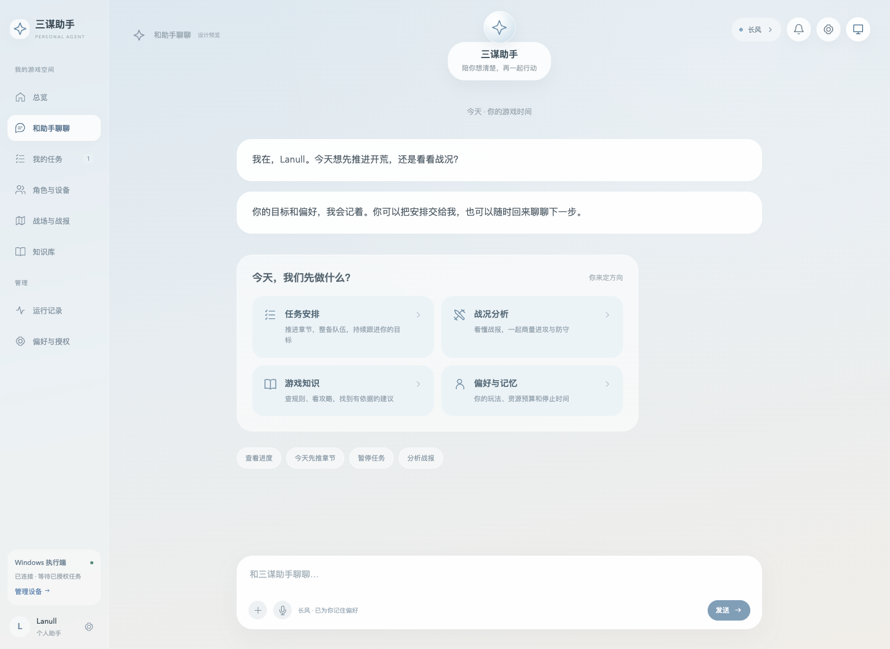

### 6.1 页面目的和布局

默认入口。用自然语言交代目标、询问进度、讨论游戏问题，并把需要执行的内容转入明确的任务确认。

从上到下为：居中助手名牌、时间提示、消息列表、首次使用能力卡、快捷建议、底部输入框。v2 隐藏了 v1 的聊天大标题、局部聊天头和右侧上下文卡；上下文改由全局右上角抽屉查看。

### 6.2 欢迎内容与功能卡

首次示例消息：

> 我在，Lanull。今天想先推进开荒，还是看看战况？

> 你的目标和偏好，我会记着。你可以把安排交给我，也可以随时回来聊聊下一步。

能力区标题为“今天，我们先做什么？”，旁边说明“你来定方向”。当前角色消息总数不超过 3 条时显示；之后隐藏。

| 编号 | 卡片标题 | 说明 | 当前点击行为 |
|---|---|---|---|
| P01-C01 | 任务安排 | 推进章节，整备队伍，持续跟进你的目标 | 发送“今天先推章节”，助手生成任务建议卡 |
| P01-C02 | 战况分析 | 看懂战报，一起商量进攻与防守 | 发送“分析一下这份战报”，回复引导查看战报 |
| P01-C03 | 游戏知识 | 查规则、看攻略，找到有依据的建议 | 发送“看看有哪些游戏攻略”，回复知识库使用提示 |
| P01-C04 | 偏好与记忆 | 你的玩法、资源预算和停止时间 | 进入 P08；当前没有独立的长期记忆管理页面 |

桌面为 2×2，窄屏为单列。卡片整块可点击，图标只是辅助，文字负责说明能力。

### 6.3 消息类型

| 类型 | 展示 | 交互 |
|---|---|---|
| 助手普通消息 | 白色大圆角气泡，左对齐 | 当前为文本，不支持复制单条／重新生成 |
| 用户消息 | 浅蓝气泡，靠右 | 保留输入原文；当前不能编辑已发送消息 |
| 当前任务卡 | 任务标题、状态、百分比、资源预留、停止时间 | “查看任务”打开 D02 |
| 任务建议卡 | “建议安排 · 等你确认”、用户目标、预计检查步骤 | “检查并确认”进入 D01，携带原目标文字 |
| 完成汇报 | 普通助手消息，包含任务完成和资源预留 | 当前不自动附详细执行明细 |
| 引用资料回复 | 文字中显示资料标题与“已审核示例” | 当前引用不是可点击来源卡，需补 |

当前角色的消息单独保存。切换角色后不显示旧角色聊天。原型没有会话列表、会话命名、分支、搜索或跨设备同步。

### 6.4 输入框与快捷入口

| 编号 | 控件／文案 | 当前行为 | 正式产品需明确 |
|---|---|---|---|
| P01-I01 | 文本框“和三谋助手聊聊…” | 支持输入，空白发送不产生消息 | 最大长度、输入中断、发送失败重试 |
| P01-I02 | 发送＋箭头 | 立即调用本地演示逻辑，追加用户与助手消息 | 接入模型后的发送中、取消生成、失败状态 |
| P01-I03 | Enter | 发送 | 中文输入法组合输入时应避免误发，当前未检查isComposing |
| P01-I04 | Shift+Enter | 换行 | 保持原生文本行为 |
| P01-I05 | 加号 | 打开 D17 添加截图或战报 | 原型只选择内置战报，不读取用户文件 |
| P01-I06 | 麦克风 | 打开 D18 语音交互预览 | 真实权限、录音、停止、识别修改均待设计 |
| P01-I07 | 角色与偏好短句 | 显示当前角色和“已为你记住偏好” | 窄屏隐藏，不承担唯一角色提示 |
| P01-I08 | 查看进度 | 发送对应短句 | 查当前活动任务 |
| P01-I09 | 今天先推章节 | 发送对应短句 | 生成新建议，而非直接改运行任务 |
| P01-I10 | 暂停任务 | 按当前活动任务暂停 | 活动任务优先选择正在执行的任务 |
| P01-I11 | 分析战报 | 回复战报说明 | 当前没有在消息内附上指定战报详情 |

原型对消息进行文字转义，不把聊天文字当成可执行 HTML。

### 6.5 当前演示如何理解消息

当前按以下顺序匹配关键词，不是真实语言理解：

| 输入包含 | 当前结果 |
|---|---|
| 暂停、停一下、别继续 | 暂停当前活动任务；没有任务时说明无任务 |
| 继续、恢复 | 检查连接和接管状态，再继续可恢复任务；同角色只留一个执行中任务 |
| 进度、做到、情况 | 回复活动任务进度并附任务卡 |
| 战报 | 追加战报说明和战场页引导文字 |
| 攻略、知识库 | 说明如何添加待审核资料 |
| 其他文本 | 生成任务建议卡，等待用户检查并确认 |

匹配顺序会影响含多个意图的句子。例如一句话同时包含“暂停”和“查看进度”，当前先执行暂停。“取消任务”“调整停止时间”“不要打地”没有独立语义处理，可能变成新任务建议。正式产品需要明确区分查询、修改、执行与取消意图，并在多目标情况下先确认对象。

### 6.6 重要状态和评审点

- 消息发送后滚动到底部；欢迎区域不自动滚走。
- 当前没有模型思考／流式输出／工具执行中状态。
- 离线时仍可聊天和形成计划，但不能恢复游戏任务。
- 人工接管时仍可问答，任务继续会被拦截。
- 通过聊天提出的保留资源和时间，目前没有自动提取为向导字段；用户须在向导里核对。
- v2 原有的聊天页“新建任务”页头被隐藏；直接创建主要走能力卡或任务建议卡。需要评审是否在输入框旁保留一个明确入口。
- 建议正式产品把“修改当前任务”和“创建新任务”分开显示，不让一句“改成晚上十点停”意外生成另一项任务。

## 7 P02 总览

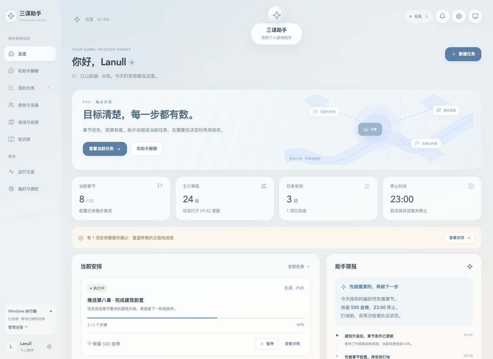

### 7.1 页面目的

给用户快速回答四个问题：现在协助哪个角色、当前最重要的目标是什么、任务推进到哪一步、有没有需要我决定的事项。它是情况入口，不替代聊天和任务详情。

### 7.2 页面区域与控件

| 编号 | 区域／控件 | 当前内容与数据 | 点击结果 |
|---|---|---|---|
| P02-C01 | 页头 | YOUR GAME, IN GOOD HANDS；你好，Lanull；当前区服与角色 | 无 |
| P02-C02 | 新建任务 | 实色按钮 | D01，默认章节目标 |
| P02-C03 | 阶段主卡 | 按角色实际阶段显示 PVE 或 PVP 标题 | 主卡不是整体可点 |
| P02-C04 | 查看当前任务 | 有活动任务时显示该任务 | D02；无活动任务则 D01 |
| P02-C05 | 和助手聊聊 | 次按钮 | P01 |
| P02-C06 | 主城地图点 | 主城示意 | P04 |
| P02-C07 | 两个目标点 | 土地或关注位置，名称受预览阶段影响 | D12 |
| P02-C08 | 最近战报地图点 | 固定第一份战报 | D13 |
| P02-C09 | 当前章节／赛季进度 | PVE 8/12；PVP 18天 | 无；当前为静态示例 |
| P02-C10 | 主力等级 | PVE 24级；PVP 42级，固定09:42更新文案 | 无；当前为静态示例 |
| P02-C11 | 任务安排 | 当前角色所有非完成、非取消任务数；附已完成数 | 无 |
| P02-C12 | 停止时间 | 当前角色新任务默认设置 | 无；不是正在运行任务的已确认时间 |
| P02-C13 | 待确认提示 | 数量＋第一项待确认任务标题 | “查看安排”打开该任务详情 |
| P02-C14 | 全部任务 | 当前安排区域右上文字按钮 | P03 |
| P02-C15 | 当前任务卡 | 标题、描述、状态、角色、阶段、进度、资源预留 | 暂停／继续／查看详情 |
| P02-C16 | 等待中的下一项 | 当前角色第一项 waiting 任务 | 右箭头打开 D02 |
| P02-C17 | 助手简报 | 当前默认偏好＋固定章节优先说明 | 无 |
| P02-C18 | 最近两条事件 | 全局事件列表前两条 | 当前未提供逐条点击入口 |
| P02-C19 | 查看进度快捷卡 | 发送“先帮我看看当前进度” | P01，附当前任务卡 |
| P02-C20 | 分析战报快捷卡 | 发送“分析一下这份战报” | P01，固定说明 |
| P02-C21 | 加入知识库快捷卡 | 发送“把新攻略加入知识库” | P01，提示资料流程 |

### 7.3 阶段文案

PVE 主卡显示“PVE · 稳步开荒”“目标清楚，每一步都有数。”，说明章节优先、资源有度、需要用户决定时再询问。

PVP 主卡显示“PVP · 战斗准备”“看清战况，再做决定。”，说明检查队伍和近期战报，准备下一场战斗。

当前简报正文没有随 PVP 阶段切换，仍写“优先推章节”“打地前检查队伍”。正式版本应根据当前角色、目标和阶段生成简报。

### 7.4 当前任务选择和空状态

活动任务先选当前角色的 running 任务；没有执行中任务时，按现有数组顺序选 waiting、paused、manual 或 disconnected 任务。approval 不会成为当前活动任务，而是放到待确认提示中。

没有活动任务时，当前安排区域显示：

> 当前没有执行中的任务  
> 告诉助手，你下一步想做什么。  
> 创建一个任务

正式版本建议区分“全部已完成”“全部待确认”“全部已取消”与“从未创建任务”，避免统一显示为空。

### 7.5 进度与信息一致性

- 当前任务资源预留来自任务已确认字段；简报和停止时间卡来自默认设置，修改偏好后可能不同。
- 总览步骤数按百分比四舍五入计算，而详情按完成阈值显示；25%、35%等示例可能不一致。
- 最近事件目前不按角色过滤。
- 总览标题按角色实际阶段显示，地图名称却跟随战场页预览阶段；可能出现 PVE 标题和 PVP 地图标签混用。
- 正式产品建议用真实步骤完成数展示进度，不从百分比反推；每个数字附实际更新时间。

## 8 P03 我的任务与完整任务流程

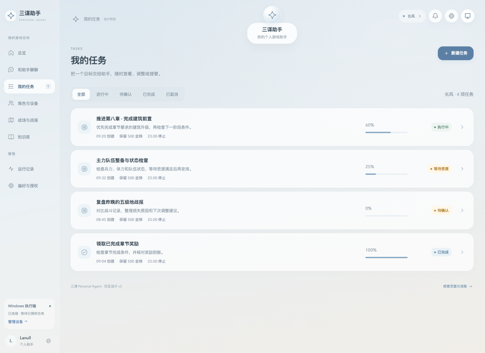

### 8.1 列表页面

页头为“我的任务”，说明“把一个目标交给助手，随时查看、调整或接管。”；右侧“新建任务”。筛选旁显示当前角色及筛选后的任务数。

| 筛选名称 | 当前包含状态 | 评审事项 |
|---|---|---|
| 全部 | 当前角色所有任务 | 包含取消和完成 |
| 进行中 | 执行中、等待资源、暂停、等待连接、人工接管 | 是否改名“未完成”更直观 |
| 待确认 | approval | 不进入“进行中” |
| 已完成 | completed | 仍可看详情 |
| 已取消 | cancelled | 不提供继续执行 |

每行显示图标、标题、描述、创建时间、资源预留、停止时间、进度条、百分比、状态和详情箭头。整行与箭头都可打开 D02。当前没有搜索、排序、批量操作、拖动优先级、编辑任务或删除历史。

空列表显示“这里还没有任务”“新建一个目标，或切换到其他筛选。”与“新建任务”。

### 8.2 D01 新建任务向导

入口：总览、任务页、聊天建议卡、战场建议按钮、目标详情。标题为“交给助手一个目标”，副标题说明这是示例操作。

三步为“设定目标 → 范围与预算 → 确认安排”。底部显示第几步；第一步可取消，后两步可上一步；最后点击“确认并创建任务”。

#### 第一步 设定目标

| 字段／控件 | 类型与默认值 | 当前校验与反馈 |
|---|---|---|
| 你希望助手完成什么？ | 三行文本框；普通入口默认“推进章节，完成当前前置任务”；聊天入口保留原话 | 去掉首尾空格后不能为空；错误“请先写下一个任务目标。” |
| 目标占位说明 | “例如：今天优先推进章节，资源不足就先等待” | 只是示例，不自动创建规则 |
| 操作哪个角色？ | 下拉框，默认当前角色，选项为示例中的两个角色 | 离线角色也可以选择 |
| 说明条 | 先检查实际状态，再拆成可执行步骤 | 不代表此时已经调用模型 |
| 下一步 | 保存本步字段 | 换角色时，资源预留和停止时间改用该角色默认值 |

#### 第二步 范围与预算

| 字段 | 当前形式 | 默认／选项 | 当前检查 |
|---|---|---|---|
| 至少保留多少金铢？ | 数字输入 | 所选角色默认值 | 有限数且不小于0；空字符串会转为0，无整数／最大值检查 |
| 今天几点停止？ | 时间输入 | 所选角色默认值 | 仅检查非空，不解释过去时间或跨天 |
| 允许助手做哪些事？ | 复选框 | 观察状态、领取奖励、升级建筑、队伍整备、打地、抽卡 | 至少选择一项 |
| 默认勾选 | 前三项 | 不从聊天文字自动推断 | 正式默认范围待用户确认 |
| 范围说明 | “超出这里的范围，助手会再次询问。” | — | 不扩大本次授权 |
| 合并错误提示 | “请填写有效预算、停止时间，并至少选择一种允许操作。” | — | 当前没有分字段指出错误 |

“保留金铢”描述余额下限。若允许抽卡，还需要另外确定抽卡方式、次数、累计消耗上限等字段，不能把这一项当作完整抽卡授权设计。

#### 第三步 确认安排

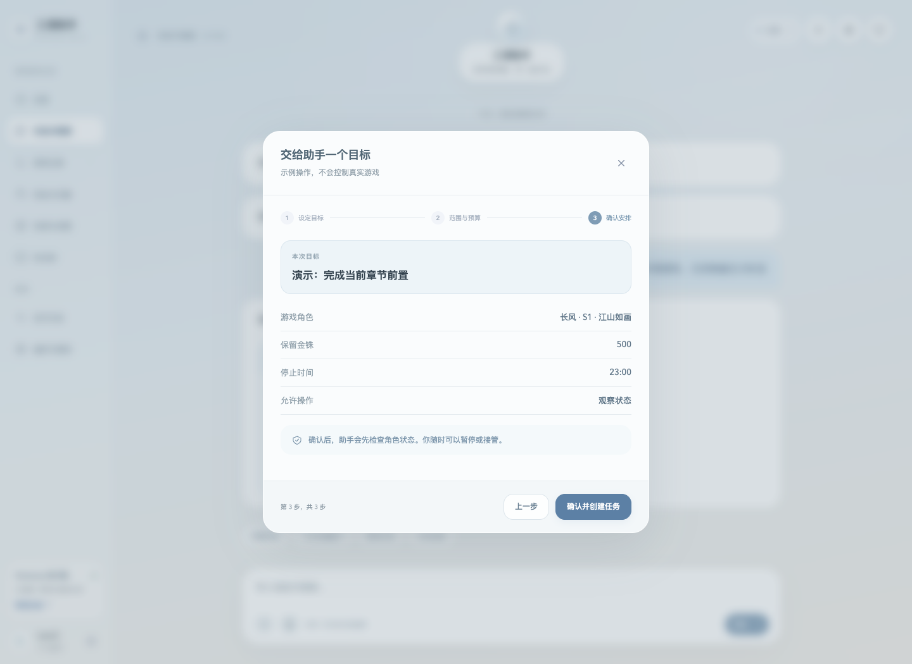

摘要必须让用户看到：完整目标、角色与区服、资源预留、停止时间、允许操作。

- 在线说明：确认后先检查角色状态，随时可以暂停或接管。
- 离线说明：先保存为待连接任务，不开始执行。
- 当前未展示“新任务将暂停哪一个旧任务”；跨角色创建时也缺少“将切换角色”的影响说明。
- “上一步”回到第二步；“确认并创建任务”才产生任务。
- 关闭、Escape或点击遮罩不会创建任务。

#### 创建后的页面与状态

1. 产生任务ID，进度为0，消耗记录为0。
2. 当前角色同一时间最多一项 running；原 running 任务改为 paused。
3. 在线且未接管时，新任务直接 running；在线但接管时为 paused；离线时为 disconnected。
4. 若选择另一个角色，切换到它，并暂停旧角色正在执行的任务。
5. 新任务插到列表首位，向所属角色聊天追加说明和任务卡，向运行记录追加创建事件。
6. 跳转 P03 并打开新任务详情。
7. 显示“任务已创建，安排已同步”。

正式产品建议在确认摘要中展示旧任务处理结果，并把“已保存计划”“正在检查状态”“已开始执行”分开呈现。

### 8.3 D02 任务详情

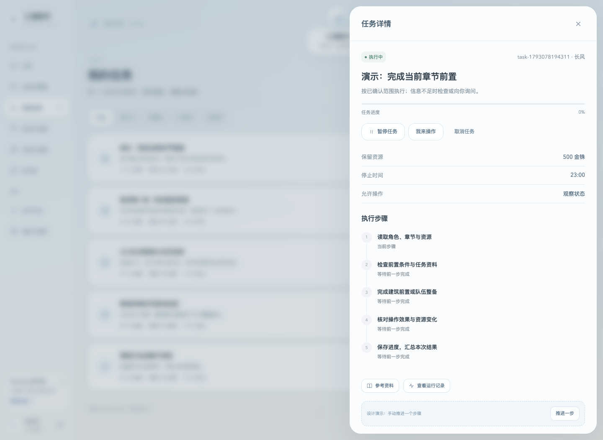

右侧抽屉依次显示：

1. “任务详情”、关闭按钮。
2. 状态、任务ID、角色名。
3. 完整标题与描述。
4. 进度条与百分比。
5. 操作区。
6. 资源预留、停止时间、允许操作。
7. 执行步骤。
8. 参考资料、运行记录。
9. 演示推进区，或完成／取消结果说明。

当前所有任务都使用五个演示步骤：

- 读取角色、章节与资源。
- 检查前置条件与任务资料。
- 完成建筑前置或队伍整备。
- 核对操作效果与资源变化。
- 保存进度，汇总本次结果。

已完成步骤写“已完成并留下记录”，当前步骤写“当前步骤”，后续写“等待前一步完成”；取消后未完成部分写“任务已取消”。

“参考资料”固定打开章节资料kb-1，“查看运行记录”进入未筛选的记录页。正式版本应关联实际任务步骤和引用，而不是共用固定模板。

### 8.4 任务控制逐项规则

| 任务状态 | 可见主要动作 | 当前行为 |
|---|---|---|
| 执行中 | 暂停任务、我来操作、取消任务 | 暂停保留进度 |
| 待确认 | 确认安排、我来操作、取消任务 | 确认安排再打开D03 |
| 等待／暂停 | 继续任务、我来操作、取消任务 | 继续前检查在线和接管状态 |
| 等待连接 | 继续任务、我来操作、取消任务 | “继续”仍可点击，但提示先恢复连接 |
| 人工接管 | 继续任务、我来操作、取消任务 | “继续”提示先交还助手 |
| 已完成／已取消 | 不显示上述操作 | 可看资料和历史记录 |

当前“继续”不会重置进度或资源预留。继续某任务时，该角色其他执行中任务先暂停。

### 8.5 D03 执行待确认任务

点击“确认安排”时，先检查连接与人工接管状态；满足条件才打开D03。离线或接管时直接提示处理条件，不先打开确认弹窗。弹窗标题“确认这项安排”，展示任务标题、角色、允许操作、资源预留和停止时间。

- “先不执行”：关闭，不改变任务。
- “确认执行”：将任务转入统一继续流程。
- 离线或接管时仍不应开始；当前为点击后提示。
- 待确认任务属于原有任务，不生成第二条重复任务。

### 8.6 D04 取消任务

标题“取消这个任务？”，说明停止后续安排，保留历史和已完成结果，不会自动恢复。

- “保留任务”：关闭，无状态变化。
- “确认取消”：状态变cancelled，记录取消原因的固定说明，重新打开详情。
- 取消不会把已经发生的游戏变化撤回。
- 当前没有输入取消原因，也没有“取消当前步骤／取消全部任务”两个范围。

### 8.7 D05 人工接管与交还

“我来操作”打开“接下来由你操作”。

确认后，当前角色的 running 和 waiting 任务都变manual，设置角色接管标记，关闭覆盖层，显示全局接管提示；其他角色的状态不变。

“交还助手”清除当前角色接管标记，把manual任务变paused，说明先重新检查状态，由用户选择要继续的任务。原型没有真正执行状态重读。

正式产品建议显示“正在停止输入／可以接管”“正在重新读取／可以继续”两个过渡状态，避免用户和自动执行同时操作窗口。接管究竟以角色还是整台交互桌面为单位，需要与Windows执行方式一起确认。

### 8.8 演示推进与完成

详情中的“推进一步”仅用于原型。任务必须为running、当前角色在线且未被人工接管，每次加20%，最高100%。

到100%后，任务变completed，聊天出现完成汇报，运行记录新增结果，详情显示完成提示。资源不实际扣减。

按钮在不满足条件时没有置灰，而是提示“任务需处于执行中，才能演示推进”。正式产品应删除此演示按钮，以真实步骤结果更新进度。

### 8.9 当前缺少的任务设计

- 编辑运行中目标、停止时间和操作范围。
- 多个任务的排队顺序、优先级、依赖与资源冲突提示。
- 明确的失败、目标不可达、效果未知、取消中和停止时间到达状态。
- 任务计划草稿保存、未保存离开提示。
- 等待原因、预计下次检查时间与条件满足后继续的实际呈现。
- 针对章节、队伍、战报、PVP目标的不同步骤模板。

这些属于待评审与后续实现，不是当前原型已完成能力。

## 9 P04 角色与设备

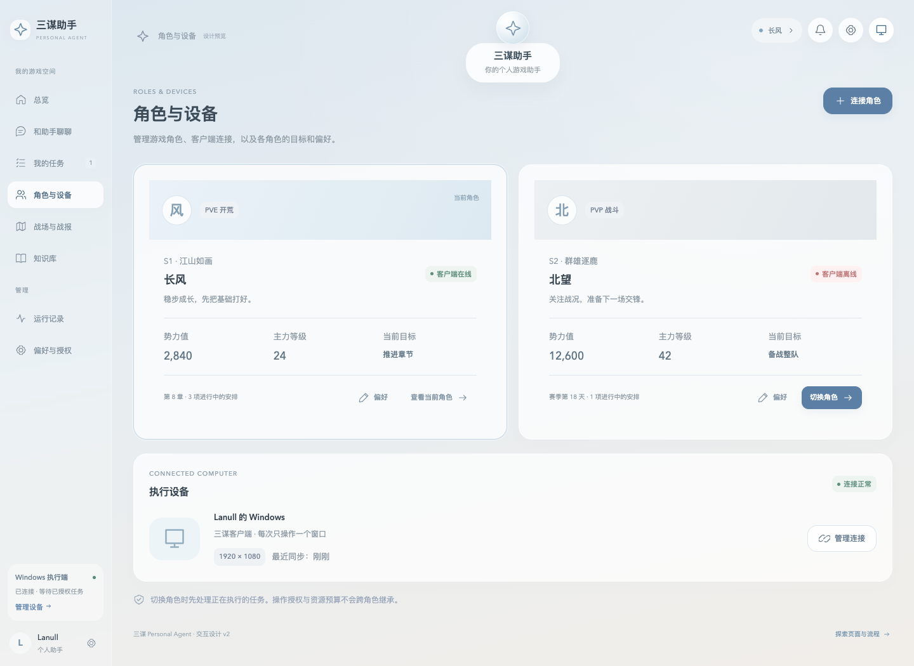

### 9.1 角色卡内容

| 内容 | 长风示例 | 北望示例 |
|---|---|---|
| 区服 | S1 · 江山如画 | S2 · 群雄逐鹿 |
| 阶段 | PVE开荒 | PVP战斗 |
| 进度 | 第8章 | 赛季第18天 |
| 势力值 | 2,840 | 12,600 |
| 主力等级 | 24 | 42 |
| 当前目标 | 推进章节 | 备战整队 |
| 初始连接 | 在线 | 离线 |
| 默认保留金铢 | 500 | 1,000 |
| 默认停止时间 | 23:00 | 22:30 |

这些角色指标是固定示例；任务推进不会修改它们。当前角色卡增加边框强调和“当前角色”标签。任务数量统计该角色所有未完成、未取消任务，包含暂停、待确认和离线任务。

### 9.2 页面控件

| 编号 | 文案／元素 | 当前行为 |
|---|---|---|
| P04-C01 | 连接角色 | 打开当前角色连接弹窗，不会新增第三个角色 |
| P04-C02 | 当前角色的偏好 | 进入P08 |
| P04-C03 | 非当前角色的偏好 | 先走切换流程；切换后仍需进入P08，提示如何调整 |
| P04-C04 | 查看当前角色 | 进入／留在P04，没有独立角色详情页 |
| P04-C05 | 切换角色 | 按运行状态直接切换或先确认暂停 |
| P04-C06 | 执行设备 | 设备名、说明、1920×1080标签、最近同步提示 |
| P04-C07 | 管理连接 | D08连接窗口 |
| P04-C08 | 底部说明 | 切换前处理当前任务，授权和资源预算不跨角色继承 |

当前没有角色搜索、排序、移除、重命名、窗口绑定选择或多个设备列表。页头“连接角色”是否应拆成“添加角色”与“连接设备”，待决定。

### 9.3 D06 选择角色与D07切换确认

角色选择窗口列出头像、名称、区服、阶段与在线状态。点击当前角色会进入角色页；点击另一个角色：

- 原角色有running任务：出现“先暂停当前角色？”。
- “继续当前角色”关闭，不切换。
- “暂停并切换”保存偏好和接管标记，暂停原角色running任务，加载新角色。
- 原角色没有running任务：直接切换。
- 切换后，聊天与任务换成目标角色，默认设置从目标角色加载，预览阶段重置为目标角色实际阶段。
- 接管标记按角色保留，切回来后仍能看见接管状态。
- 运行记录会新增系统事件“切换到角色XX”。

### 9.4 D08 连接 Windows 客户端

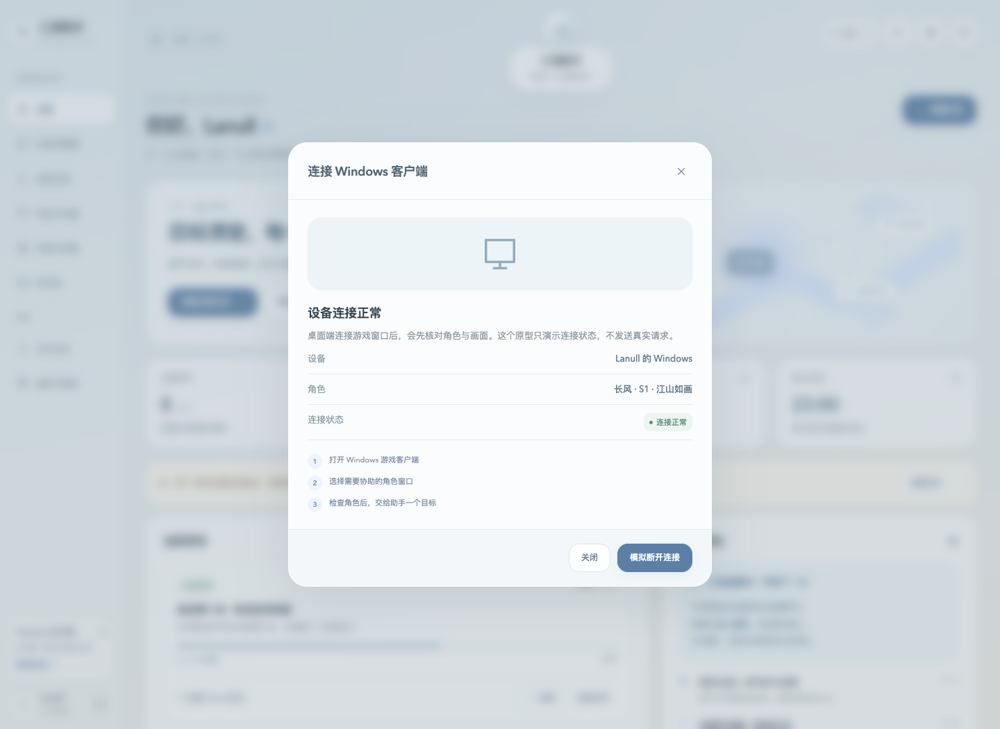

| 元素 | 在线时 | 离线时 |
|---|---|---|
| 弹窗标题 | 连接Windows客户端 | 相同 |
| 内容标题 | 设备连接正常 | 让助手看见你的游戏 |
| 设备 | Lanull的Windows | 相同 |
| 角色 | 当前角色与区服 | 相同 |
| 状态 | 连接正常 | 未连接 |
| 主按钮 | 模拟断开连接 | 模拟连接成功 |
| 次按钮 | 关闭 | 关闭 |

说明步骤为：打开Windows游戏客户端 → 选择需要协助的角色窗口 → 检查角色后交给助手目标。

断开时，当前角色的running／waiting／manual任务变disconnected；暂停、待确认和终态任务不变。重连后，disconnected统一变paused，不自动恢复。原始状态会写入beforeDisconnect，但当前恢复逻辑不读取它。

正式连接流程需要区分设备在线、游戏进程存在、窗口选定、角色识别成功、允许执行。原型只有一个角色级connected布尔值，尚无连接中、失败、权限不足和窗口冲突页面。

### 9.5 离线页面

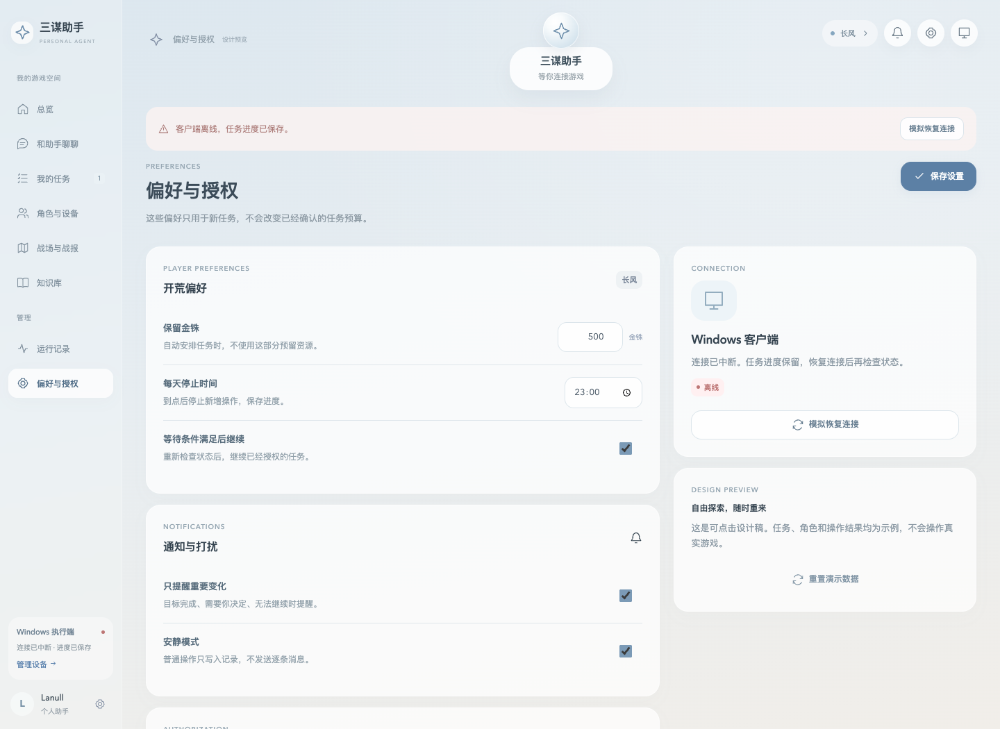

离线时用户仍可看记录、问答、创建计划；任务不能推进。新任务保存为等待连接。恢复后保留进度和原授权，重新核对角色，再由用户选择继续。正式产品应说明断连时正在执行的动作是否已经完成，不能仅凭网络恢复就重复操作。

## 10 P05 战场与战报

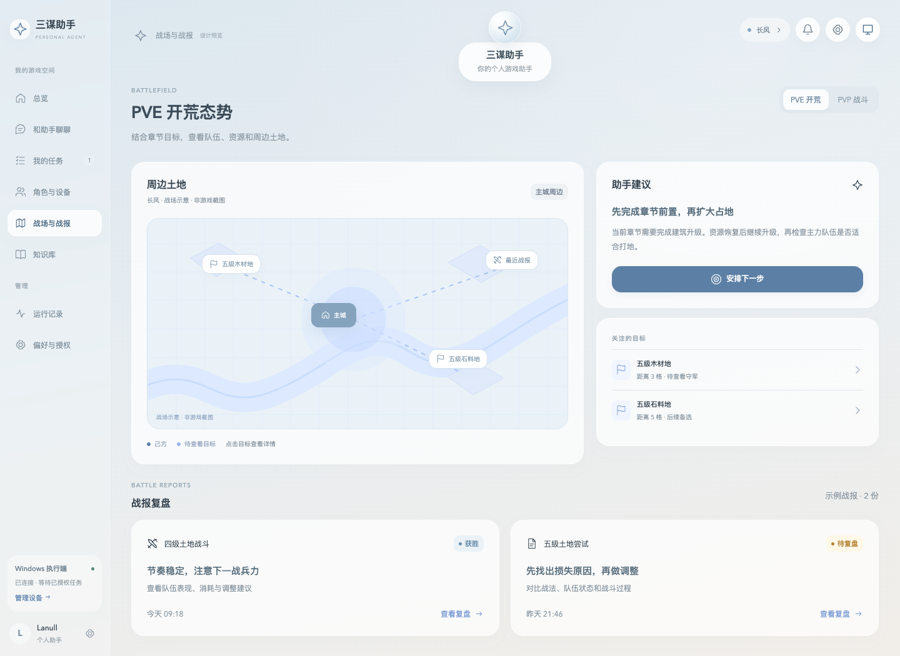

### 10.1 PVE与PVP页面内容对照

| 区域 | PVE | PVP |
|---|---|---|
| 页标题 | PVE开荒态势 | PVP战斗准备 |
| 主图标题 | 周边土地 | 前线态势 |
| 图上角标 | 主城周边 | 备战阶段 |
| 助手建议 | 先完成章节前置，再扩大占地 | 先整备，再决定是否出击 |
| 主要动作 | 安排下一步 | 安排备战 |
| 目标一 | 五级木材地，距离3格，待查看守军 | 北侧防守位置，需要补充最新情报 |
| 目标二 | 五级石料地，距离5格，后续备选 | 友军集结位置，队伍整备后再确认 |
| 战报一 | 四级土地战斗 | 前线遭遇战 |
| 战报二 | 五级土地尝试 | 防守战斗复盘 |

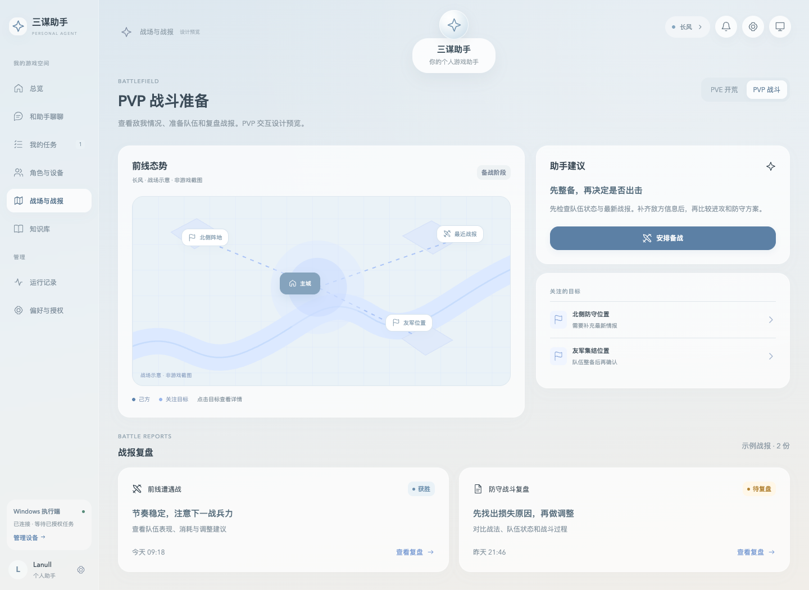

当前切换按钮只修改预览值state.phase，不修改角色实际phase、任务或授权。切换时会提示这是预览。正式产品需要决定阶段由真实进度识别、用户选择，还是允许同时查看两类内容。

### 10.2 地图与关注目标

主图为固定示意图，不是真实游戏截图，也没有真实坐标、缩放、平移或拖动。

| 控件 | 当前去向 |
|---|---|
| 主城 | P04角色页 |
| 第一个目标 | D12，land-1 |
| 第二个目标 | D12，land-2 |
| 最近战报 | D13，battle-1 |
| 右侧目标列表 | 与地图对应目标使用相同入口 |
| 安排下一步／安排备战 | D01，但目前没有携带具体目标 |
| 图例 | 己方、待查看／关注目标、点击查看说明 |

### 10.3 D12 土地或位置详情

PVE显示“土地详情”，按目标ID显示五级木材地或五级石料地；PVP显示“关注目标”，但目前两个目标都会显示北侧防守位置。

字段为：目标名称、当前状态“需要查看最新情况”、建议顺序“检查队伍 → 查看目标 → 决定操作”。底部为“关闭”和“交给助手安排”。

目前“交给助手安排”不携带目标ID、名称、位置和阶段，仍打开默认章节任务。正式建议中必须保留目标上下文，并在任务确认摘要中显示所选对象。

### 10.4 战报卡

两份固定示例：第一份获胜，今天09:18；第二份待复盘，昨天21:46。卡片显示标题、结果、简短结论、说明与“查看复盘”，整卡可点。

无战报、解析中、解析失败、信息不足、过期情报等状态尚未提供。

### 10.5 D13 战报复盘

抽屉展示战报标签、获胜／待分析、复盘标题、战前兵力7,200、战后兵力6,140、助手复盘、下一步建议。

- “查看运行记录”进入P07，当前不筛选到这场战斗。
- “在聊天中讨论”发送“分析这份战报，给我下一步建议”。
- 当前没有把战报ID或正文传入聊天；两份战报共用示例数值和解释。
- 在PVP预览下打开，详情标签仍是“四级土地战斗／五级土地尝试”。

正式产品建议最少显示战斗时间、双方队伍、结果、损失、关键原因、引用的战报片段和后续建议；只知道一部分内容时明确显示缺哪些信息。具体战斗字段由游戏可取得的数据决定，本稿不虚构完整战斗解析能力。

### 10.6 本页需要先解决的关系

阶段、目标、战报与任务要贯通：用户从哪个对象开始，任务和聊天就应继续指向那个对象。当前页面已表达布局方向，但这条上下文传递仍是占位。

首期PVE可先实现一个目标类型和一份真实战报的完整路径。PVP保留页面与字段设计，按真实业务补内容，不只更换文案。

## 11 P06 知识库

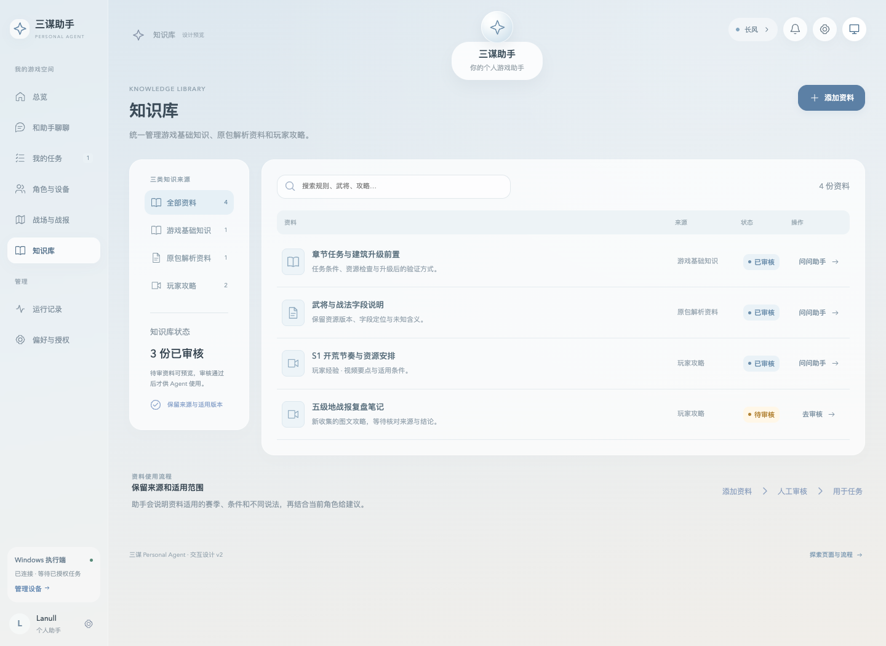

### 11.1 页面分工与布局

知识库为所有角色共享，保存三类知识来源。桌面左侧筛来源，右侧搜索与资料列表；底部说明“添加资料 → 人工审核 → 用于任务”。引用资料时再结合当前角色和当前任务。

| 编号 | 元素 | 当前内容／行为 |
|---|---|---|
| P06-C01 | 页标题与说明 | 知识库；统一管理游戏基础知识、原包解析资料和玩家攻略 |
| P06-C02 | 添加资料 | D09 |
| P06-C03 | 来源筛选 | 全部资料、游戏基础知识、原包解析资料、玩家攻略；各有数量 |
| P06-C04 | 知识库状态 | 已审核资料数量、待审说明、保留来源与版本提示 |
| P06-C05 | 搜索框 | “搜索规则、武将、攻略…”；匹配标题和摘要，忽略大小写 |
| P06-C06 | 结果数 | 当前来源与关键词筛选后的数量 |
| P06-C07 | 资料列 | 来源图标、标题、摘要 |
| P06-C08 | 来源列 | 三类来源名称 |
| P06-C09 | 状态列 | 已审核／待审核 |
| P06-C10 | 已审核操作 | “问问助手”，进入P01并附带资料标题 |
| P06-C11 | 待审核操作 | “去审核”，打开D11 |
| P06-C12 | 标题区域 | 打开D10资料详情，不需要点击整行 |
| P06-C13 | 底部说明 | 保留来源和适用范围；考虑赛季、条件和不同说法 |

搜索和来源筛选同时生效，选择会保留。当前按字符串包含关系查找，不做真实知识检索。每次输入重绘列表并恢复光标位置。

空结果显示“没有找到相关资料”“换一个关键词，或者添加一份新的攻略。”与“添加资料”。当前没有单独的知识库完全为空页面。

### 11.2 初始示例资料

| 资料 | 来源 | 状态 |
|---|---|---|
| 章节任务与建筑升级前置 | 游戏基础知识 | 已审核 |
| 武将与战法字段说明 | 原包解析资料 | 已审核 |
| S1开荒节奏与资源安排 | 玩家攻略 | 已审核 |
| 五级地战报复盘笔记 | 玩家攻略 | 待审核 |

### 11.3 D09 添加资料

| 字段 | 当前控件与文案 | 校验／结果 |
|---|---|---|
| 资料标题 | 文本框；占位“例如：S1开荒攻略笔记” | 去掉首尾空格后不能为空 |
| 资料来源 | 下拉框，默认玩家攻略 | 玩家攻略／游戏基础知识／原包解析资料 |
| 来源链接或定位说明 | 文本框；占位为链接、视频时间点或文件位置 | 非空即可，可以是文字而非URL |
| 提示 | 新资料先进入待审核区；演示不抓取链接 | 不隐藏审核步骤 |
| 取消 | 关闭 | 不新增资料 |
| 生成待审核资料 | 创建pending条目 | 缺字段时显示“请填写标题和来源，便于后续核对。” |

成功后：条目插入顶部 → 写新增待审核资料事件 → 进入知识库 → 自动打开该条审核抽屉。

当前不校验资料重复、标题长度、URL可访问性、文件大小或内容格式；来源定位被拼到摘要文字里，没有独立的结构化字段。

正式产品建议先明确导入类型：视频链接、图文链接、在线文档、上传文件、手动条目、REA字段包。各类型应该有各自的来源和解析进度，不用一个文本框承担全部操作。

### 11.4 D10 资料详情和D11审核资料

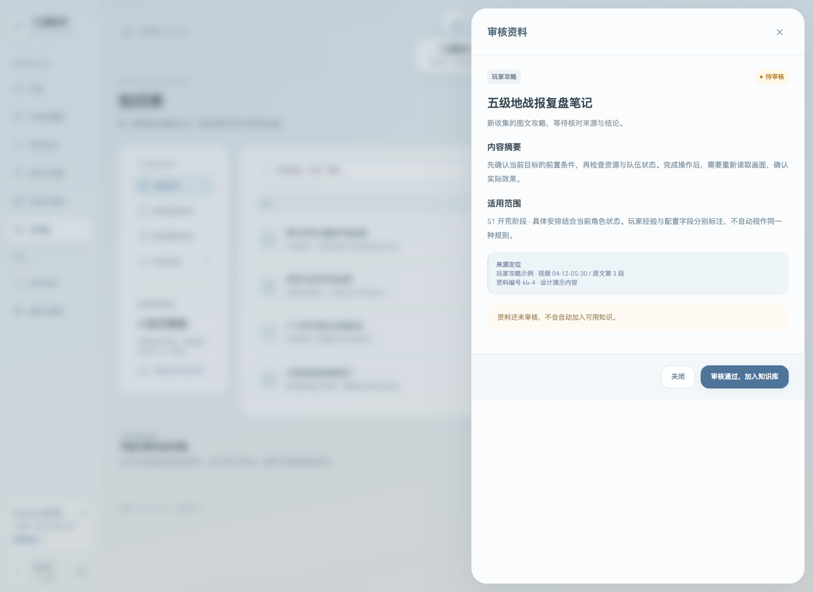

同一抽屉有“资料详情”和“审核资料”两种标题。内容顺序：

1. 来源类别与状态。
2. 标题和摘要。
3. 内容摘要。
4. 适用范围。
5. 来源定位。
6. 待审提示或已审核提示。
7. 底部动作。

当前所有资料使用同一份内容摘要和S1开荒适用范围。来源定位按类别显示三组示例文字：玩家视频时间点、原包版本与字段位置、基础规则章节。新导入的来源输入只出现在摘要中；当前没有直接打开原文的链接按钮。

| 当前状态 | 按钮 | 结果 |
|---|---|---|
| 待审核 | 关闭 | 不改变状态 |
| 待审核 | 审核通过，加入知识库 | 改为reviewed，写记录，关闭抽屉并刷新列表 |
| 已审核 | 关闭 | 回到底层页 |
| 已审核 | 用这份资料问助手 | 当前角色聊天追加问题与固定示例回答，跳P01 |

正式审核至少需要考虑“通过”“不采用”“需要补充资料”三种结果，保存审核意见、审核人、时间和版本；是否逐条审核具体结论，待决定。对已采用资料还需提供更正与撤回，避免只能一直累加。

### 11.5 知识回答与任务的关系

当前“问问助手”只带资料标题，回复为固定章节建议，未读取全文，也没有针对PVP角色更换回答。正式流程应携带资料ID、版本、引用片段、当前角色与问题，回复中可直接查看原文位置。

资料是否经过审核，与它是否适用于当前任务是两个判断。PVE规则、某赛季攻略和解析字段不能因为“已审核”就无条件用于所有角色。

### 11.6 本页待补状态

- 添加资料的解析中、部分成功、失败重试。
- 资料重复与不同版本合并。
- 原文无法访问、来源撤回、适用版本未知。
- 资料互相矛盾时的并列展示。
- 审核拒绝、退回补充、撤回已审核资料。
- 已审核状态的颜色统一：列表当前使用蓝色done样式，详情使用绿色reviewed样式。
- 窄屏隐藏状态列后，仍应保留清楚的“待审核／已审核”文字，不只靠按钮名称推断。

## 12 P07 运行记录

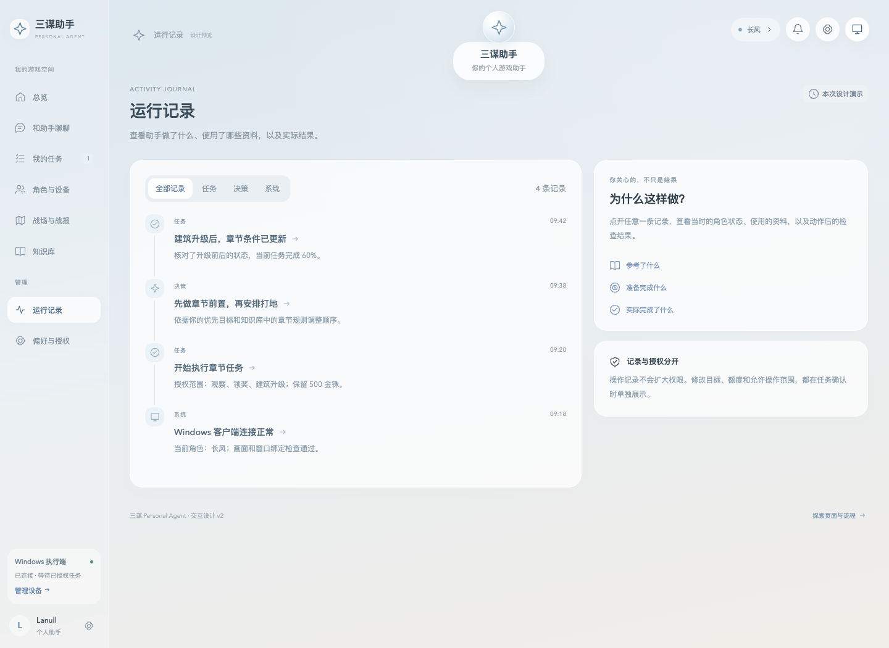

### 12.1 页面内容

页头“运行记录”，说明“查看助手做了什么、使用了哪些资料，以及实际结果。”；角标“本次设计演示”。

左侧按新到旧列事件，右侧说明“为什么这样做？”与“记录与授权分开”。960px以下隐藏右侧解释栏，保留记录主体。

| 编号 | 元素 | 当前行为 |
|---|---|---|
| P07-C01 | 全部记录 | 显示全部事件 |
| P07-C02 | 任务 | 筛task事件 |
| P07-C03 | 决策 | 筛decision事件 |
| P07-C04 | 系统 | 筛system事件 |
| P07-C05 | 记录数量 | 当前筛选数量 |
| P07-C06 | 单条事件 | 类型、时间、标题、说明 |
| P07-C07 | 标题箭头 | D14单步详情 |
| P07-C08 | 空状态 | “暂时没有这类记录”“开始一个任务后，相关过程会显示在这里。” |

当前有“确认”类型的展示标签，但没有对应独立筛选，现有操作也未生成该类事件。没有按角色、任务、时间段、结果或关键词筛选。

### 12.2 D14 单步记录详情

标题“这一步发生了什么”，顶部显示时间、事件标题和说明。四段内容为：

| 区域 | 当前固定示例 |
|---|---|
| 当时的状态 | 当前角色和章节状态已读取 |
| 采用的依据 | 章节规则与玩家偏好 |
| 选择的操作 | 在已授权范围内推进当前目标 |
| 结果检查 | 新观察与预期变化对比 |

底部显示事件ID、数据来源“交互原型”、真实游戏操作0；“查看参考资料”固定打开kb-1，“关闭”结束抽屉。

正式详情应由具体事件的数据生成。不同事件可能没有游戏动作或知识引用，不应填入同一份“检查通过”说明。例如保存偏好事件应展示变更前后值，而不是游戏状态验证。

### 12.3 记录的角色与任务归属

当前events为全局数组，只有id、time、title、detail、type，没有roleId、taskId或实际调用ID。切换角色不改变记录范围；总览也读取全局最近两条。

**建议待评审：** 默认显示当前角色记录，提供“所有角色”筛选；每行仍显示角色名。也可选择默认全局记录，但必须在页面标题附近明确范围。通知、任务详情、战报跳转到记录时应自动带上对象筛选。

### 12.4 正式产品需要展示的结果层次

区分“已提出建议”“已批准”“已发送操作”“已看到效果”“任务完成”。只收到工具响应不等于目标已达成。日志可以保留技术细节，但普通用户优先看到目标、动作、结果与下一步。

缺少截图、调用或验证证据时显示缺什么，不填一段看似完整的成功说明。详细技术字段可放折叠区，避免把页面变成原始日志终端。

## 13 P08 偏好与授权

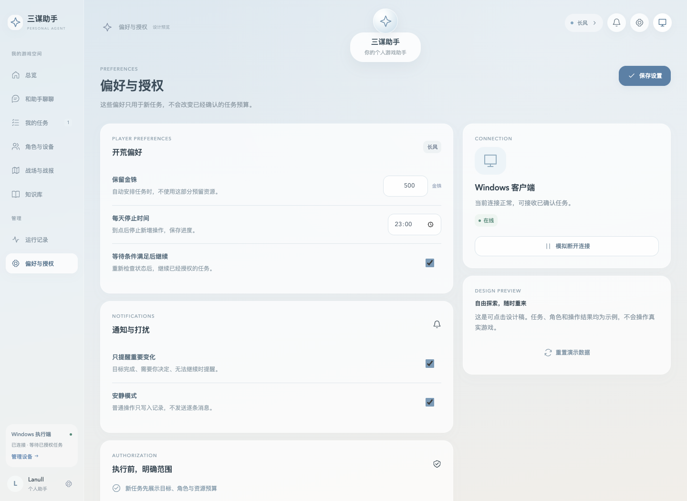

### 13.1 范围与布局

设置属于当前角色。页头明确：“这些偏好只用于新任务，不会改变已经确认的任务预算。”右上为“保存设置”。

左侧为开荒偏好、通知与打扰、执行范围说明；右侧为Windows连接状态与演示重置。窄屏变为单列。

### 13.2 每个字段

| 字段 | 当前控件与初始值 | 保存后有什么作用 | 当前未实现部分 |
|---|---|---|---|
| 保留金铢 | number；长风500，北望1000；HTML设min=0、max=999999、step=100 | 新任务预留默认值 | 不读真实余额，不计算可花金额；脚本未检查max、step或整数 |
| 每天停止时间 | time；23:00／22:30 | 新任务停止时间默认值 | 没有到点停止调度 |
| 等待条件满足后继续 | 开关，默认开 | 保存autoResume | 没有条件观察与自动唤醒 |
| 只提醒重要变化 | 开关，默认开 | 保存notify | 不控制当前Toast或通知列表 |
| 安静模式 | 开关，默认开 | 保存quiet | 不改变实际提示和消息行为 |

字段说明分别解释资源预留、到点后停止新增操作、重新检查后继续，以及只提醒目标完成、需要决定和无法继续。正式产品应定义“重要变化”清单，以及安静模式是否只减少普通提示。

### 13.3 保存与未保存状态

点击“保存设置”检查资源预留是有限非负数、停止时间非空。失败提示“请填写有效的资源预留和停止时间”；成功更新当前角色偏好，写系统事件，刷新页面，提示“设置已保存，仅用于新任务”。

原型允许数字空输入转换成0，也允许小数；HTML最大值和步长没有被保存逻辑强制执行。未保存就切页或切角色，表单中的变化丢失，没有提醒。

**正式建议：** 标记“有未保存修改”；字段分别报错；资源使用整数单位；保存失败时保留输入并提供重试。是否自动保存或显式保存，由用户评审决定。

### 13.4 执行范围说明

当前为三条静态说明：

- 新任务展示目标、角色与资源预算。
- 超出授权范围时再征求决定。
- 可以随时暂停或接管，不丢失任务进度。

本区域没有授予额外权限的开关，实际操作仍在任务确认时选择。未来若增加常驻授权，应显示适用角色、动作、额度、有效期和撤销入口，不能只放一个“全自动”开关。

### 13.5 连接和D19重置

“模拟断开连接／模拟恢复连接”与D08使用同一套状态转换。

“重置演示数据”打开确认：

- “保留当前演示”：关闭。
- “重置示例数据”：重建全部示例角色、任务、消息、资料、事件和设置。
- 原型UI重置后进入总览；首次打开与测试辅助重置却进入对话，需统一。
- 这是设计演示工具，正式产品不应保留这种会清空全部业务状态的同名入口。

## 14 所有弹窗与辅助窗口清单

各页面章节已经说明字段和动作；本表用于检查是否遗漏入口、返回和状态。

| 编号 | 名称 | 样式 | 主要入口 | 确认／主要出口 |
|---|---|---|---|---|
| D01 | 交给助手一个目标 | 中央三步向导 | 总览、任务、聊天建议、战场、目标 | 创建任务后P03＋D02 |
| D02 | 任务详情 | 右侧抽屉 | 列表、总览、消息任务卡、上下文 | 任务控制、知识、记录 |
| D03 | 确认这项安排 | 中央确认 | 待确认任务继续 | 同一任务转执行，不重复创建 |
| D04 | 取消这个任务 | 中央危险确认 | 任务详情 | 取消后回D02 |
| D05 | 接下来由你操作 | 中央确认 | 任务详情 | 设置接管，显示全局提示 |
| D06 | 切换游戏角色 | 中央选择 | 顶栏角色按钮 | 切换或进入D07 |
| D07 | 先暂停当前角色 | 中央确认 | 切换有运行任务的角色 | 暂停旧任务并切角色 |
| D08 | 连接Windows客户端 | 中央引导 | 侧栏、角色页、指南 | 模拟连接／断连 |
| D09 | 添加一份资料 | 中央表单 | 知识库 | 新待审条目＋D11 |
| D10 | 资料详情 | 右侧抽屉 | 资料标题、任务引用 | 已审核资料可带入对话 |
| D11 | 审核资料 | 右侧抽屉 | 去审核、导入成功 | 通过后刷新知识库 |
| D12 | 土地详情／关注目标 | 中央详情 | 地图与目标列表 | 新建任务向导 |
| D13 | 战报复盘 | 右侧抽屉 | 战报卡／地图最近战报 | 记录页或聊天 |
| D14 | 这一步发生了什么 | 右侧抽屉 | 运行记录标题 | 参考资料 |
| D15 | 当前角色与安排 | 右侧抽屉 | 顶栏显示器图标 | 角色、偏好、任务详情 |
| D16 | 需要你关注 | 中央列表 | 顶栏铃铛 | 待确认任务或任务页 |
| D17 | 添加截图或战报 | 中央演示 | 输入框加号 | 使用示例战报进入聊天 |
| D18 | 语音交互预览 | 中央演示 | 输入框麦克风 | 发送固定语音转写文本 |
| D19 | 重置设计演示 | 中央确认 | 偏好页 | 恢复初始示例 |
| D20 | 设计预览指南 | 宽中央窗口 | 顶栏星形、普通页页脚 | 8页导航、首次连接、关闭 |
| D21 | 页面截图放大 | 原生dialog | screens.html图片 | 关闭或Escape回总览板 |

D21属于设计评审工具，不是正式产品页面。原型内D01–D20都是单层覆盖容器，打开新窗口会替换旧窗口；其中D19重置与D20预览指南也属于演示工具，不直接进入正式产品。

### 14.1 D17 附件演示细节

显示“把游戏画面交给助手”，提供“使用示例战报”和“取消”。选示例只发送“帮我分析这份示例战报”，没有真实文件或附件对象。

正式附件流程需要补文件选择、预览、移除、上传中、上传失败、格式／大小限制、当前角色归属，以及识别前是否需要用户确认。

### 14.2 D18 语音演示细节

显示麦克风、声波和示例句“今天先推章节，保留五百金铢。”。点击“发送示例语音”后将固定文字作为聊天输入。关闭不会发消息，不申请麦克风。

正式语音流程应覆盖：开始录音、权限拒绝、录音中、结束、转写、改字、确认发送、取消。语音提出操作也要经过与文字相同的任务确认，不直接跳过授权。

### 14.3 D16 通知与D20指南

通知目前只有待确认任务，不包含完成、断连或错误历史；无待确认项时显示“暂时没有需要你决定的事项”。

指南列8个页面入口，以及任务创建、推进接管、资料审核、断连恢复四条体验路径；“查看首次连接页”打开D08，“开始体验”关闭指南。

### 14.4 设计总览板

screens.html列出14个桌面页面／状态截图和窄屏对话示例。点击截图可放大；“进入页面”跳到原型对应主页面，不直接还原该截图的弹窗状态。流程链接按任务与知识两条线组织。正式产品中不出现该总览板。

## 15 页面之间的完整流程

### F01 从一句话到任务开始

P01输入目标 → 建议卡保留原话 → D01设定目标 → 核对角色 → 选择范围和资源预留 → 摘要确认 → 创建任务 → P03＋D02 → P01同步任务卡。

评审重点：原话与结构化字段是否一致；用户是否知道当前要操作哪个角色；确认前不执行。

### F02 从总览处理待确认任务

P02看到数量与第一项标题 → D02 → D03 → 用户确认 → 同一任务进入执行 → 状态同步到P02、P03。聊天中若已有该任务卡，会显示新状态；当前确认操作不会新增聊天消息或任务卡。

若取消确认，原任务保持待确认。通知D16是同一流程的另一个入口。

### F03 暂停与继续

P02或D02暂停 → 保存进度 → 状态paused → 用户点继续 → 检查连接和接管 → 若可继续，暂停同角色其他running任务 → 目标任务running。

正式产品需先说明是否存在正在完成的原子操作，再显示“已暂停”，避免按钮反馈与实际输入状态不同步。

### F04 取消任务

D02取消 → D04解释影响 → 确认 → cancelled终态 → 保留详情和历史。

“保留任务”或关闭取消窗口没有状态变化。取消不等于删除，也不等于撤回已发生的游戏效果。

### F05 人工接管与交还

D02我来操作 → D05确认 → 当前角色执行／等待任务manual → 全局显示由你操作 → 用户操作 → 交还助手 → 原型检查提示 → 任务paused → 用户选择继续。

正式版本需要把“停止输入”和“重新读取状态”的过程显示出来，并决定接管影响当前角色还是整个Windows交互桌面。

### F06 断连与恢复

P08或D08模拟断连 → 相关任务disconnected → 全站离线条 → 无法继续推进 → 恢复连接 → 相关任务paused → 重新检查后用户继续。

要测试断连发生在开始前、动作已发送但未确认、等待资源和人工接管时的不同结果。

### F07 切换角色

顶栏或P04选另一角色 → 若旧角色running则D07 → 确认暂停 → 加载目标角色聊天、任务、偏好与接管状态 → 更新顶栏和页内容。

待决定：正式产品“切换查看”是否应该影响后台执行。建议查看与执行控制分开，避免用户查看另一个角色就暂停原任务。

### F08 新建任务时选择另一角色

D01第一步选另一角色 → 第二步加载该角色默认设置 → 第三步确认 → 当前原型切换角色并暂停旧运行任务 → 新任务出现在所选角色下。

当前第三步没有说明旧任务受影响。正式建议摘要加入“将切换到XX，并暂停XX任务”，或者允许新任务只排队、不切当前查看角色。

### F09 添加攻略到知识库

P06添加资料 → D09填写标题和来源 → 创建pending条目 → D11核对内容与出处 → 审核通过 → P06显示已审核。

资料没有审核前不能通过“问问助手”作为已批准资料使用。正式版还需补拒绝、补充和撤回路线。

### F10 带资料回到对话

P06已审核资料问助手 → P01追加资料相关问题和回答 → 可继续提出任务 → D01确认。

当前只传标题，正式版必须传资料ID、版本和引用片段，并在消息里提供来源入口。

### F11 从战场目标形成安排

P05选PVE／PVP视图 → 点击具体目标D12或战报D13 → 讨论／安排 → P01或D01 → 确认角色、对象、范围与资源 → 新任务。

当前目标和战报信息没有完整传递，这是页面间交互的优先修订项，不能只用通用章节目标代替。

### F12 修改偏好

P08修改 → 保存 → 当前角色默认设置更新 → 下一次D01读取新默认值 → 已确认任务不变。

如果用户意图修改正在运行的任务，应进入独立“调整当前任务”流程；当前原型没有这一流程。

### F13 任务完成

真实产品由执行结果验证完成；原型由“推进一步”达到100%触发 → completed → 任务列表和卡片同步 → 聊天出现汇报 → 运行记录可查。

汇报建议包含做成什么、资源变化、未完成事项、下一步可选安排，而不是只有“成功”。

### F14 重启与刷新

当前原型从localStorage恢复角色、任务、聊天、知识和设置；URL中的有效页面名优先。弹窗、未发送文字和向导草稿不恢复。

正式版本重启应从可靠的任务存档恢复，重新检查设备与角色状态，再决定哪些任务能继续；不直接把浏览器中“running”当作真实运行状态。

## 16 数据如何在页面之间保持一致

本节说明前端需要的产品信息，不是要求后端照搬原型的localStorage结构。正式后端仍使用项目已有接口和执行约定。

### 16.1 当前原型数据

| 数据 | 字段／内容 | 所属范围 |
|---|---|---|
| 状态格式版本 | version=1 | 这是存储格式版本，不是设计稿v1 |
| 角色列表 | id、name、server、phase、connected | 两个固定示例角色 |
| 当前角色 | role | 当前查看和操作的角色副本 |
| 战场预览模式 | phase=pve／pvp | 当前为全局选择，与role.phase分开 |
| 接管标记 | manual、manualRoles | 当前角色投影＋按角色保存 |
| 默认设置 | resourceReserve、stopTime、quiet、autoResume、notify | 当前settings＋按角色preferences |
| 任务 | id、roleId、title、description、status、progress、reserve、stop、allowed、created、spent | 按角色区分 |
| 聊天 | who、text、roleId，可附taskId或proposal | 按角色显示 |
| 知识 | id、title、source、status、summary | 全局共享 |
| 事件 | id、time、title、detail、type | 全局共享，目前没有角色与任务关联字段 |
| 页面选择 | route、taskFilter、eventFilter、kFilter、kQuery | 全局保存，不按角色区分 |
| 临时界面 | draft、overlay、toast | 临时内存；不恢复向导和弹窗 |

### 16.2 统一数据的最低要求

- 总览任务卡、聊天任务卡、任务列表和详情都引用同一个任务ID，不各自保存一份进度。
- 任务已确认的资源限制与角色默认偏好分开；修改偏好不改旧任务。
- 当前角色变更后，所有可执行入口都校验对象是否属于这个角色。
- 知识内容可共享，但回答和建议必须带适用角色、赛季、时间与任务条件。
- 运行事件需要能关联到角色、任务、调用和结果，才能解释真实执行过程。
- 查看模式、用户接管状态、设备连接、任务执行状态应分别表达，不能用一个“在线／运行中”标签替代全部含义。

### 16.3 正式数据建议

| 信息对象 | 最少需要表达 | 对应页面 |
|---|---|---|
| 玩家偏好 | 内容、作用角色、来源、更新时间、是否由用户确认 | P01、P08 |
| 角色状态 | 角色身份、区服、赛季、章节、队伍、资源、读取时间、未知字段 | P02、P04、P05 |
| 任务目标 | 目标原话、整理后的目标、角色、阶段、目标对象、优先级 | P01、P03、D01 |
| 已确认范围 | 允许动作、资源预留、累计消耗上限、停止条件、确认版本 | D01、D02、P08 |
| 执行进度 | 当前步骤、完成步骤、等待原因、下一次检查时间、最近实际结果 | P02、P03 |
| 操作控制 | 正在运行者、接管请求、输入是否已停止、恢复检查状态 | 全局提示、D02 |
| 资料引用 | 资料ID、版本、原文位置、适用条件、审核结果 | P06、P01、P07 |
| 通知 | 角色、任务、类型、严重程度、未读状态、可操作入口 | G09、D16 |
| 运行事件 | 对象关联、动作、前后状态、结果、失败／未知原因、证据链接 | P07 |
| 对话附件 | 文件或截图、角色归属、识别状态、分析结果、引用关系 | P01、P05 |

这些是待评审的数据需求，不是本轮已经新增的后端接口。

### 16.4 保存、刷新与恢复

原型保存键为sanmou-design-v2。每次渲染或记录事件会保存整个state。JSON损坏或版本不符时恢复默认示例；当前没有完整结构校验，同版本缺字段可能报错。

保存失败被静默忽略，因此“设置已保存”可能只表示当前内存已更新。正式产品需要保存中、保存成功、保存失败和重试，不能一律提示成功。

未发送的输入、未保存的设置和向导草稿在切页或关闭时可能丢失。需决定草稿是否自动保留，以及退出前是否提示。多个浏览器标签页或多个终端同时修改的规则也尚未设计。

## 17 任务与控制状态

### 17.1 当前任务状态表

| 内部状态 | 用户看到 | 当前进入方式 | 当前离开方式 |
|---|---|---|---|
| approval | 待确认 | 预置示例任务 | 确认后执行，或取消 |
| running | 执行中 | 在线且未接管时创建、继续或批准 | 暂停、接管、断连、切角色、新任务替换、完成、取消 |
| waiting | 等待资源 | 预置示例任务 | 手动继续、暂停、接管、断连、取消 |
| paused | 已暂停 | 用户暂停、交还、重连、切角色、同角色其他任务开始、接管时创建新任务 | 检查后继续或取消 |
| manual | 人工接管 | 接管当前角色的执行／等待任务 | 交还后暂停、聊天暂停、断连后等待连接、取消 |
| disconnected | 等待连接 | 离线时创建，或执行／等待／接管时断连 | 重连后暂停、聊天暂停、取消 |
| completed | 已完成 | 演示进度到100% | 只查看，不再继续 |
| cancelled | 已取消 | 二次确认取消 | 只查看，不再继续 |

### 17.2 状态转换的具体约束

1. 新建或继续一个任务会暂停同角色其他running任务；并不会把它们取消。
2. 暂停、重连和交还不重置进度，也不重新补满预算。
3. cancelled和completed是当前UI终态，没有恢复入口。
4. 离线且接管时可以同时存在“角色manual=true、任务disconnected”；重连后任务paused，但角色仍可能manual。
5. 当前waiting没有真正的资源检测；继续只是进入统一检查后改为running。
6. 暂停、取消、断连的反馈都是同步演示，正式执行端需要返回实际停止／保存结果。
7. 当前只有进度百分比，不能据此计算真实任务成功。
8. 聊天“暂停”还可把waiting、manual或disconnected任务改为paused，但不改变角色离线／接管标记。任务状态和角色控制状态仍需分别解释。

### 17.3 正式版本需要补充的状态

| 状态／信息 | 用户为什么需要知道 | 建议交互 |
|---|---|---|
| 正在准备计划 | 助手还在整理目标或读取状态 | 可取消，不显示正在执行 |
| 等待确认及原因 | 可能是新任务、预算变化或重要选择 | 展示具体变化与确认范围 |
| 正在暂停／取消 | 已发出的操作可能尚未结束 | 说明正在停止新增输入，完成后反馈 |
| 等待资源／冷却／外部事件 | 不是系统失败 | 显示等待原因、预计检查时间 |
| 执行失败 | 当前步骤确实失败 | 说明可重试、换方案或需要用户处理 |
| 结果尚不确定 | 操作可能已发生，但还没核对到 | 先查实际状态，不直接重复执行 |
| 目标已不可达 | 现有任务已无法满足 | 说明原因，提供修改目标或终止 |
| 授权失效／停止时间到达 | 不应继续新增操作 | 保存进度，说明后续如何处理 |
| 恢复检查中 | 连接恢复不等于已可运行 | 检查角色与未决操作后允许继续 |

**待决定：** 用户可见状态不要机械暴露所有内部技术状态。可以用主要状态＋一行原因说明，具体状态留在详情。

## 18 表单、错误与通知规范

### 18.1 当前可见错误

| 场景 | 当前反馈 | 当前是否阻止操作 |
|---|---|---|
| 任务目标为空 | “请先写下一个任务目标。”，字段下方 | 是，不进入下一步 |
| 预留非法／时间为空／范围全空 | 合并错误提示 | 是，不进入确认 |
| 角色离线后继续 | “客户端离线，请先恢复连接” | 是，任务不启动 |
| 接管时继续 | “当前由你操作，请先交还助手” | 是 |
| 非执行状态推进 | “任务需处于执行中，才能演示推进” | 是 |
| 打开其他角色任务 | “当前角色没有这项任务” | 是 |
| 资料标题或来源为空 | “请填写标题和来源，便于后续核对。” | 是，不创建资料 |
| 未审核资料问助手 | “请先审核这份资料” | 是 |
| 偏好输入非法 | “请填写有效的资源预留和停止时间” | 是，不保存 |
| 浏览器保存失败 | 没有用户反馈 | 仅忽略保存失败，需补 |

### 18.2 正式表单建议

- 必填项有明确标记；错误靠近字段，保留已输入值。
- 数量字段明确单位、整数要求、允许最小／最大值，不把空输入当成0。
- 停止时间必须附日期或解释“今天／下次”；已过时间不应默默排到错误的一天。
- 角色、任务、对象名称较长时，摘要不能把关键身份截断到无法识别。
- 多步向导上一步先保存当前输入；关闭时是否保留草稿由统一规则决定。
- 确认提交期间按钮防止重复点击；后端返回成功后再显示已创建。
- 批量选择操作时应说明潜在消耗，抽卡等操作单独展示参数，而不是只勾一个词。

### 18.3 通知分级建议

| 类型 | 建议形式 | 是否需要用户操作 |
|---|---|---|
| 普通步骤完成 | 写运行记录，必要时更新任务卡 | 否 |
| 等待资源 | 任务状态＋检查时间 | 通常否 |
| 任务完成 | 简短汇报＋结果详情入口 | 否，可安排下一步 |
| 需要决定 | 持久通知卡，带角色与任务 | 是 |
| 设备或服务断连 | 全局状态条＋对应任务说明 | 可能需要 |
| 操作效果未知 | 持久阻塞提示，说明正在核对什么 | 视恢复结果 |
| 达到预算／停止时间 | 保存进度并通知 | 若要继续需重新确认 |
| 偏好保存成功 | 短提示 | 否 |

安静模式可以减少普通操作消息，但不能隐藏需要用户处理的事项。通知应能跳到准确角色与任务，保留未读／已处理状态；当前通知弹窗尚无这些能力。

### 18.4 状态文案建议

优先使用清楚动作，而不是抽象术语：

- “等待木材恢复，预计20分钟后重新检查”，而不是“等待调度”。
- “任务已暂停，已完成的步骤保留”，而不是“进入挂起状态”。
- “还没有确认这次操作是否生效，先重新读取游戏”，而不是直接写“失败，重试”。
- “新的设置只用于后续任务”，避免用户误以为当前任务已更新。

时间与资源数值需来自实际数据；这里的例句不是新的游戏规则。

## 19 可访问性、键盘与窄屏

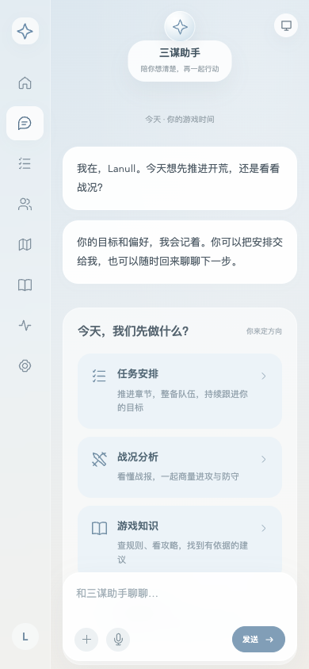

### 19.1 当前已有

原生按钮和表单；部分图标按钮有可访问名称；弹窗标题关联、Escape关闭、Tab循环；关闭后尝试恢复焦点；Enter发送、Shift+Enter换行；轻提示可被读屏器播报；系统要求减少动画时关闭动画和过渡。

### 19.2 正式产品必须检查

| 检查项 | 当前情况 | 预期规则 |
|---|---|---|
| 中文输入法 | 没有检查输入组合状态 | 确认候选词的Enter不能发送消息 |
| 窄屏图标导航 | 文本被隐藏，图标aria-hidden，按钮缺独立名称 | 每个按钮有可访问名称；可提供可见提示 |
| 任务状态 | 窄屏隐藏状态列 | 至少保留文字状态或紧凑标签 |
| 知识状态 | 窄屏隐藏状态列 | 待审核不能只靠“去审核”间接表达 |
| 弹窗初始焦点 | 通常在关闭按钮 | 表单首字段、确认框安全动作，按场景设置 |
| 弹窗关闭焦点 | 来源控件重绘后可能不存在 | 回到同一功能入口或稳定标题 |
| 背景交互 | 有aria-modal，但主内容未设inert | 弹窗打开时背景不能被键盘／读屏继续操作 |
| 消息更新 | 主要靠Toast播报 | 新消息和重要任务状态有适度播报 |
| 页面标题 | 聊天h1被视觉CSS隐藏 | 保留可访问页面名称与语义层级 |
| 颜色对比 | 多处浅灰与半透明背景 | 逐项检查正文、辅助文案与按钮的可读性 |
| 触摸尺寸 | 部分图标按钮约30px | 关键点击目标建议达到约44px有效触摸区 |
| 文字缩放 | 未记录测试 | 200%文字缩放不遮挡必需信息 |
| 软键盘 | 未记录测试 | 输入框与最新消息不被遮挡 |
| 自动滚动 | 消息超过3条后重绘滚底 | 用户看旧消息时不强行拉走；提供“回到最新” |
| 动效 | 欢迎动画与语音声波 | 减少动画设置生效，不能用动效单独表达状态 |

“390px无横向溢出”只是一个布局检查项，不代表这些体验已经验收。

## 20 优先评审的问题和建议

以下内容需要review，不在本轮直接修改原型。

### 20.1 先确定的产品规则

| 编号 | 问题 | 当前表现 | 建议讨论结论 |
|---|---|---|---|
| R01 | 查看角色是否影响后台运行 | 切换查看会暂停原角色running任务 | 建议分开“查看角色”和“控制／接管角色”，与多窗口目标一致 |
| R02 | 新目标是新增还是修改 | 普通聊天多生成新任务；新任务抢占旧任务 | 提供“调整当前安排／新增并排队”，在确认中说明影响 |
| R03 | 资源预留与花费上限 | 只有保留金铢 | 分开余额下限、单任务消费上限；抽卡再明确次数和方式 |
| R04 | 任务与角色接管双重状态 | manual与disconnected／paused可组合 | 明确界面优先级和接管作用范围，避免状态互相掩盖 |
| R05 | 自动继续与停止时间 | 只存值，没有调度行为 | 定义触发、检查、失效、跨天与停止中的反馈 |
| R06 | 运行记录范围 | 共享事件无roleId | 选择默认当前角色或全局；无论哪种都保留角色与任务标识 |
| R07 | PVE／PVP视图与实际阶段 | 分离但共享全局预览变量 | 将预览模式限制在战场，或明确全局模式；不改变任务授权 |
| R08 | 长期记忆的用户入口 | “偏好与记忆”实际只进设置 | 首期是否仅做偏好；若称记忆，应支持查看、纠正、移除已记事项 |

### 20.2 当前原型的优先修订项

| 编号 | 具体问题 | 影响 | 建议修订 |
|---|---|---|---|
| R09 | “不要继续”可能命中继续关键词 | 反向理解控制意图 | 正式接入前用明确意图识别与对象确认；控制命令加否定测试 |
| R10 | PVP安排仍预填章节目标 | 目标上下文丢失 | 携带阶段、目标ID、名称和来源；确认摘要完整展示 |
| R11 | PVP友军目标详情串用北侧防守位置；战报详情仍显示PVE土地战斗 | 列表与详情不一致 | 按同一目标／战报数据生成两处内容 |
| R12 | 所有任务共用5步和kb-1引用 | 无法解释具体任务 | 根据任务类型与实际计划生成步骤和引用 |
| R13 | 总览默认设置与任务已确认设置混放 | 用户可能以为当前任务时间已改 | 分别标“当前任务约束”“新任务默认值” |
| R14 | 总览最近事件全角色混用 | 误认另一个角色的动作 | 按R06选定范围过滤或加角色标识 |
| R15 | 金铢空值变0、小数与上限未校验 | 表单含义不清 | 明确必填、整数、最大值和单位，逐字段提示 |
| R16 | 向导返回／离开丢输入 | 用户反复填写 | 返回前保存字段，统一草稿和离开策略 |
| R17 | 二级弹窗替换一级抽屉 | 来源上下文丢失 | 支持返回到原详情，或采用清楚的单层内嵌展开 |
| R18 | 离线／接管时继续按钮仍可点 | 操作结果依赖短提示 | 显示不可用原因，保留“恢复连接／交还助手”的直接入口 |
| R19 | 知识审核只有通过 | 资料流程不完整 | 增加不采用、补充、审核意见和撤回 |
| R20 | 来源定位和回答均是固定示例 | 不能据此评审引用效果 | 显示实际来源字段、对象关系与引用片段 |
| R21 | UI重置回总览，默认进入对话 | 初始体验不一致 | 统一回对话，或把重置目标写清楚 |
| R22 | 消息、设置保存失败不可见 | 用户误以为数据持久保存 | 保存失败反馈、保留输入和重试 |
| R23 | 窄屏关键状态、角色入口收起 | 需要额外点击才能理解当前控制范围 | 保留角色／状态最小提示，补导航可访问名称 |
| R24 | 助手对PVP仍给固定章节简报 | 专家感与当前阶段不符 | 简报读取实际目标与阶段，不用固定欢迎文案充当分析 |

### 20.3 可以后置的设计

多聊天会话管理、通知中心高级筛选、任务批量操作、地图平移缩放、多设备同步、知识批量审核等，可以在核心任务流程确定后继续设计。它们不是本次原型的隐含承诺。

真实语音、截图上传、PVP详细战斗信息虽然可以后续实现，但应先明确入口、对象归属和失败反馈，避免到联调时重新改变主页面结构。

## 21 验收与评审方法

### 21.1 已有原型检查

[verification.json](verification.json)记录32项浏览器检查通过，包括首页四类能力、上下文抽屉、8页打开、任务确认、暂停／接管、断连恢复、取消终态、角色隔离、资料审核、偏好刷新恢复、PVP预览、任务完成、390px横向溢出及脚本错误检查。

该记录验证的是原型的演示行为。它不覆盖真实模型、游戏操作、调度、语音、知识解析，也不表示所有页面细节已经经过用户评审。本次文档整理不修改或重跑原型流程。

### 21.2 当前原型的推荐review顺序

1. 从P01欢迎页开始，看四类能力是否清楚。
2. 用自己的话提出一个章节目标，检查建议卡是否保留原意。
3. 走完D01三步，注意角色、允许操作、资源预留与时间。
4. 从D02暂停、继续、接管、交还，再取消另一项任务。
5. 切换到北望，核对聊天、任务、偏好和接管状态。
6. 在设置页模拟断连／恢复，观察任务状态。
7. 在P06导入一份资料，查看待审核、通过、引用回聊天。
8. 在P05切PVP，检查目标、战报、聊天、任务之间的信息是否一致。
9. 查看P07记录，指出哪些说明缺少真实关联。
10. 在390px或放大文字下重复关键动作，检查角色与状态是否仍容易识别。

### 21.3 正式功能建议验收用例

以下是建议补充的验收，不是已经通过的测试；涉及R01–R08的部分须先确定产品规则。

| 用例 | 操作 | 期望 |
|---|---|---|
| U01 | 输入“不要继续” | 不启动任务，明确理解否定 |
| U02 | 输入“把当前任务改成22点停” | 指向现有任务，显示变更摘要，不意外新增任务 |
| U03 | 在执行中创建新任务 | 说明排队或暂停旧任务的影响，再确认 |
| U04 | 查看另一个角色 | 按R01决定执行是否继续，界面说明一致 |
| U05 | 切换角色后打开旧任务链接 | 不误操作新角色；可只读查看或明确切换 |
| U06 | 等待资源后手动继续 | 重新检查条件，不仅改状态文字 |
| U07 | 动作已发出时断连 | 显示效果待核对，重连不重复发送 |
| U08 | 任务到停止时间 | 停止新增动作，保存进度并说明当前步骤结果 |
| U09 | 预算不足／达到消费上限 | 不越界消耗；指出缺口与可选处理 |
| U10 | 人工接管时有在途输入 | 确认自动输入停止后再显示可接管 |
| U11 | 交还后角色画面已变化 | 重新读取，不沿用旧状态立即执行 |
| U12 | 在PVP选择第二个具体目标 | 详情、对话、计划、确认都指向同一目标 |
| U13 | 从战报进入聊天 | 保留战报ID、内容和双方信息，不发送无对象的泛问 |
| U14 | 资料审核不通过或需补充 | 有明确状态和意见，不加入可用知识 |
| U15 | 资料撤回或赛季不匹配 | 新建议不继续使用失效内容，历史引用可追溯 |
| U16 | 同一资料重复导入 | 能识别重复或提示新版本 |
| U17 | 设置保存失败 | 保留输入、提示失败、支持重试 |
| U18 | 表单输入后上一步／切页 | 按已确定规则保留或提示，不能静默丢失 |
| U19 | 中文输入法Enter选词 | 不误发消息 |
| U20 | 键盘打开和关闭多层详情 | 焦点位置可预测，背景不被误操作 |
| U21 | 手机查看任务／知识列表 | 能直接辨认关键状态与当前角色 |
| U22 | 用户阅读旧消息时收到新回复 | 不强行滚走，提示有新消息 |
| U23 | 运行记录筛选不同角色 | 记录归属、引用、跳转对象正确 |
| U24 | 同时打开两个前端修改任务 | 显示最新版本与冲突，不静默覆盖 |
| U25 | 浏览器或客户端重启 | 恢复任务后先核对真实状态，不误认仍在运行 |
| U26 | 空角色／空知识／空战报 | 有明确引导，不展示假数据 |
| U27 | 真实语音权限拒绝 | 保留文字入口，能重新授权或取消 |
| U28 | 截图识别失败或信息不足 | 指明缺项，允许重选／补充，不生成假状态 |

### 21.4 各agent建议分工

| 评审方向 | 重点 | 输出 |
|---|---|---|
| 产品与任务体验 | PVE／PVP定位、目标、任务安排、暂停取消接管 | 产品决策清单与必须补的流程 |
| UI与视觉 | 温和渐变、字体、留白、层级、状态识别、窄屏 | 逐页视觉问题与改版建议 |
| 交互与可访问性 | 键盘、弹窗、返回、表单、通知、输入法 | 可复现问题与验收步骤 |
| 前端与状态管理 | 角色隔离、草稿、持久化、数据关联、状态同步 | 状态模型建议与缺失接口 |
| 游戏专家与知识 | PVE／PVP内容、资料适用性、战报与目标信息 | 必要字段、错误假设与资料缺口 |
| Harness与后端 | 停止／取消／接管、恢复、预算、动作效果 | 前端状态与真实执行语义的对应关系 |

同一问题可被多方发现，但建议以R编号、页面编号和具体控件定位合并，避免重复计数。

## 22 按钮与事件完整索引

这里的标识是原型源码的data-action，供开发agent核对，不是要求用户学习的术语。导航另使用data-nav，对应第3节8个路由。共51个处理分支。

| 编号 | 源码标识 | 用户入口 | 当前作用 |
|---|---|---|---|
| A01 | context-panel | 顶栏当前角色与任务 | 打开D15 |
| A02 | go-settings | 调整偏好 | 进入P08 |
| A03 | close | 关闭、取消、先不执行等 | 只关闭当前覆盖层 |
| A04 | guide | 设计预览指南 | 打开D20 |
| A05 | new-task | 新建任务／安排／检查并确认 | 打开D01；可接收聊天目标 |
| A06 | wizard-next | 向导下一步 | 校验并保存本步后前进 |
| A07 | wizard-back | 向导上一步 | 回上一步；当前未保存输入可能丢失 |
| A08 | wizard-create | 确认并创建任务 | 创建并进入P03＋D02 |
| A09 | task-detail | 任务卡、列表、详情箭头 | 打开当前角色任务D02 |
| A10 | task-filter | 任务筛选 | 改变列表筛选 |
| A11 | pause-task | 暂停任务 | 任务变paused，保留进度 |
| A12 | resume-task | 继续任务／确认安排 | 检查连接、接管；必要时D03 |
| A13 | approve-task | 确认执行 | 待确认任务进入统一继续流程 |
| A14 | advance-task | 演示推进一步 | 符合条件时进度加20% |
| A15 | cancel-task | 取消任务 | 打开D04 |
| A16 | confirm-cancel | 确认取消 | 任务变cancelled |
| A17 | takeover | 我来操作 | 打开D05 |
| A18 | confirm-takeover | 确认接管 | 角色接管，执行／等待任务变manual |
| A19 | handback | 交还助手 | 清除接管，相关任务paused |
| A20 | go-chat | 和助手聊聊 | 进入P01 |
| A21 | go-activity | 查看运行记录 | 进入P07，当前未带对象筛选 |
| A22 | send-chat | 发送 | 读取输入框并处理消息 |
| A23 | quick-chat | 快捷卡、建议、战报讨论 | 发送预置文字 |
| A24 | role-picker | 顶部角色选择 | 打开D06 |
| A25 | role-summary | 主城／查看角色 | 进入P04 |
| A26 | switch-role | 选择角色／切换角色 | 必要时D07，否则切换 |
| A27 | confirm-role | 暂停并切换 | 确认切换角色 |
| A28 | edit-role | 角色卡偏好 | 当前角色到P08；其他角色先切换 |
| A29 | connect | 连接角色／管理设备／首次连接 | 打开D08 |
| A30 | connection-toggle | 模拟断开／恢复连接 | 更新当前角色连接和相关任务 |
| A31 | k-filter | 知识来源筛选 | 改变来源类别 |
| A32 | kb-detail | 资料标题／参考资料 | 打开D10 |
| A33 | review-kb | 去审核 | 打开D11 |
| A34 | approve-kb | 审核通过，加入知识库 | 条目变reviewed |
| A35 | ask-kb | 问问助手／用资料问助手 | 已审核资料进入当前角色聊天 |
| A36 | import-knowledge | 添加资料 | 打开D09 |
| A37 | create-kb | 生成待审核资料 | 校验后建pending条目并打开D11 |
| A38 | set-phase | PVE／PVP预览切换 | 改变state.phase，不改role.phase |
| A39 | land-detail | 地图目标／关注目标 | 打开D12 |
| A40 | battle-report | 战报卡／最近战报 | 打开D13 |
| A41 | event-filter | 记录类型筛选 | 改变事件列表 |
| A42 | trace-detail | 记录标题 | 打开D14 |
| A43 | save-settings | 保存设置 | 更新当前角色新任务默认值 |
| A44 | notifications | 顶部通知 | 打开D16 |
| A45 | go-tasks | 查看全部任务 | 进入P03 |
| A46 | voice | 麦克风 | 打开D18 |
| A47 | voice-send | 发送示例语音 | 将固定示例文本发到聊天 |
| A48 | attach | 输入框加号 | 打开D17 |
| A49 | attach-example | 使用示例战报 | 将示例战报请求发到聊天 |
| A50 | reset-demo | 重置演示数据 | 打开D19 |
| A51 | confirm-reset | 重置示例数据 | 重建示例，UI回总览 |

## 23 原型文件与实现位置

| 文件 | 负责内容 | 评审时看什么 |
|---|---|---|
| [index.html](index.html) | 页面入口与资源加载顺序 | 使用styles、secondary、theme-soft三层样式 |
| [app.js](app.js) | 状态、全局壳、总览、聊天、任务和所有动作处理 | initial、prepareState、shell、chatPage、taskWizard、taskDetail、changeTask、selectRole、handle |
| [secondary.js](secondary.js) | 角色、知识、战场、运行记录、偏好页面 | roles、knowledge、battle、activity、settings |
| [styles.css](styles.css) | 基础布局、组件、第一版响应式 | 表单、任务卡、弹窗、基本断点 |
| [secondary.css](secondary.css) | 其他页面布局与补充样式 | 知识表格、角色卡、战报、记录、设置 |
| [theme-soft.css](theme-soft.css) | 第二版视觉覆盖 | 渐变、圆角消息、侧栏、功能卡、输入框、窄屏 |
| [screens.html](screens.html) | 设计总览板 | 截图放大与进入各主页面 |
| [verify.mjs](verify.mjs) | 浏览器原型检查脚本 | 具体交互断言，不等同真实业务测试 |
| [verification.json](verification.json) | 已有32项检查结果 | 检查范围与限制 |
| [previews/](previews/) | 实际浏览器截图 | 与文字描述对照，不把示例数值当游戏事实 |

后续实现仍需对齐[总体规划v10](../../sanmou-multimodal-agent-plan-2026-10-23-v10.md)和[MS0接口约定v4](../../contracts/harness-ms0-episode-contract-v4.md)。本稿提出的页面与状态建议，不自动修改这些协议。

### 23.1 这份文档没有做什么

本轮只新建设计评审文档与阅读版，不修改原型或业务代码，不把待评审选择写成用户已经批准的需求，也不提交或推送。原型中的已知问题留待review后统一处理。

## 24 发给其他agent的评审说明

可以连同这份文档和截图，使用以下说明：

> 请review这份三谋 Personal Agent 页面与交互设计。产品只服务三谋，覆盖PVE开荒和PVP战斗，首期先做PVE；风格为简约、温和、雾蓝到暖白渐变。
>
> 请按“当前原型”“正式产品建议”“待决定”三个层次理解，不把示例数据、关键词回复或模拟连接当成正式实现。
>
> 优先检查：玩家目标是否能贯穿任务；任务与角色是否隔离；暂停、取消、接管、等待和断连是否清楚；预算与授权是否明确；PVE/PVP、战报、资料到聊天与任务的上下文是否完整；所有重要动作是否有返回、错误和空状态。
>
> 逐项给出：页面／控件编号、问题、实际影响、建议改法、需要Lanull决定的事项、建议验收步骤。重复问题合并；将视觉偏好、产品决策和可复现交互缺陷分开。重点先列5个最重要问题，再给完整清单。
>
> 如果能访问当前原型和源码，请核对具体操作；如果不能，直接基于本文评审，并只把确实需要实测的项目列为待核实。无需重新选择训练框架，除非当前交互会影响已有执行协议。
>
> 本轮只review，不修改文件，不提交、不推送。

### 24.1 评审反馈模板

| 问题编号 | 页面／控件 | 类型 | 重要程度 | 当前问题与影响 | 建议修改 | 是否需用户决定 | 验收步骤 |
|---|---|---|---|---|---|---|---|
| 示例 | P03／D01确认 | 产品决策 | 高 | 创建新任务会暂停旧任务，但确认摘要没有说明 | 摘要列出受影响任务，或改为排队 | 是 | 先启动A，再创建B，检查摘要与结果 |

重要程度按影响判断：会对错角色操作、误解停止／授权、丢失关键上下文的优先；视觉细节和便利性改进随后。不要仅因一个功能尚未接真实后端，就把正常的设计占位统一评为缺陷。
