# 三谋多模态 Agent 项目规划 v10

2026-10-23。策略基模保持 **Qwen3.5-9B**；首版采用固定 Gemini 感知＋RAG＋文本策略，训练保持 **LoRA SFT → PPO**。接口细节见 [MS0 Episode 契约 v4](contracts/harness-ms0-episode-contract-v4.md)。

在本机 Windows 多开三谋客户端，每个窗口由独立 Agent 推进角色。Harness 是 Agent 的运行框架：给模型准备输入、调用工具、检查权限、协调窗口、保存过程、测试效果和恢复故障。完整操作轨迹用于 SFT（学习示范动作）与 PPO（根据奖励改进策略）。游戏客户端暂不放到云端运行。

v10补齐三件事：多个决策步骤之间如何计算GAE训练优势、奖励算到哪一步、采样中断后如何处理；TV2必须在最终使用的verl FSDP2训练程序中验收；MS7前逐项完成恢复测试。训练仍用Transformers＋PEFT＋TRL做SFT，verl FSDP2＋SGLang做同步PPO；9B决策模型（Actor）只训练LoRA，2B回报估计模型（Critic）连同价值输出层一起训练。单A100 80GB和SV1–SV3部署计划不变。

接口说明是MS0 v4；一次任务的基础数据格式仍叫v3.ms0，新增训练数据转换格式ppo-token-gae-v1。代码复用核对记录对应`6e304b79`，此前同步到`b7efac4`时仅更新了协调／待办记录。已有只读TaskRunner、上下文、预算、任务存档、运行记录和评测继续复用；当前任务见[根Todo](../todo-list.md)。

## 技术选择

| 部分 | 选择 |
|---|---|
| 感知基线 | Gemini 3.8 Flash，HIGH；固定模型、prompt 与观察 schema |
| 策略基模 | Qwen/Qwen3.5-9B；首版使用文本输入路径 |
| 策略输入 | 目标、结构化观察、RAG、历史、工具定义和约束 |
| SFT示范学习 | Transformers＋PEFT＋TRL SFTTrainer；Qwen3.5-9B文本输入、BF16 LoRA；明确标出哪些动作token参与训练 |
| PPO奖励驱动训练 | verl FSDP2＋SGLang，同步PPO／GAE；不改成GRPO，不自研训练器 |
| Actor／Critic | 9B Actor：冻结合并 SFT 底座＋新 PPO LoRA；2B Critic：Qwen3.5-2B 语言骨干＋scalar value head，全参训练、不用 LoRA |
| Reference／奖励 | 固定 SFT 底座作为 KL Reference；实际业务奖励仍由 Harness 独立结算，不增加奖励模型 |
| 游戏环境 | 本机 Windows，同一登录账号、多区服角色、每窗口一个 Agent |
| 共享服务 | 视觉 API、Qwen 推理、只读知识库；角色状态和上下文隔离 |
| 查看运行过程和整理数据 | LangSmith：查看调用与动作记录、人工标注、整理SFT样本、比较测试结果；保留本地原始记录和模型文件，不必先接LangGraph |
| 推理 Demo | SGLang 主选，vLLM 仅备选；Qwen3.5-9B 文本路径、BF16、单 GPU／单副本；先基模，MS3 后接离线合并的 SFT LoRA 制品 |
| 部署 Demo | 固定 Docker 镜像 → 单 GPU Linux 节点上的 K8s／Helm；私有访问、就绪检查、监控和维护窗口回滚 |
| 算力 | 单张 A100 80GB；microbatch 1、CPU offload、分阶段驻留，宿主 RAM 建议128GB；峰值与吞吐由 TV4 实测 |
| 对照 | 规则策略、原始 Qwen、SFT、SFT＋PPO，以及同工具／同任务下的教师模型 |

Qwen checkpoint 本身保留多模态能力，直接看截图留作后续对照，首版架构不变。教师模型是比较基线，不是学生性能上限。

## 开发分工与云端连接

| 主线 | 主责与交付 | 运行位置 |
|---|---|---|
| Windows Harness | H1–H9、客户端与 Bridge、感知接线、工具执行、录制、角色状态、账本、实机验证与恢复 | Windows 本机；每角色独立会话，共用输入互斥 |
| Mac 模型工程 | PolicyAdapter／服务协议、SGLang、Docker／Helm、SFT／PPO、模型制品与发布 | Mac 开发；云端 Linux A100 执行 CUDA 推理和训练 |
| QA-agent RAG | 采集三类知识来源，整理成统一格式，再审核、检索、引用并测试效果 | 独立跨平台工作区，默认 Mac 开发；只读知识服务可本地或私网部署 |
| 两端连接与测试 | 统一 Windows 与云模型服务的请求、版本、采样和错误处理；QA 通过现有共享接口提供资料 | Windows 保持游戏执行与奖励判定权；Mac 不作为必经中转 |

先连接两条流程：① Windows保存实际模型输入 → 云端返回动作建议 → 本地执行工具并检查结果 → 下一轮；② 固定采样批次和策略版本 → 关联Windows新轨迹与云端生成记录 → 将完整数据文件交给训练程序 → 更新后检查新版本，再采下一批。缺失的原始数据不能用LangSmith摘要补写。

双方先确定输入、工具、响应、版本、关联编号和错误含义；测试超时、取消、重复响应／上传及断网恢复，避免重复执行或混用不同批次的数据。游戏仍在Windows本机运行；SV部署演练与PPO训练分时使用同一张GPU。

## 开发路线与阶段目标（Roadmap／Milestones）

游戏与学习主线仍为 **工程闭环 → SFT 与多窗口 → PPO 与过夜运行**；新增独立的 **SV1 推理服务 → SV2 集群部署 → SV3 运维 Demo** 支线。数字和阈值是首版验收规格，不是已测成绩。

- MS0 → MS1 → MS2 为主线；MS2 早期单窗口切片可与 MS1 采集准备并行，不等待完整训练集。
- MS3 SFT 与 MS4 双窗口隔离可在 MS2 后并行；MS3 → MS5 → MS6 是学习线。
- MS0先确定轨迹转训练数据的规则，用G1–G6预先算好的结果检查GAE和奖励计算，不加载模型。通过后再接入PPO训练。TV1在MS3开始时检查SFT；TV2在最终verl训练程序中验证2B Critic；TV3检查固定参考模型与GAE数据；TV4在MS5开始时用单卡完成两轮更新。TV1–TV4是检查项，不另加开发阶段。
- MS3＋MS4及R1–R6实机恢复清单通过后推进MS7；R5整机断电耐久性归属MS4后／MS7前，未验保持pending。可用稳定SFT过夜采样，新PPO发布仍需MS6。
- SV1 在 MS0 输入／模型接口约定冻结后，可用固定状态与工具样本、原始 Qwen 独立启动；SV1 → SV2 → SV3 不以 PPO、多窗口或过夜运行为前置，也不成为 MS1–MS7 的统一前置。
- MS3 后把已验收的 SFT 制品接入服务，重跑 SV1 质量回归与 SV3 发布／回退；这是服务支线的最终模型交接点。若 MS7 改用该 endpoint，先通过 SV3；否则继续使用原稳定推理路径。
- 复用已有TaskRunner、上下文、预算、任务存档、运行记录和评测；通过带版本号的任务接口接入模型决策，同一角色会话只由一个运行程序控制。
- H9 LangSmith：接口冻结后接 Trace，随 MS1 接审核／导出，随 MS3／MS6 接实验对照；不阻塞本地 MS0。
- QA的QK1–QK7独立推进：先确定资料记录格式、测清当前效果，再补采集、审核、检索和回答。QK7接口与MS0并行，MS1记录使用的是哪个已审核知识库版本。MS0不用等全部知识补齐；MS2／MS3开始前，要补齐当前任务所需知识，或缩小任务范围。

| 阶段 | 要做什么 | 怎样算完成 | 先完成什么 |
|---|---|---|---|
| MS0 跑通基础接口 | v4接口说明、v3.ms0适配、模拟工具／动作账本／目标检查、实际模型输入记录、ppo-token-gae-v1训练数据转换与测试 | 原8组25个场景、G1–G6计算检查和全部接口约束通过；旧v1只读测试仍通过；不加载模型、不发送实机输入 | 无 |
| MS1 准备可训练数据 | 接入Gemini、单窗口录制、3–5条示范、标注动作含义、接入教师模型采样、保存数据文件清单 | 角色／目标／上下文来源／动作／反馈可追溯；训练与保留集隔离；导出读回通过 | MS0 |
| MS2 跑通单窗口任务 | 初始化、章节／建筑操作工具、现有安全检查；发送输入前复查控制权与版本号，保存动作账本并支持恢复 | 一轮选服／创角／教程／预算抽卡；3 个不同起点短任务成功；断连、重复请求、错目标与结果不明反例通过 | MS0＋MS1；早期切片可并行 |
| MS3 SFT 策略 | TRL＋PEFT 的9B BF16 LoRA、动作 mask、训练／合并制品、模型概率适配；并行准备2B Critic | TV1 通过；SFT 合并前后与重载一致性通过；至少20个未见短任务首次动作合法率≥95%、任务成功率≥80%；报告各基线及失败分母 | MS1＋MS2 |
| MS4 两个窗口互不干扰 | 多窗口排队、避免长期等不到执行、绑定角色；实测控制权换手后旧请求被拒绝，各窗口状态分开 | 60分钟、至少60次输入事务、每窗口至少20次、至少20次跨窗切换；零串窗／重复写，故障恢复通过 | MS2 |
| MS5 跑通PPO训练 | verl FSDP2＋SGLang；9B LoRA Actor＋2B全参Critic，固定SFT Reference、跨行token-chain GAE、单卡错峰 | TV2–TV4与接入层G1–G6通过；优势／奖励无默认路径覆盖或重复结算；至少一批真实新游戏rollout完成Actor／Critic更新、重载与评测；mock小跑单列 | MS3＋MS0训练数据计算检查；SV1请求／采样检查，不依赖SV2／SV3 |
| MS6 PPO 收益验证 | 冻结评测、SFT／PPO 对比、发布记录 | 预先固定主指标、分层、样本量与阈值；收益达到规格且系统不退化再发布 | MS5 |
| MS7 过夜运行 | 异常检测、恢复、通知、额度、R1–R6验收与运行报告 | 恢复清单全部通过再先2小时、后8小时；轨迹完整，无串窗／重复消耗；未通过仅做有人值守短测试 | MS3＋MS4＋R1–R6；使用服务Demo endpoint时另须SV3 |
| SV1 推理与 Docker Demo | 单 GPU SGLang＋Qwen BF16 服务、固定镜像／配置、现有模型 adapter 接入、最小请求集 | 容器真实加载模型；多轮文本状态＋工具往返→可解析提议；鉴权、版本绑定、超时／取消及采样记录读回通过；保存单请求和并发基线 | MS0 输入约定＋可控 GPU 环境；可先用基模 |
| SV2 K8s／Helm Demo | 一份 chart、单副本 Deployment／Service、GPU 资源、缓存、Secret 引用与 probes | 在真实 GPU 节点完成 Helm 安装、就绪、请求、Pod 重建；镜像／模型版本可复现；模板检查与真实部署分别记录 | SV1 |
| SV3 运维与交付 Demo | 最小指标／日志、一次配置对照、故障恢复、升级回退和操作说明 | 完成下文固定负载报告、2 类故障演练、A→B→A 服务版本回退与复部署；MS3 后再用 SFT 制品完成交接回归 | SV2；SFT 交接追加依赖 MS3 |

MS2／MS4可用规则或脚本验证工具能否正确执行，MS3／MS6再比较模型效果。MS3保留首次失败，重试后的成功另报；20个任务是首版验收数量，不代表各种任务都已测过。

### 尽早跑通一个真实小任务

在现有代码上验证，不额外增加一个 MS-1 阶段：

1. 在现有只读 Harness 上完成单窗口观察、状态检查与策略建议，比较 Qwen／教师的提议，分类感知、工具、策略和环境错误。
2. MS2 中先接通一个“章节要求的建筑升级”任务；实机写操作前具备单窗口独占、持久意图、既有守卫与效果核对。
3. 多个起点的小样本成功只说明这条链可走通；记录真实耗时、调用数、成本与失败原因，决定后续投入。

不预设“1–2 周完成”“平均每任务10分钟”或“过夜可采几百条”。10分钟是首轮预算上限，实际吞吐要包括初始化、等待、输入串行和模型耗时。

### 当前开发顺序

Windows先做MS0接口和模拟测试，Mac并行整理训练数据转换、GAE计算及SV1服务接口，QA做QK1／QK4与QK7接口。模型输入格式确定后即可在云GPU验证SV1；MS0整体测试通过后，Windows推进MS1／MS2与H9，再做MS3 SFT、MS4双窗口和MS5 PPO。SV2／SV3、知识检索改进各自验收，不要求所有工作都等它们完成。具体任务见[根Todo](../todo-list.md)。

## 项目总任务树

下图保留总体工作范围；具体哪些已有、哪些新增，以后文代码映射和 v4 契约为准。

```mermaid
flowchart LR
    root["三谋多模态 Agent"]

    root --> models["1 模型与知识"]
    models --> vision["Gemini 3.8 Flash HIGH：截图转状态"]
    models --> policy["Qwen3.5-9B：文本策略与工具调用"]
    models --> knowledge["QA RAG：基础知识、REA 解析、玩家攻略"]

    root --> environment["2 Windows 游戏环境"]
    environment --> clients["同账号多区服角色：每窗口一个 Agent"]
    environment --> bootstrap["登录、选服、创角、选州、教程、抽卡"]
    environment --> tasks["信息获取、章节、建筑、整备、打地"]

    root --> harness["3 Harness"]
    harness --> loop["Agent Loop：任务状态、预算、停止与恢复"]
    harness --> tools["工具调用：登记工具、检查参数、解析、重试与防重复执行"]
    harness --> context["模型输入：当前状态、历史、检索资料、长度与费用限制"]
    harness --> permissions["权限：角色窗口、动作范围、额度与审批"]
    harness --> scheduling["窗口协调：状态分开、输入排队、操作权与有效期"]
    harness --> storage["存储：JSONL 日志、SQLite 账本、证据文件"]
    harness --> trace["运行记录：保存实际模型输入，关联调用、动作与资料来源"]
    harness --> eval["测试：工具、模型输入、权限、策略与完整任务"]
    harness --> langsmith["LangSmith：查看运行过程、审核训练样本、比较版本效果"]

    root --> data["4 轨迹与数据集"]
    data --> demos["录制 3–5 条完整人工示范"]
    data --> annotation["给操作记录分段标注：观察、谁选的动作、反馈与验证"]
    data --> splits["按角色与任务划分：训练、开发、最终测试集"]

    root --> learning["5 SFT 与 PPO"]
    learning --> sft["TRL 与 PEFT：9B LoRA SFT、动作 token mask"]
    learning --> ppo["verl FSDP2 与 SGLang：同步 PPO 与 GAE"]
    learning --> trainingRoles["9B LoRA Actor、2B Critic、固定 SFT Reference"]
    learning --> trainingChecks["TV1 mask更新、TV2 value head、TV3 Reference、TV4 单卡两轮"]
    learning --> release["评测通过、发布新版本、继续采样"]

    root --> serving["6 模型服务最小 Demo"]
    serving --> serve["SV1：SGLang 单卡 BF16 推理与 Docker"]
    serving --> deploy["SV2：K8s 与 Helm 单副本部署"]
    serving --> operations["SV3：指标、压测、恢复与回滚"]

    root --> roadmap["7 实施顺序"]
    roadmap --> foundation["MS0 契约 → MS1 采集 → MS2 工具闭环"]
    roadmap --> functional["MS2 后：MS3 SFT 与 MS4 多窗口可并行"]
    roadmap --> trainingRoad["MS3 → MS5 PPO 更新 → MS6 收益验证"]
    roadmap --> autonomous["MS3 与 MS4 及恢复测试通过 → MS7 过夜"]
    roadmap --> serviceRoad["MS0 输入约定 → SV1 → SV2 → SV3；MS3 后交接 SFT"]
```



## H1 让 Agent 连续做任务，并能暂停和恢复

每个角色按观察画面 → 准备模型输入 → 模型提出动作 → 检查工具调用 → 执行并验证 → 保存进度的顺序运行。已有只读TaskRunner继续服务v1；新增EpisodeCoordinator／Runner通过带版本号的接口接管模型任务，不允许两个运行程序同时独立操作同一会话。

- 保存目标、预算（budget）、截止时间（deadline）、未完成调用／操作和模型版本；恢复时不换任务、不补满额度。
- 由结果检查程序判断目标已达成、未达成或尚不确定（satisfied／not_satisfied／unknown）；模型调用complete_task只是提出完成请求。
- 宏动作选择一次后固定意图，新观察只重绑定原目标；取消／abort／撤权仍立即生效。
- 输入前取消可以终止未发送操作；输入后取消／断连保留结果不明状态，先核对，不能重放整个动作。
- 异常检测程序（watchdog）分别报告游戏、Bridge、模型和磁盘故障；系统故障与模型选错动作分开记录。

**验收重点**：游戏实际效果与保存的任务进度一致；取消不会撤销已经发生的游戏变化；重启不导致重复消耗。

## H2 工具调用与结果检查

服务端统一登记工具名、版本、输入输出格式（schema）、是否改变游戏状态（state_effect）、是否操作窗口（window_effect）、超时、重试、权限、预算和结果检查程序（verifier）。模型只填写允许的动作参数，不能自行决定工具影响、点击区域（bbox）、角色状态或授权。

每个决策步骤（DecisionStep）可同时调用多个不改变游戏状态、也不操作窗口的只读工具；其他工具每步最多调用一个。调用次数限制与鼠标键盘操作权分开检查：wait_ticks、complete_task算在“其他工具”内，但不占用窗口。工具之间有先后依赖就拆到下一步；并行结果按请求顺序写回。

工具覆盖知识、当前画面、带导航的观察、语义游戏动作和任务控制。查看面板需要切页／聚焦时也属于输入。未来实机 adapter 必须解析为可信 CandidateAction，经过现有 DispatchGuard、UIActionRunner、帧／目标／确认／verifier 与 Bridge；mock 不连接真实设备，dry-run 不输入。

**验收重点**：稳定错误码、参数与引用可核对；未知工具／错误批次零派发；协议成功、实际效果和任务成功分开。

## H3 给模型准备上下文，保存实际输入

复用BoundedContextBuilder：先保留必需信息（mandatory-first），并使用与原状态分离的数据副本（detached projection）。补充模型实际请求格式，完整保存每次工具调用及返回结果。

| 内容 | 规则 |
|---|---|
| 任务／身份／权限／未决操作 | 固定且优先保留，模型不能回写 |
| 当前观察 | 角色绑定、同帧来源、未知项和时间；与历史合并状态分开 |
| 工作记忆／近期历史 | 限制长度、注明来源；模型发起的工具调用与全部返回结果成组保留 |
| 检索资料 | 保存实际提供给模型的内容、知识库与条目校验值（hash）、适用条件和检索程序版本 |
| 版本与实际请求 | 保存模型、适配器、分词器、模板、提示词、采样设置的版本；保留actual_messages、actual_tools，以及最终输入文本或token数据文件 |

保存输入时深拷贝全部内容、重新检查，再按固定格式写入只读记录；仅设置frozen=True不能保证内部嵌套数据不会被修改。校验值覆盖实际输入和版本信息；后续用量统计与响应另行关联，不改原输入。

输入长度加预留输出长度不能超过模型上限；必需信息已超限时不调用模型。压缩和裁剪要留下明细，不能丢掉未知项、未完成操作或人工接管位置。RunBudget在调用前预留额度，成功、异常或用量未知时都按规则结算；恢复时保留原限额、截止时间和未结算额度。

## H4 权限与运行控制

授权范围（scope）写清角色、窗口、工具、目标、资源额度、有效期、确认和撤销方式。实际操作必须同时符合授权、运行模式、设备能力、已实现工具、任务步骤规则（Runbook）和已有安全检查；检索资料、工具返回内容或模型建议不能改变权限。

MS0只做模拟测试或不发送输入的试运行（mock／dry-run）；真实切页和游戏操作仍需符合当前执行开关与实机证据要求。输入前检查 `0 <= observation_age <= ttl`，时间需带时区；拒绝未来时间、旧角色窗口绑定和过期画面。

保留限频、预算和异常停机：登录失效、验证码／限制提示、身份异常或重复失败时暂停相关操作并通知。随机间隔不作为可靠保障。同账号多角色不等于账号风险隔离；账号选择保持用户既定方案，不自动换账号或扩张操作范围。

## H5 协调多个游戏窗口

AccountIdentity → RoleSession → DeviceSession，各角色独立历史与状态，共享模型／RAG。状态接受检查 binding revision、source generation、capture sequence 与 state revision；迟到感知只能归档，不能覆盖新状态。

同一个Windows交互桌面的鼠标键盘一次只交给一个任务。操作权凭据（lease）包含持有人（owner）、有效期（expiry）、递增控制编号（fence）和撤销规则，由实际发送输入的一端检查；取得操作权后再查当前画面、角色、目标、取消状态和预算。上一批输入还未停止，不能只因凭据过期就把控制权交给别人；长时间等待应释放操作权。

MS0 定义并 mock 验证这些接口；MS2 做真实单窗口独占与复查；MS4 才建设完整跨窗口队列、公平性和切换实证。已有因果 ID／Trace 不推迟，LangSmith 查看与评测接入按 H9 推进；其他可视化或 OTel 后端仍为可选后续工作。

## H6 保存进度、处理重复请求与故障恢复

| 数据 | 权威来源与边界 |
|---|---|
| v1只读任务 | 继续用JsonRunStore／RunOwnership保存任务与控制权；存档格式和恢复身份不变 |
| v3任务 | 新版EpisodeStore保存进度，同一记录仅一个写入者并带版本号；可引用v1子任务，不复制出第二份主状态 |
| Runbook 阶段 | 原 RunbookStateStore 与阶段确认，不与 episode 混同 |
| 实际游戏操作 | SQLite ActionLedger记录业务动作、步骤、尝试次数、资源预留和实际效果 |
| 输入与证据文件 | 只读保存实际模型输入、原画面、内容校验值和文件是否准备好（ready） |
| 运行记录与日志 | 保留相关事件、JSONL日志和待同步副本；不能仅凭日志决定是否重发游戏操作 |
| 数据集与测试 | 保存带版本的数据清单、分组、标签、代码版本和运行证据 |

业务 operation 固定角色、任务、动作、目标、期望变化和意图序号；网络重传、模型换 call ID 或更新截图不自动生成新的业务意图。同 key 不同 payload 拒绝。宏动作下一步骤与同一步重试分开。

分别记录是否发送及实际效果：未发送（not_sent）、已生效（applied）、无效果（no_effect）、部分生效（partial）、尚不确定（unknown）。只有确认未发送或无效果，才可批准重试；效果不明时保留资源预留并核对游戏状态，部分生效时建立与原动作关联的恢复操作。

真实不可逆输入前持久提交 intent、资源预留和 dispatch_started；关键账本采用 WAL＋synchronous=FULL，失败不输入。账本与事件去重同事务，文件先核 hash 再发布 ready。进程崩溃和断电耐久性分别验收；当前文档不承诺外部游戏 exactly-once。

## H7 记录操作过程，确定奖励和训练数据归属

复用现有因果运行记录（causal trace），把任务、决策、模型调用、逻辑调用、业务动作、步骤和尝试次数的编号关联起来，再挂上角色、观察、模型输入、权限、执行和结果。原始日志、审核标注与训练导出分别保存。

actor_origin 由 Harness 或审核层写入，覆盖 policy、rule、teacher、human、bootstrap、recovery。记录输入输出和实际行动，不补造隐藏思维过程。

奖励由独立可信判定产生唯一 RewardEvent；parse／schema／permission 等各自提供事实，单一结算边界累计 I／D，重放不重复扣分。成功只结算一次。工具原语执行不切策略片段；人工／恢复策略改选业务动作时切分归因。

PPO transition 连接前后输入、实际动作 token、旧概率、value、mask、reward event、terminated/truncated 和 learning segment。缺必需字段的记录仍保留作诊断或合格 SFT，不伪装成 on-policy rollout。

## H8 测试效果，检查新版本能否发布

MS0 使用 v4 沿用的8组25个子场景，并增加G1–G6纯数值oracle；分别报告输入、终态、错误码、精确S／I／D／R、真实mock dispatch数以及raw advantages／returns；不用“成功或失败都通过”或“去重或崩溃恢复任选其一”。原有只读 task_eval 回归单独保留。

分别测试画面识别、模型输入、权限、动作结果检查、策略和完整任务。成功／失败、超时、取消、身份错误、预算耗尽、效果不明、操作权失效、输入副本被改动和重启后核对状态，都要有预期结果明确的测试。注明运行环境、是否真实调用模型、是否发送游戏输入。

开发用样本、发布回归样本和最终测试集分开；最终测试集不参与训练或调参。要拿其中失败案例改进系统，先把它转为开发样本，并另建未见过的最终测试集。新模型按固定评测、小范围运行、扩大采样的顺序发布；未通过就继续用稳定版本。

## H9 LangSmith：查看运行过程、审核样本、比较效果

把LangSmith接到现有Harness和QA，用来查看运行过程、审核样本和比较测试结果，不要求先接入LangGraph。目前是规划，功能仍待开发。

| 工作 | 要做什么、怎样算完成 | 阶段与负责人 |
|---|---|---|
| H9.1 查看运行过程 | 用任务、步骤、调用和动作编号，串起画面观察、知识检索、模型决策和工具结果；设置有容量上限的后台同步队列，识别重复记录、支持断网补传。至少能查看3步完整过程；断网时本地继续记录，恢复后不产生重复事件 | MS0接口确定后；Windows主责，Mac／QA补服务端记录 |
| H9.2 审核并导出训练样本 | 导入一条人工示范和一条模型记录，分别审核通过／拒绝的步骤；修改另存，保留原件与来源。导出完整模型输入和工具问答，只使用当步已知信息，记清版本；按角色和完整轨迹分组，仅审核合格动作参与SFT训练，仍需通过TV1 | MS1 → MS3；Windows录制／标注，Mac导出 |
| H9.3 比较不同版本效果 | 用固定测试集比较基模与SFT，MS6再加PPO；QA单独比较检索和回答方案。本地与平台使用相同样本，统计总数和分数一致，能查看失败案例；离线测试与实机结果分开 | 策略随MS3／MS6，QA随QK4／QK5；Mac汇总 |

本地原件、实际模型输入、动作账本和结果验证记录是依据；LangSmith保存可重建的副本，不替代H7／MS0的奖励计算或PPO训练数据。只同步获准且已去除敏感信息的内容；截图单独审核，凭据不上传。本地关键记录写入失败时仍按原规则停止操作。使用平台已有审核界面，不另建复杂后台。

参考：[运行过程查看](https://docs.langchain.com/langsmith/observability)、[标注队列](https://docs.langchain.com/langsmith/annotation-queues)、[数据集与导出](https://docs.langchain.com/langsmith/manage-datasets)。

## QA-agent：知识库与问答建设（QK1–QK7）

QA负责查找游戏知识和回答问题；Harness保存当时实际给模型看的资料，SFT／PPO负责学习如何决策。现有QueryService、QA MCP、KnowledgeProvider、别名与词语匹配检索、视频提取和部分证据检查继续复用。

当前SourceType只有manual_rule这一类；ChatAgent按固定顺序检索、改写问题、回答。还需补齐三类知识来源的统一记录、信息不足时继续查找的流程，以及独立的效果测试。

### 三类知识来源

| 来源 | 整理什么 | 记录哪些依据 |
|---|---|---|
| 游戏基础知识 | 术语、武将、战法、建筑、章节和基础规则，列清哪些已有、哪些缺失 | 出处、对象编号、适用赛季与条件、是否已经确认；不知道的规则明确留空 |
| REA原包解析数据 | 已从游戏原包提取的字段数据，包括配置、文案、对象关系和数值含义 | 客户端／资源版本、原件校验值（hash）、字段位置、解析程序版本和未知项；客户端字段不直接等于服务器实际规则 |
| 玩家自投攻略 | 三方平台视频、图文和在线文档中的经验、观察、配队与操作建议 | 作者、URL、发布／采集时间、适用赛季，以及视频时间点、段落／图片位置、文档章节／修订版本和可用范围 |

来源和内容性质分别记录：已确认规则、原包字段和玩家经验不能混成同一种事实。基础知识也要能查到最初出处；转载、摘录和交叉整理注明来自哪份原资料。外部资料里的指令只当作待审内容，不能因此操作游戏或发布知识。

### 开发任务与完成标准

| 工作 | 要做什么 | 怎样算完成 |
|---|---|---|
| QK1 统一知识记录格式，检查缺哪些知识 | 列出知识覆盖清单；记录资料来源、内容性质、对象及别名、版本、时间、原文位置、内容校验值和审核状态；兼容已有条目 | 三类知识来源各有样例；能明确记录版本未知、同名不同对象和资料矛盾 |
| QK2 提取不同格式的资料 | 复用现有规则YAML、REA提取字段、视频字幕和必要画面；补图文与在线文档读取，把内容整理为游戏对象、原文片段和具体说法 | 规则文件、REA数据、视频、图文、在线文档各跑通一份；可查回原资料，重复导入不生成重复条目 |
| QK3 审核资料，保存知识库版本 | 新资料先放待审区，人工审核后加入新版本；处理重复和矛盾内容，支持补充更新、撤回和重建检索索引 | 未审核内容不进入新的已审核知识库版本；更正和撤回可查旧版，相同数据重复建索引结果一致；以前人工导入的内容保留原来源 |
| QK4 先测清楚当前效果 | 完成Q-E0人工核对的标准答案和不参与训练、调参的最终测试集，覆盖三类来源；固定题目、知识库版本、正确证据、每条结论的判断标准和通过门槛 | 先测现有按词语匹配的方案；检查相关资料找回比例、回答是否有依据、引用完整性、拒答和冲突处理，报告失败数量及对应的全部样本数。同一原资料及其转载、摘录、改写只分到同一数据集，最终测试题目与答案不用于调参 |
| QK5 提高查找资料的准确性 | 按武将、战法等对象查询并按词语匹配，筛选符合赛季、版本、问题指定时间且未撤回的资料；关键词与向量结合检索、结果重新排序作为可选实验 | 测试查错对象、跨赛季、过期、版本未知和互相矛盾的资料；与固定的原方案对比效果后再决定是否采用新方法 |
| QK6 根据证据回答，资料不足时继续查找 | 复用已有证据检查和原文定位：先查资料，判断是否够用，不够再查，仍缺关键信息就向用户追问；限制查询次数、时间和费用，到上限停止 | 回答的具体结论能定位到原文；完全无依据时不调用生成模型。测试资料矛盾时的说明、缺信息追问和超时退出；只能查资料，不能调用知识发布或游戏控制工具 |
| QK7 把知识检索接入Agent和训练流程 | 复用common中的KnowledgeProvider／KnowledgeAnswer接口，按需增加带版本号的资料信息；与H3模型输入、H7运行记录、H9工作台连接 | 能从一次任务回查检索问题、知识库版本、证据及实际模型输入；QA断连时按任务设置停止或降级；不能用后来更新的知识补写旧轨迹输入 |

顺序：先做QK1和QK4，再做QK2／QK3、QK5、QK6；QK7接口可与MS0并行，正式接入的知识必须已有审核版本。新增资料逐批加入开发样本，重新记录对照成绩；最终测试集不用于调参。分别比较知识库、检索方法和策略模型的改动，避免把补充知识带来的提升算成训练收益。

REA先使用[已提取并整理的字段数据](research/rea/2026-10-18/README.md)，仍需核对游戏含义。本轮不读取原包、不重启暂停的Q06／REA解析或发布流程；新的解析工作另行确认范围。原始二进制、账号材料和私密原件不进入公开知识库。

已有模块与流程：[QA模块](modules/qa-agent-design.md)、[RAG评审](qa/qa-agent-rag-review-2026-10-05.md)、[Q-E0评测准备](qa/qa-e0-review-preparation-2026-10-18.md)、[视频处理流程](runbooks/bilibili-video-knowledge-workflow.md)。

## 版本、部署与感知实验

分别记录 client_build、resource_snapshot、season／scenario、observation schema、perception prompt/model、template/OCR 与 KB revision；分辨率、缩放和语言另记。未知版本不猜测。客户端变化后先采只读观察并验证受影响功能；仅把旧截图重跑通过不能证明新 UI 兼容。

Gemini 配置按真正发 API 请求的运行环境加载。Mac 上的 env 文件仅是配置来源，不作为 Windows／WSL 固定路径；不自动同步密钥，manifest 只保存非敏感配置与版本摘要。

OCR、ROI 和图标模板可作为与固定 Gemini 基线的并行对照，用同一截图集比较字段准确性、漏检、延迟与成本，再决定路由。已核验的版本化资源可辅助校验；未核验逆向资料不升级为权威 RAG，配置预期不能替代动作后观察。当前暂停的逆向／归档发布流程不因这项实验重启。

## 模型推理与部署：最小 Demo（SV1–SV3）

### 范围与运行位置

目标：把三谋的文本策略模型做成一个**可复现部署、可测量、可恢复、可回滚**的服务。只选一套推理引擎、一张 GPU、一个副本、一份 Helm chart；所有部署演练默认使用固定样本和 dry-run，不派发游戏操作。

- **Windows 本地**：游戏客户端、Bridge、角色会话、RAG／Context 和执行守卫保持原职责。
- **GPU Linux 节点**：serving Pod 只负责 Qwen 推理；独立 SFT／PPO 训练环境可错峰复用同一 GPU，不与部署 Demo 同时占卡。节点可自有或短租，首测沿用 A100 80GB 资源假设，实际显存和价格由小跑记录。节点需有安装驱动、容器运行时和 K8s GPU 插件的权限；Colab 的训练 GPU 配额不等于具备这一环境。
- **模型服务边界**：接收版本化文本输入和工具定义，返回提议、usage 与可用的响应元数据。不能读写角色账本、控制窗口、扩大权限或决定游戏成功。
- **最小网络**：Service 使用 ClusterIP，经受控私网／隧道接入；启用 API key，凭据用运行时 Secret 引用，不写入镜像、values、日志或仓库。不建设公网 API 平台或多租户系统。

主选 **SGLang**，采用 Qwen3.5-9B 文本路径与 **BF16**。先验证基模、离线合并 SFT 制品、多轮工具调用和采样记录，再固定 SGLang／依赖版本与镜像 digest。参考 [SGLang Qwen3.5 实现](https://github.com/sgl-project/sglang/blob/main/python/sglang/srt/models/qwen3_5.py)与[官方 RL 集成说明](https://docs.sglang.io/docs/advanced_features/sglang_for_rl)。vLLM 只在明确的兼容性或稳定性阻塞下作为备选；切换需记录原因并重跑验收，不同时维护两套引擎，也不在请求重试时自动切换。

### SV1：单卡推理与 Docker

1. 复用现有模型 client／PolicyAdapter 边界；只增加服务接入配置和必要适配，不重写 Agent Loop。
2. 固定 Qwen revision、SGLang／依赖版本、镜像 digest、BF16、上下文上限、tokenizer／chat template、工具／reasoning parser、推理参数与输入 schema。先提供基模版本；MS3 后将 LoRA 离线合并成独立权重制品，再由 SGLang 加载。manifest 保留基模、adapter、合并方法／版本、最终制品 hash 和完整模型配置；首版不做动态 LoRA 或多 adapter 管理。
3. 固定输入包含目标、结构化状态、检索片段、历史和工具定义；覆盖多轮 assistant 工具提议→mock tool reply→下一轮提议。模型返回由既有解析／schema 边界检查，合法提议仅进入 dry-run；工具调用被吞入 reasoning／空输出、截断或格式错误均记录为失败样例。
4. 请求关联原有 invocation／Context ID 和实际服务版本；超时、取消、断连分别记录，未确认完成的请求不能混入成功统计。重试受原 RunBudget 控制，不由网关无限重试。
5. 无密钥／错误密钥拒绝；错误模型版本拒绝；正常、错误工具输出、超时及取消各有样例。工具错误属于提议／策略质量，不混入 HTTP 可用性。

6. 保存实际生成 token、对应的 log-prob／结束原因和服务版本，使用所选 SGLang 版本支持的原生采样接口或经验证的等价接口；不从解析后的工具 JSON 反推原始生成 token。SV1 验证记录完整且可读回，trainer 的概率一致性仍在 MS3／MS5 验收。

输出：固定镜像与配置说明、模型制品 manifest、最小样本集和真实请求记录。SGLang 负责推理／rollout 生成与概率输出；Harness 负责环境、Context、工具、轨迹和独立奖励；TRL＋PEFT 负责 SFT，verl FSDP2 负责 PPO 的 GAE、actor／critic 梯度与参数更新；具体版本、kernel 和资源参数经 TV1–TV4 验证后锁定。

### SV2：K8s／Helm 单副本部署

最小 chart 只包含 Deployment、ClusterIP Service、非敏感 ConfigMap、已有 Secret 引用及模型缓存卷声明；GPU 驱动／容器工具／device plugin 作为节点预检，不放进应用逻辑。

- 配置 CPU／内存与 GPU 资源；一个 serving Pod 申请一张 GPU，模型缓存和模型 revision 可追溯。可用单节点 K8s，例如 k3s；必须有真实 GPU 调度和模型响应，CPU 模拟或仅渲染模板不算完成。
- startup probe 给足模型加载时间，readiness 在模型就绪后才放流量，liveness 检查服务存活；probe 不反复执行完整生成。
- 固定 `replicas=1`，使用 `Recreate` 维护窗口更新；先停止新请求、排空或明确中断在途请求，再释放旧 Pod 的 GPU、加载新版并复测。不会要求同一张 GPU 同时承载两个各申请一张 GPU 的 Pod。
- 执行 Helm 配置校验后真实安装，记录 Pod 调度／启动／就绪时间；重建 Pod 后缓存可复用，服务可重新响应。停机时间如实记录，单副本 Demo 不标成高可用或零停机。
- 保留可安装的上一版镜像、模型和 values。Helm 回退后同时核对实际模型 hash／配置，不只检查 release revision；回退机制参考 [Helm rollback](https://helm.sh/docs/helm/helm_rollback/)。

### SV3：最小压测、运维与交付

**负载与对照**：冻结一份脱敏的开发样本集，覆盖约 1k／4k 输入 token 两档、并发 1／2／4，输出上限统一为 256 token；每格至少20个请求，预热另计。若实际工具格式需要更长输出，在基准前统一调整并冻结，截断输出仍计入分母。Demo 规模共6格，参数均是首轮实验规格。

- 记录首 token 延迟 TTFT、输出 token 间隔／TPOT、端到端 p50／p95、吞吐、错误／超时率、排队与活动请求、GPU 显存和利用率；包含排队时间并明确统计定义。按实付 GPU 时长摊出每100次请求成本，不把它当真实游戏每任务成本。
- 固定权重、输入、输出预算、采样设置与缓存条件，只改变一项服务配置（如调度并发上限），完整重跑 A/B；两组都报告工具解析合法率及固定 oracle 检查结果。未改善也保留结论，不强设吞吐提升百分比；候选质量下降则继续用 A。训练最终保留集不用于这轮性能调参。
- 正常负载无 OOM；HTTP 成功率≥99%，超时和断连计入分母；正常请求与故障注入分开统计。p95／吞吐先测基线，不在未知硬件配置上预设毫秒级 SLO。接入 SFT 后仍须满足 MS3 的独立策略 gate。
- 复用现有 Trace ID，服务侧增加启动／加载／错误日志和指标；先用一份轻量 Prometheus 抓取配置保存指标，GPU 数据可用独立采样记录，不强制 Grafana／OTel 集群。SGLang 开启 `--enable-metrics`，抓取 `/metrics`；服务端指标与客户端端到端测量分开标注，指标名及定义参考 [SGLang Production Metrics](https://docs.sglang.io/docs/references/production_metrics)。原始 prompt／账户信息默认不进运维日志。

**两类故障与一次回退**：

| 演练 | 动作与验收 |
|---|---|
| 进程退出 | 在独立测试窗口终止推理进程，观察 readiness、失败请求和 Pod 恢复；记录发现、加载和恢复耗时；关联失败 invocation，无重复游戏派发 |
| 模型加载失败 | 候选版本使用错误制品路径；未就绪不接正常任务，日志能定位问题，恢复已知良好版本后固定样本通过 |
| 服务 A→B→A | 用两个明确的服务配置／制品版本演示升级及 Helm 回退；展示 release、模型 hash、配置与请求结果。没有第二个已验收 checkpoint 时只改服务配置，不伪装成模型收益 |

告警最小覆盖服务不可用与请求超时／错误突增；在演练前设定阈值和观察窗口，证明能触发并随恢复解除。这里只要求服务／进程恢复，不把节点故障转移、跨机房容灾或多副本 HA 纳入首版。

**交付包**：一份部署／排障／升级回退说明、一份版本与负载 manifest、一份对照／故障报告，以及可复现的短 Demo。按说明从空应用命名空间和已有合格 GPU 节点重新部署一次，实际请求成功；不要求重装整台主机。部署记录与性能样本分开保存，单份脚本／说明可以覆盖多个步骤，不新增文档堆。

未来实现时，部署制品集中到 `deploy/model-serving/`，独立服务压测／演练工具集中到 `scripts/model-serving/`，验收报告进入 `docs/test-reports/`；仅为规划位置，本轮不创建 Dockerfile、chart、脚本或开发任务。

### 与 SFT／PPO 的交接

“策略发布版本”固定策略权重、输入约定和推理行为；“部署版本”还绑定镜像、chart 与服务配置。服务重启不能偷偷切换策略，按 invocation 留下实际版本。

- SV1–SV3 可先用基模完成部署验证；MS3 后用离线合并的 BF16 SFT 制品重跑固定样本、策略 gate 及升级回退，记录合并前后的质量与概率一致性。训练侧仍保留原始基模＋adapter 与恢复 checkpoint，部署导出不替代训练恢复制品；交付状态分别写“基模 Demo 已过”与“SFT 制品已交接”。
- 同一 PPO 采样批次固定权重、SGLang 版本、BF16、tokenizer／template、工具 parser、采样与约束解码。更新 checkpoint、重新合并制品、改变精度／配置或切换备选引擎前，先停止新采样、结算在途请求、保存轨迹和明确截断原因；重新验证后只进入下一批。
- Serving 返回文本成功不代表满足 PPO 数据合同。引擎／精度／采样配置改变后，重新核对 MS3／MS5 的 token、mask、旧 log-prob 与 ratio；不合格数据不得进入 PPO，原始诊断和合格 SFT 样本仍保留。
- 单 GPU 上，独立服务 Demo 保持 Recreate 维护窗口，与训练错峰。PPO 训练内部由 verl 组织 rollout sleep／显存释放、CPU offload、更新和批次间权重同步，这是单卡阶段调度；不等于生产热更新、动态 LoRA 或双副本服务，不在同一采样批次中途换权重。

**后续可选**：量化质量／性能对照、多 GPU 并行、多副本高可用、自动扩缩容与完整监控平台。它们不属于 SV1–SV3 的最小完成条件，也不作为当前 SFT→PPO 主线前置。

## 轨迹、教师数据与 SFT

一条角色成长轨迹包含多个短 episode，统一关联任务／身份、输入、动作来源、实际执行、反馈和独立标注。

首批人工示范仍为 3–5 条：初始化、预算抽卡、升级／章节、前置不足和异常恢复。先贯通录制、语义标注和工具边界，再扩到 30–50 条短任务试点；后续数量由覆盖与学习曲线决定。

教师使用同一工具、权限和 verifier 采样，记录模型与 prompt；实际 rollout、离线标签、纯合成数据明确区分。成功和失败原件均保留，终局成功不洗白中间错误；SFT 选审核合格动作，失败中的正确诊断／恢复也可入选。

Context 来源分开：captured_runtime_context 是实际发送输入；reconstructed_demo_context 是从人工录制当步及此前证据构建，保留 source_cutoff、构建版本和标注来源。教师改写不冒充用户原动作，未来观察或答案不回填早期输入。

Qwen3.5-9B LoRA 训练完整多轮轨迹或历史前缀→下一动作，仅监督目标动作 token。数据按角色、任务族和完整轨迹划分；训练与部署使用兼容 Context 逻辑与工具模板。

### SFT 实现与制品

- 使用 Transformers 原生 Qwen3.5 实现、PEFT LoRA 和 TRL SFTTrainer；只训练语言侧目标模块，视觉部分冻结／不加载。明确记录实际 LoRA target modules，不盲套其他 Qwen 架构的层名。
- 导出预分词 input_ids 与显式 labels：审核合格的目标动作及必要结束符计 loss，system／user／tool、无监督历史及未审核动作设为 `-100`。assistant-only 不是 action-only，实际送入 trainer 的 mask 必须人工抽检并通过 TV1。
- 保留完整多轮工具往返与 source cutoff；冻结 tokenizer、chat template、thinking 设置、tool parser 和特殊 token。仅监督动作，不补造隐藏推理文本；初版关闭跨样本 packing。
- 保存两类制品：可恢复的 adapter＋optimizer／scheduler／随机状态 checkpoint，以及供 SGLang／PPO 初始化使用的合并 BF16 HF safetensors。两者均带基模 revision、数据 manifest、tokenizer／模板与合并方法 hash；合并制品不覆盖训练原件。
- SFT 环境与 PPO 环境分别锁定依赖组合，通过 HF／PEFT 制品衔接。核对 Qwen3.5 DeltaNet backward 所需的 Torch、Transformers、FLA／相关 kernel；不把最新 TRL 直接灌入可能依赖旧 value-head 接口的 verl 环境。

实现参考：[TRL SFTTrainer](https://huggingface.co/docs/trl/sft_trainer)、[Qwen3.5 模型文档](https://huggingface.co/docs/transformers/model_doc/qwen3_5)、[PEFT 合并制品](https://huggingface.co/docs/peft/main/package_reference/lora#merge-lora-weights-into-the-base-model)。

## Episode 与奖励

首轮任务仍为章节要求的建筑升级；起点绑定建筑和章节目标，可观察、领奖、升级前置／目标和等待。首轮预算20次决策、10分钟上限，按实测调整。

目标达成结束；提前声明完成但未达标、目标不可达或预算耗尽记失败；设备／服务故障按截断处理。已完成目标跳过，新角色提供新起点，不代表任意中间状态可重置。

```text
R = S - 0.1 × min(I / 5, 1) - 0.1 × min(D / 5, 1)
S = 独立验证的成功标记
I = 无效动作数
D = 重复且无进展的操作数
```

I 保持解析、未知工具、schema、多 active、权限／新鲜度／角色／幂等、目标缺失的既定类别。D 保持同 episode 同工具／参数且已核验区间未变化，wait_ticks 豁免。I／D 独立，可同一新调用同时命中；同请求重传／审计重放不重复计数。

state_digest 采用版本化任务语义投影，包含页面和已验证信息可见性，排除时间、观察ID、帧hash等纯元数据；区间 A→B→A 不视为没变化。缺证据的 D 保持待结算。必要的系统重观察不伪装成新策略动作，模型自主重复观察仍按同一规则判断。

本版不增加步数／时间奖励项；先报告效率分项与步数膨胀。初始化卡池作为条件，稀有度不直接作奖励；游戏资源成本按实际账本记录。

## PPO 闭环

SFT checkpoint → 固定行为策略采样 → 独立奖励 → 优势估计 → actor／critic 更新 → 冻结评测 → 发布下一版。

- 各窗口固定批次 policy，记录卡池、资源、地图和阶段；按初始条件分层比较。
- MS3 小跑提前核对 checkpoint／adapter、实际 token、工具 schema、tokenizer／template 和采样配置下的概率定义；同时检查 token／mask／log-prob 对齐与未更新权重的 ratio。
- raw probability 与 temperature/top-p/约束采样后的分布不混用；不通过时隔离 PPO 导出，原始数据和合格 SFT 样本仍保存。
- 接管后的回报不倒灌到原策略；取消／截断另标学习资格与 bootstrap 依据，不把所有 S=0 都当真实终止失败。
- 首版固定 9B LoRA Actor＋2B全参Critic／value head、BF16、固定SFT Reference；具体 value-head 接线、KL系数、学习率与 offload 参数经小跑冻结，不预设多个完整9B副本同时驻留。
- 拒绝采样 SFT 可作额外低成本基线，不能替代 MS5 的 PPO 更新验收。GRPO／DPO 如后续比较，须先建立可比条件和样本构造，不把不同卡池角色随意配组／配对。

### Actor、Critic 与 Reference

| 角色 | 权重与更新 | 项目边界 |
|---|---|---|
| Actor | MS3 合并后的9B权重记为 `W_sft` 并冻结，另建 rank 16 的 PPO LoRA `Δθ`；只更新 PPO adapter | 提出游戏动作，仍经过现有 Harness |
| Critic | Qwen3.5-2B 文本骨干＋scalar value head；语言骨干和 head 全参训练，不用 Critic LoRA，视觉部分冻结／不加载 | 估计后续回报，服务于 GAE；不决定实际奖励或游戏成功 |
| KL Reference | `W_sft`；通过关闭 PPO adapter 取得固定 SFT 策略，复用冻结底座 | 整轮 PPO 训练不漂移，与采样批次的 old-policy 分开 |
| SGLang rollout | 每批次开始加载 `W_sft + Δθ_k` 的有效合并权重，记录真实生成 token 与概率 | 一批采完再更新；不把动态 LoRA 管理纳入首版 |

不能直接继续原 SFT adapter、再将禁用 adapter 后的原始 Qwen 称为 SFT Reference；也不能把每次 PPO 增量永久写回 `W_sft`。部署合并只生成新制品，原底座 hash 保持。Reference 只用于偏移约束，PPO ratio 的旧概率取自正确绑定的行为策略／更新前记录。

官方 [9B tokenizer](https://huggingface.co/Qwen/Qwen3.5-9B/blob/main/tokenizer.json)与[2B tokenizer](https://huggingface.co/Qwen/Qwen3.5-2B/blob/main/tokenizer.json)当前文件 hash 相同，作为兼容性初筛；TV2 仍检查锁定版本的完整词表／added tokens、特殊 token、模板和代表样本实际 token IDs。Critic 消费 Actor 的真实输入序列，不独立重写上下文。

实际业务奖励继续使用原 S／I／D 公式，不增加奖励模型。若启用 KL，单列训练 loss 正则与指标，不改写 RewardEvent 或任务成功分；GAE／value target 是训练派生量，不成为新的业务事实。

### verl 与现有 Harness 的接线

通过verl AgentLoop／环境适配层调用现有Harness，不再实现第二套窗口控制或工具权限系统。Harness返回真实Context、token、RewardEvent与边界；新增可测试的TokenChainGAE适配器只连接数值链并回填advantages／returns，随后复用verl现有token-level PPO loss与value loss。默认逐行GAE和终局reward广播必须明确绕过，不能覆盖已注入结果。

- 首版采用policy-token时间尺度，gamma=lambda=1；每个实际采样response token为一个节点（包含必要格式和可追溯的实际生成内容），工具返回／观察／padding／模板确定性插入位置mask=0。PPO mask不直接复用SFT action-only labels；Critic value对应生成该token之前的真实前缀，必须核对移位。
- 每个DecisionStep仍按当时实际Context独立前向，只把episode／segment内的value、reward和后继索引串起来：行尾接下一决策的真实新Context价值，不自动归零。只拼数值链，不拼模型未见过的prompt；更新前冻结整批values／targets，scatter后actor优势只标准化一次，Critic targets不标准化。
- 独立RewardEvent按原归属步骤结算累计公式的差分r_j=C_j-C_(j-1)，只落在该步最后有效policy token；工具回复确认成功仍归原动作，不能落到mask=0位置。完整episode的token reward和等于原R；I／D封顶、去重、延迟结算和取消后的成功不倒灌。
- 真实任务终止（含TaskSpec自然预算耗尽）不bootstrap；干净采样截断用可信下一Context和冻结Critic求bootstrap，只接value不接链外advantage。接管、取消、未知效果／奖励或无bootstrap证据的受影响片段首版不进PPO，不能伪造terminal=0；07b取消语义不变。
- 不加载真实游戏的固定回放来冒充 on-policy 新采样。TV4 可先使用可交互 mock 工具环境，但必须真实调用模型、计算梯度和更新参数。

完整数据字段、b／c边界mask、公式、奖励差分和G1–G6 oracle以 [MS0 v4 训练合同](contracts/harness-ms0-episode-contract-v4.md) 第8节为准；不另设相互竞争的trainer合同。

接口与实现参考：[verl LoRA](https://verl.readthedocs.io/en/latest/advance/ppo_lora.html)、[Agent Loop](https://verl.readthedocs.io/en/latest/advance/agent_loop.html)、[Reference 复用实现](https://github.com/verl-project/verl/blob/main/verl/trainer/ppo/ray_trainer.py)。采用合并权重接 SGLang 是本项目选择，不据旧文档推断它是所有版本唯一支持路径。

### 单张 A100 80GB 起跑配置

以下是首轮实验规格，不是已测峰值或可直接执行的 launch config；具体配置键以锁定的框架版本为准。

| 项目 | SFT | PPO |
|---|---|---|
| 框架 | Transformers＋PEFT＋TRL SFTTrainer | verl FSDP2＋SGLang，按批次同步 PPO／GAE |
| 模型 | Qwen3.5-9B 文本 LoRA | 9B LoRA Actor＋2B全参Critic／value head |
| 精度 | BF16 | Actor／Critic 模型存储与计算显式 BF16；优化器状态按框架记录，不能因默认FP32意外翻倍 |
| LoRA | rank16／alpha32 | 新 PPO adapter 先 rank16／alpha32；Critic不启用LoRA |
| 输入长度 | 每个样本总长先4K，含目标动作 | 最小算子探针先约2K输入＋256输出；多轮试跑的学习片段总预算先4K，记录每步实际长度 |
| 批量 | microbatch1，梯度累积16 | 每批先8条短episode，rollout n=1、microbatch1、PPO epoch1；mini-batch先4，实际累积由有效片段数计算 |
| 省显存 | gradient checkpointing | gradient checkpointing、参数／优化器CPU offload、非活动角色卸载与rollout释放 |
| 暂关优化 | packing | Actor／Critic packing与remove-padding关闭，复杂融合kernel与异步off-policy更新关闭 |
| 并行 | 单卡 | 单节点／单GPU，TP=1、SP=1；FSDP2在world_size=1没有跨GPU分片收益 |
| 宿主资源 | 建议128GB RAM，保留checkpoint与缓存空间 | 建议128GB RAM，记录CPU峰值、交换／搬运与导出耗时，不依赖swap长期顶住内存 |

序列预算超限先选择更短任务或按已有语义边界分段，不截掉目标动作、工具回复、mandatory context 或奖励归属；非真实终止的分段必须保留 bootstrap／学习资格。长度、batch、KL系数、学习率和 offload 调整都生成新的实验配置记录。

单卡阶段安排：

1. SGLang 使用固定行为策略采完整批次；Actor／Critic 非活动训练状态卸载。
2. rollout 完成后，由 verl 调度 serving sleep／释放权重及KV占用，再计算 values、旧概率、Reference 和优势，按阶段更新 Critic 与 Actor。
3. 保存 Actor adapter、Critic／value head、optimizer／scheduler、随机状态及批次游标；导出当前有效合并策略，验证 `W_sft` 未变。
4. 唤醒或重载 SGLang，核对版本后开始下一批；不同时运行 SV3 压测、Helm 演练或其他模型常驻服务。

初始基准按约9B／2B计算，BF16裸权重分别约18GB／4GB；它们不是总峰值。TV4 分别记录GPU allocated／reserved／设备总占用、CPU峰值和各阶段耗时，包含初始化、优化器状态、导出合并及恢复瞬间；需要预留空间且不得OOM。

### 四项训练最小验证（TV1–TV4）

| 检查点 | 对应 milestone | 最小操作与通过证据 |
|---|---|---|
| TV1：SFT mask／更新／重载 | MS3起步 | 用带工具往返的审核样本，确认目标动作labels有效，其余指定位置为-100；至少一次真实LoRA optimizer step，loss／梯度有限、adapter参数改变；保存重载结果在预先设定数值容差内一致，合并制品可读且通过工具格式回归 |
| TV2：最终verl worker验收 | MS3可提前准备，MS5前必过 | 必须由锁定的verl FSDP2 worker加载2B＋value head；记录实际模型类／model_type、骨干与head加载键、optimizer参数组、视觉冻结或剥离方式；用Actor真实token核对value移位；BF16／checkpointing／offload下真实更新、同路径恢复并再更新一次；裸HF脚本不单独判通过 |
| TV3：固定Reference／概率对齐 | MS3制品就绪后，MS5前必过 | 在固定token序列上检查更新前ratio与rollout／trainer概率定义；Actor更新后参数及固定样本logits／log-prob有可测变化，不要求解码文字改变；禁用PPO adapter后的Reference在冻结容差内一致且 `W_sft` hash 不变；明确raw与采样后分布并报告偏差 |
| TV4：单卡两轮闭环 | MS5起步 | 同一A100连续两轮“新采样→唯一奖励差分→跨行GAE→Actor／Critic更新→保存→SGLang同步”；G1–G6在最终接线输出不被默认路径覆盖，第二轮使用更新策略；无OOM／混批，记录含临时权重副本的GPU／CPU峰值与阶段耗时，并做完整checkpoint恢复 |

TV1–TV4 都要求实际模型／训练证据，不能以配置存在或mock梯度替代。TV4 的可交互mock环境结果与真实游戏结果分开标注；MS5 的完成条件仍额外要求至少一批真实新游戏 rollout 更新，MS6 才判断训练是否改善任务表现。

已知兼容检查点：Qwen3.5 的 TRL value-head 包装与 packed sequence 边界有公开问题，首版关闭 remove-padding／packing并用microbatch1；同时验证当前锁定版本的value-head加载、可训练参数和checkpoint路径，不假定只配模型名就能训练。[问题记录](https://github.com/verl-project/verl/issues/7931)

所有小跑报告记录源码／依赖版本、模型与数据hash、mask样例、参数更新摘要、概率误差、GPU／CPU峰值、恢复结果及失败原因；进入MS6前先通过这四项工程验证。本轮不安装框架或执行这些检查。

### MS7 恢复入场清单

MS0验证进程故障的mock语义，MS2验证单窗口真实恢复，MS4验证多窗口；下列R1–R6必须在MS7之前收口。执行细节见MS0 v4第6.4节，任何未验证项保持pending。

| Gate | MS7前必须留下的证据 |
|---|---|
| R1 宿主／账本崩溃 | intent、dispatch_started、verifier、奖励事务前后各故障点恢复；持久状态／artifact／游标一致 |
| R2 ack丢失／结果不明 | 新观察对账先于重发；applied不重发，unknown暂停；无重复输入／资源消耗 |
| R3 owner／输入资源 | 新lifetime有效接管，旧owner／fence及迟到输入失效；角色／窗口身份与输入互斥保持 |
| R4 预算／取消 | deadline、已用额度、未决预留与撤权不重置；取消终态不翻转 |
| R5 实机掉电耐久性 | 归属MS4后／MS7前，在隔离测试条件下验证；未具备条件标pending，不用WAL配置或kill进程替代 |
| R6 恢复后组合运行 | 两窗口证据关联完整，无串窗／重复奖励／消耗，异常暂停和通知有效；通过后才运行2小时→8小时 |

本轮不执行断电或游戏故障注入。以后验收须先选择隔离、可恢复环境，不对日常主机直接破坏性测试；未过门禁仅允许有人值守短测试。

## 当前代码与新增边界

| 能力 | 当前实现 | 新增内容 |
|---|---|---|
| 任务与策略 | [TaskRunner](../packages/pioneer-agent/src/pioneer_agent/agent_harness/task_runner.py)、[task contracts](../packages/pioneer-agent/src/pioneer_agent/agent_harness/task_contracts.py) | 版本化 episode／工具提议 adapter，保留 v1 只读路径 |
| Context | [BoundedContextBuilder](../packages/pioneer-agent/src/pioneer_agent/agent_harness/context_builder.py) | 实际模型请求、工具配对、深不可变快照 |
| 预算 | [RunBudgetLedger](../packages/pioneer-agent/src/pioneer_agent/agent_harness/run_budget.py) | 接入新增模型／工具调用；游戏资源独立事务 |
| checkpoint | [RunStore](../packages/pioneer-agent/src/pioneer_agent/agent_harness/run_store.py) | v3 EpisodeStore 与副作用账本，不重写 v1 格式 |
| Trace／Eval | [task trace](../packages/pioneer-agent/src/pioneer_agent/agent_harness/task_trace.py)、[task eval](../packages/pioneer-agent/src/pioneer_agent/agent_harness/task_eval.py) | invocation／operation／reward lineage 与新副作用 mock 子场景 |
| 游戏执行 | [AutonomousLoop](../packages/pioneer-agent/src/pioneer_agent/runtime/autonomous_loop.py)、[DispatchGuard](../packages/pioneer-agent/src/pioneer_agent/runtime/dispatch_guard.py)、[UIActionRunner](../packages/pioneer-agent/src/pioneer_agent/executor/ui_runner.py) | 固定意图续跑、可靠对账和后续输入租约集成 |
| QA 知识服务 | [KnowledgeProvider](../packages/sanmou-common/src/sanmou_common/ports.py)、QA QueryService／ChatAgent、现有采集管线 | QK1–QK7：管理三类知识来源、审核并保存版本、检索与引用、效果测试，以及接入Agent运行流程 |
| 感知 | [VisionSync](../packages/pioneer-agent/src/pioneer_agent/perception/vision_sync.py) | 环境配置、观察版本与独立感知对照 |
| 模型服务与部署 | 复用现有模型 client／新策略 adapter 接口、Context 版本和 Trace；尚无本版 GPU 服务验收 | SV1–SV3：独立推理服务、Docker、单副本 K8s／Helm、指标、配置对照与回退；不承担游戏执行 |
| SFT／PPO训练 | 复用轨迹、Context、RewardEvent与Eval边界；本版训练栈尚未接入 | TRL／PEFT SFT与verl FSDP2／SGLang薄适配、9B Actor／2B Critic、TV1–TV4；不自研训练框架 |

## v6 已采纳建议（v10 沿用）

| 建议 | 处理 |
|---|---|
| P1 垂直切片 | 并入既有 Harness 与 MS2 早期验证，不新增 MS-1 |
| P2 精简 MS0 | 复用已有基础；完整跨窗调度移 MS4，关键写操作合同不后置 |
| P3 教师扩量 | 加入教师基线与审核采样，保留失败／恢复数据，不设300–500硬门槛 |
| P4 改学习算法 | PPO主线不变；拒绝采样SFT、GRPO、DPO仅额外实验 |
| P5 log-prob | 前移到MS3适配诊断，作为MS5数据资格条件 |
| P6 原生资源/OCR | 可核验资料与感知对照并行，不阻塞主线、不重启暂停逆向 |
| P7 风险控制 | 合入权限、预算、异常停机，不新增随机间隔保障 |
| P8 效率奖励 | 保留当前公式，先检查唯一计数与效率指标 |
| P9 版本绑定 | 客户端、赛季、观察、模板、知识与模型分别绑定 |
| P10 部署/对照 | 去掉Mac固定运行路径假设；教师不是上限；首版维持文本策略 |

## 入口与来源

- [文档索引](README.md)、[MS0 v4](contracts/harness-ms0-episode-contract-v4.md)、[领域术语](../CONTEXT.md)
- [Bridge](runbooks/bridge-architecture.md)、[录制回放](runbooks/windows-record-replay.md)、[现有 task/context](contracts/harness-task-context-v1.md)
- [旧 v9／v8／v7／v6／v5 与 MS0 v3／v2](archive/design-review-2026-10-23/README.md)、[更早总体方案](archive/sanmou-multimodal-agent/README.md)
- [Qwen 官方模型卡](https://huggingface.co/Qwen/Qwen3.5-9B)、[SGLang RL 集成](https://docs.sglang.io/docs/advanced_features/sglang_for_rl)、[SQLite durability](https://www.sqlite.org/pragma.html#pragma_synchronous)

本版保留Windows运行框架、Mac模型工程、云端连接和三类知识来源的建设计划；本轮只把规划与待办改成直白说明，仍为v10／MS0 v4。技术选择、阶段先后关系和奖励公式不变，代码与历史归档未改。历史进展见[Todo归档](archive/todo-history/2026-10-23.md)。
