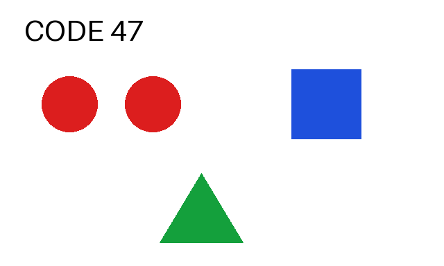
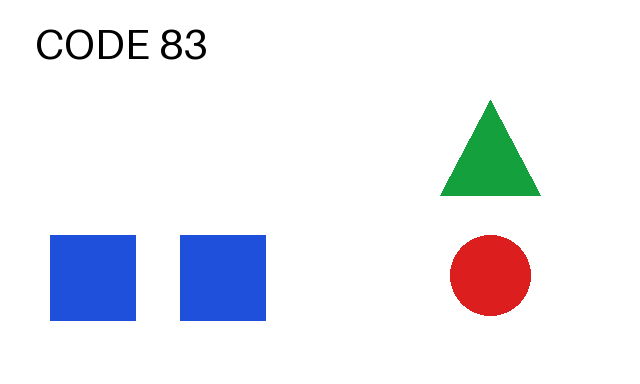

# Colab A100：Qwen3.5 文本、工具往返与图片实测

日期：2026-10-24（Asia/Singapore；云端日志使用 UTC）。Qwen3.5-9B 在用户现有 Colab A100 上完成 **3 次文本生成和 2 次图片生成**。两轮工具提议、鉴权拒绝、原生 token 读回通过；两张合成图片各 6 项内容判断正确。完整 SV1、J2 和训练验收仍未完成。

## 今日收口与明日交接

今天分别完成了两段验收：项目HTTP接口与合成上游的本地往返，以及Colab上的真实原生模型请求。**真实模型尚未经过项目网关完整运行**，这是用户指定的明天第一优先级；今晚只整理交接，不继续开发或分配GPU。

| 今天完成 | 已有证据 |
|---|---|
| 本地HTTP接口、预算／版本／异常处理，训练文件交接包，三类知识来源待审包 | [第二批报告](mac-batch2.md)；CPU回归1821项，1819通过／2项平台跳过，知识仍未发布 |
| A100上的文本、两轮工具提议、鉴权与原生token读回 | 本报告及原始文本证据；工具回复为模拟数据 |
| 两张合成图片 | 内容判断12／12；首张带代码围栏，第二张在JSON约束下严格解析通过；不是游戏图像质量评测 |
| 部署兼容修复与独立复核 | `ff121f1`；23项相关测试通过；代码及原始证据经独立审核 |
| 主干集成 | 源码／证据提交`14b209b5c14b10875f7874055505aadee78d9f72`的[CI 40001210808](https://github.com/Muluoguiben/sanmou_monorepo/actions/runs/40001210808)四个作业全部通过 |

**最终资源状态**：小跑先停止自建SGLang服务，随后用户明确确认关闭并删除整份A100运行时。已在Colab页面执行并核验“重新连接”按钮、空的活动会话列表。笔记本与Mac／仓库证据保留；临时模型、venv、运行时变量及旧连接不能继续使用。Mac保存了版本清单和证据，没有把19GB权重或整个venv备份到本地。下次需重建，见[连接与重建说明](../../runbooks/colab-access.md)。

明天由Mac主管统一接线与验收，按以下顺序执行：

1. **恢复运行条件**：确认可用GPU及受控连接，按本报告成功版本重建独立环境与固定模型；重新核对文件hash、服务配置、模板和parser。旧临时路径和凭据不得直接当作有效连接。
2. **走真实项目接口**：从项目`PolicyServiceAdapter`经`HttpPolicyTransport`进入`policy_gateway`，由`SGLangChatBackend`请求真实Qwen。记录每个组件的所在主机和连接方式，保留回环绑定／受控访问。至少完成“模型提出工具调用→模拟工具回复→模型下一轮提议”，不能用原生直连或事后封套重建替代这项实测。
3. **按同一批次核验**：保存实际`PolicyRequest`、网关转出的原生请求和完整响应，绑定invocation／context／request hash／manifest hash，逐项对齐真实token IDs、usage和结束原因。两轮共用预算账本，每轮只预留和结算一次，结束无未结算账目。无密钥、错密钥、错版本由网关拒绝，且有证据表明未增加上游真实模型调用。模拟工具调用与游戏输入分开计数，游戏输入为0；概率含义未验证时保持`unavailable`，不授PPO资格。
4. **独立复核再提交**：原始记录脱敏、保存并读回，由独立agent核对；更新根Todo，提交对应源码与报告。只把“项目网关与真实模型两轮联通”标为完成。

后续待办继续保留：真实游戏截图质量、Windows请求云模型并衔接本地工具（J2）、Docker GPU与完整服务验收（SV1）、超时／断连后的后端取消与并发证据、训练文件远程传输、QA人工gold／待审来源审核，以及LoRA／Critic／PPO真实训练（TV1–TV4）。这些不因明日最小链路通过而自动完成。

## 环境与模型绑定

- GPU：NVIDIA A100-SXM4-80GB，81920 MiB，驱动 580.82.07。
- 独立环境：Python 3.12.3，SGLang 0.5.22，torch 2.14.1+cu130，CUDA 13.0，transformers 5.19.0，flashinfer 0.7.1。原 Colab Python 3.13 环境未修改。完整版本见[安装清单](colab-native/installed-packages.json)和[冻结依赖](colab-native/requirements-py312.lock)。
- `pip check` 无冲突；真实 CUDA BF16 矩阵乘法返回预期值 16。见[检查](colab-native/pip-check.txt)与[CUDA 探针](colab-native/cuda-probe.txt)。
- 模型：`Qwen/Qwen3.5-9B@c202236235762e1c871ad0ccb60c8ee5ba337b9a`；13 个普通文件合计 19,329,302,904 字节。远端逐文件计算 SHA256，四个权重分片和 tokenizer.json 与该 revision 的官方 LFS SHA256 全部一致。见[文件清单](colab-native/model-files.json)和[核对记录](colab-native/model-revision-proof.json)。Mac 独立审核检查清单与证据一致性，未另下载 19GB 权重。
- 直接使用官方 Colab MCP WebSocket 传输连接现有笔记本；没有新建 GPU 运行时，也没有永久注册 Codex MCP 插件。SSH 模板见[接入说明](../../runbooks/colab-access.md)。

这是一份独立的 `colab-native-text-v1` 实验配置，不冒充 Docker 部署 manifest。实际[文本配置](colab-native/launch-public-3.json)采用 BF16、8192 context、单请求、显存静态比例 0.55、prefill/decode CUDA graph disabled、`qwen3_coder` 工具 parser、`qwen3` reasoning parser；只监听回环地址。凭据临时生成并放入 0600 私有配置，没有进入证据、命令行或仓库。读取本地固定模型时启用离线模式。

## 文本与工具结果

| 请求 | HTTP／结果 | 输入／输出 token | 客户端耗时 |
|---|---|---:|---:|
| 首次文本 | 200，准确返回 `READY` | 17／2 | 63.05 秒 |
| 第一轮 | 200，`query_knowledge(query="building upgrade rule")` | 414／28 | 2.02 秒 |
| 第二轮 | 200，`complete_task`，reason 逐字引用工具回复 | 492／41 | 1.91 秒 |

首次耗时包括首次运行／编译开销；这些是单次观测，不是吞吐或延迟分位数基线。工具回复明确标为 synthetic；没有查询正式知识库、执行游戏动作或发布知识。

三次请求均明确提供九项采样设置，关闭 thinking，非流式、单输出，要求原生 token IDs 与 meta_info。输入 IDs、输出 IDs、usage、逐 token 概率三元组和 OpenAI logprob 字段逐项一致；两轮以 `tool_calls` 结束。原始请求与响应均按字节归档，见[文本证据索引](colab-native/evidence-index.json)。

现有 `ToolRegistry.parse` 接受真实两轮提议；`assistant_message()` 投影与真实第二轮请求中的 assistant 历史完全一致。common 封套仅在本地离线重建做 schema 读回检查；这不是经过真实 HTTP gateway 的运行记录。概率性质仍为 `unavailable`，`ppo_eligible=false`，不把 native logprob 当最终行为采样分布。

独立审核逐字节核对文本29份原件／64524字节、图片15份原件／64877字节；JSON索引文件自身另计。两份请求中的PNG data URI与原图完全一致，并已直接查看图片。审核代码、结果及自身hash另存[审核目录](colab-audit/artifact-index.json)：[文本结果](colab-audit/verification-text-cli-summary.json)、[图片结果](colab-audit/verification-vision-summary.json)。原始证据目录未被审核修改。

复核使用固定源码 `ff121f1` 的 checkout，以它的 common/pioneer `src` 设置 PYTHONPATH，在装有项目依赖的 Python3.12 环境运行下列参数化脚本。`--output` 指向尚不存在的 JSON 文件；`--source-root` 为该固定源码目录，`--evidence-root` 分别为保存的 `colab-native`／`colab-vision`。脚本只离线读取，不请求GPU。

```text
verify_text_receipts_cli.py --source-root SOURCE --evidence-root TEXT_RECEIPTS --output NEW_TEXT_AUDIT.json
verify_vision_receipts.py --source-root SOURCE --evidence-root IMAGE_RECEIPTS --output NEW_IMAGE_AUDIT.json
```

无密钥／错误密钥各返回 401；文本配置中的单张图片请求返回 400（`Image count 1 exceeds limit 0`）。见[鉴权结果](colab-native/auth-results.json)与[图片拒绝响应](colab-native/media-rejected-response.json)。未把 health 探针当作模型就绪证明。

## 用户追加的图片测试

另启[图像测试配置](colab-vision/vision-launch-public.json)，只把 image 上限改为 1；视频／音频仍为 0。生产文本配置不改变。直接向原生 SGLang 发送 PNG 与文字问题，未经过目前只接文本的项目 policy 封套。

| 检查项 | 图一 | 图二 |
|---|---|---|
| 文字 | CODE 47 | CODE 83 |
| 红圆／蓝方块／绿三角数量 | 2／1／1 | 1／2／1 |
| 三角相对圆的位置 | 下方 | 上方 |
| 方块相对圆的位置 | 右侧 | 左侧 |
| 语义判断 | 6／6 | 6／6 |
| 格式 | 有 Markdown 围栏，原文不是纯 JSON；去围栏后比对通过 | 启用 `response_format=json_object`，原文严格 JSON，比对通过 |
| 耗时 | 9.17 秒 | 3.70 秒 |
| 输入／图像／输出 token | 314／240／74 | 314／240／69 |





两张图都是本轮生成的 640×384 合成测试图；预期答案在请求前写入，问题只给字段与判断选项，没有附答案。图二同时改变了图像内容和输出格式，不能用两次结果单独归因格式变化对准确率的影响。原始图、内嵌同一 PNG 的请求、完整响应、token 记录和独立预期全部保留，见[图像索引](colab-vision/evidence-index.json)。这证明基础图片路径工作，不是游戏截图感知准确率评测。

## 启动问题、修复与边界

1. Colab 默认 Python 3.13 缺少本组合的 outlines-core wheel，改用现有 Python 3.12 独立 venv；CUDA 依赖固定为 13.0 系列，重新解析 NumPy 2.3.5 后安装通过。
2. 首次启动因子进程 PATH 缺 venv/bin，FlashInfer 找不到已经安装的 ninja；修正 PATH。见[首次日志](colab-native/server.log)。
3. Qwen3.5 不在 SGLang 0.5.22 的 `language-model-only` allowlist。加载原始模型，并用三类媒体额度为 0 限制文本入口。默认图片预热随后触发限制；改为 `skip-server-warmup=true`，用实际文本生成验证就绪。见[第二次日志](colab-native/server-2.log)。
4. 成功服务日志保留了 `freeze_gc` 启动时连接竞争告警；后续真实文本／图像请求成功。不把它改写成零告警启动。

部署修复提交 [`ff121f14758847b897ae4f049cbb8a14cd9b3dfe`](https://github.com/Muluoguiben/sanmou_monorepo/commit/ff121f14758847b897ae4f049cbb8a14cd9b3dfe)，18 项部署测试与 5 项 manifest 转换测试通过，主管复验和独立代码审查通过。正常加载原模型，不宣称剥离视觉塔；未检查实际模块驻留明细，`vision_tower_status=not_inspected`。参考[官方 allowlist 检查](https://github.com/sgl-project/sglang/blob/baa9befa381511cd4d56f83980951e5a45fffc6d/python/sglang/srt/arg_groups/model_hook.py#L1055-L1085)。

文本请求后显存观测 45562 MiB，图片请求后 46423 MiB，包含配置的缓存池，不是权重或训练显存估算。小跑结束时先向本轮自建服务进程组发送 SIGTERM，观察到退出码 -9，随后 GPU 计算进程列表为空；不声称优雅退出或请求取消链路已验收。见[文本停止记录](colab-native/shutdown.json)与[图片停止记录](colab-vision/vision-shutdown.json)。两份JSON记录的是当时仅停止服务、尚未删除运行时的状态，原字节保留；后来按用户确认删除整份运行时的结果见本报告顶部交接记录。

剩余：Docker GPU 镜像、完整项目 gateway 的实时链路、错版本／超时／断连后的后端取消证据、并发基线、Windows J2、真实游戏图像评测、TV1–TV4 与 PPO。此次成功不改变这些阶段的待验状态。
